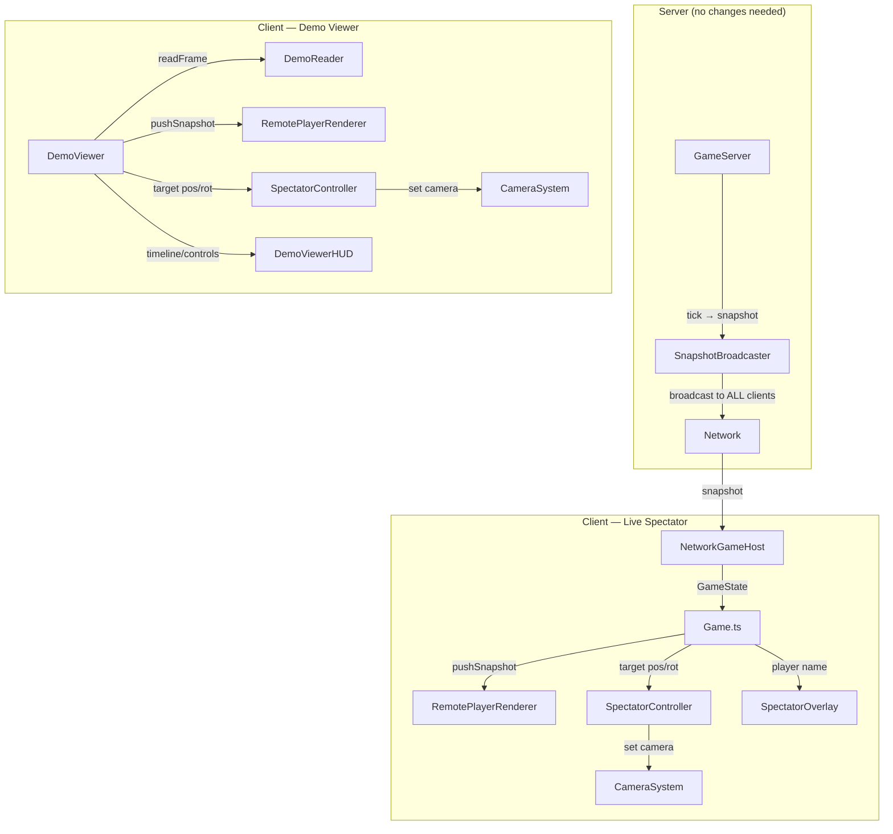

# Demo & Spectator Mode — Research & Implementation Plan

> **Branch:** `feature/demo-spectator`
> **Date:** 2026-03-26
> **Status:** Research Complete (v2 — refined with detailed implementation)

## Executive Summary

Spectator mode is partially implemented (freefly camera only — no player-following chase-cam). Demo recording works server-side but there's no browser playback. The lobby WATCH button exists in the UI but has no click handler. This document details the current state and what needs to change for a complete spectator + demo experience.

---

## Ground Rules

> [!IMPORTANT]
> These rules apply to ALL changes in this branch.

1. **Additive only** — all changes must be new files or additions to existing files. No refactoring, renaming, or restructuring of existing engine code.
2. **Do not break the engine** — the existing 677 tests must continue to pass at all times. Run `npx vitest run` before every commit.
3. **Bug fixes allowed for demo recording only** — if `DemoRecorder` or `DemoReader` have bugs discovered during implementation, fixes are permitted. All other engine files are read-only unless adding new exports/methods.
4. **Tests required for all new features** — every new file (`SpectatorController`, `DemoViewer`, browser gzip) must have a corresponding test file. Target: ≥80% branch coverage on new code.
5. **No server-side changes** — the server already works correctly for spectators. All work is client-side.

---

## 1. Current State Audit

### 1.1 Spectator Mode

| Component | File | Status | Notes |
|-----------|------|--------|-------|
| State machine | [Game.ts:L142](file:///Users/sundflux/src/priva/new/wash/shag/src/games/fps/Game.ts#L142) | ✅ Works | `'spectator' \| 'playing'` state toggle |
| Freefly camera | [SpectatorCommand.ts](file:///Users/sundflux/src/priva/new/wash/shag/src/engine/console/commands/SpectatorCommand.ts) | ✅ Works | Toggles `FreeflyController` |
| Join overlay UI | [SpectatorOverlay.ts](file:///Users/sundflux/src/priva/new/wash/shag/src/games/fps/client/SpectatorOverlay.ts) | ✅ Works | JOIN GAME / SPECTATE buttons with team support |
| Freefly HUD cue | SpectatorOverlay.ts | ✅ Works | Key binding guide panel |
| First-person bar | SpectatorOverlay.ts L136-174 | 🔲 UI only | "SPECTATING: PlayerName" bar exists but is **never shown** |
| Next/prev player | SpectatorOverlay.ts L33-34 | 🔲 Stub | `_onNextPlayerCallback` / `_onPrevPlayerCallback` declared, never wired |
| Server join/leave | [NetworkGameHost.ts:L216](file:///Users/sundflux/src/priva/new/wash/shag/src/engine/network/client/hosts/NetworkGameHost.ts#L216) | ✅ Works | `sendJoinGame()` / `sendSpectate()` messages |
| Server handling | [GameServer.ts:L739](file:///Users/sundflux/src/priva/new/wash/shag/src/games/fps/server/GameServer.ts#L739) | ✅ Works | Full JoinGame→spawn, Spectate→remove entity flow |
| Snapshot broadcast | [SnapshotBroadcaster.ts:L56](file:///Users/sundflux/src/priva/new/wash/shag/src/games/fps/server/SnapshotBroadcaster.ts#L56) | ✅ Works | Iterates ALL `clients.values()` — spectators **do** receive snapshots |
| PVS for spectators | SnapshotBroadcaster.ts L116-122 | ✅ Correct | Spectators have no entity → `clientEntity?.transform` is null → returns **unfiltered** state |
| Prediction disable | [Game.ts:L722](file:///Users/sundflux/src/priva/new/wash/shag/src/games/fps/Game.ts#L722) | ✅ Works | `sendInput()` already skips on `spectator` state |
| Remote player render | [RemotePlayerRenderer.ts:L163](file:///Users/sundflux/src/priva/new/wash/shag/src/games/fps/client/RemotePlayerRenderer.ts#L163) | ✅ Works | Filters by `localEntityId` — spectators have no entity, so **all players render** |
| Pause menu | [PauseMenu.ts](file:///Users/sundflux/src/priva/new/wash/shag/src/games/fps/client/hud/widgets/PauseMenu.ts) | ✅ Works | "Go Spectator" / "Join Game" buttons toggle |
| Scoreboard spectators | [Scoreboard.ts:L134](file:///Users/sundflux/src/priva/new/wash/shag/src/games/fps/client/hud/widgets/Scoreboard.ts#L134) | 🔲 Partial | Collects spectator list but display untested |
| FPS actions context | [FPSActions.ts:L125](file:///Users/sundflux/src/priva/new/wash/shag/src/games/fps/client/FPSActions.ts#L125) | ✅ Works | `fps_spectator` input context defined |
| Chase-cam camera | — | ❌ Missing | No camera controller follows another player's entity |
| Player cycling logic | — | ❌ Missing | No code to enumerate alive entities and cycle through them |
| Target player HUD data | — | ❌ Missing | No extraction of target player HP/weapon/armor from GameState |

### 1.2 Demo Recording

| Component | File | Status | Notes |
|-----------|------|--------|-------|
| Server recorder | [DemoRecorder.ts](file:///Users/sundflux/src/priva/new/wash/shag/src/games/fps/server/DemoRecorder.ts) | ✅ Works | Records full BinaryProtocol snapshots to gzipped `.shagdemo` |
| Auto-record | [GameServer.ts:L479](file:///Users/sundflux/src/priva/new/wash/shag/src/games/fps/server/GameServer.ts#L479) | ✅ Works | Starts on `MatchPhase.Active`, stops on `PostGame` |
| File format | DemoRecorder.ts | ✅ Works | Header + frames + index table + footer; random-access via binary search |
| Demo reader | [DemoReader.ts](file:///Users/sundflux/src/priva/new/wash/shag/src/shared/demo/DemoReader.ts) | ✅ Works | Parses header, index, frames. Binary search seek. |
| Browser gzip | DemoReader.ts L16-23 | ❌ Missing | Falls back to `zlib` (Node-only). Comment says "use DecompressionStream" |
| Demo archive list | LobbyServer.ts | ✅ Works | `demos:list_response` event scans demo directory |
| Demo archive tab | [LobbyPanel.ts:L787](file:///Users/sundflux/src/priva/new/wash/shag/src/engine/ui/panels/LobbyPanel.ts#L787) | ✅ Works | Full demo grid UI with card design |
| VIEW DEMO button | LobbyPanel.ts L727-736 | ⚠️ Downloads | Triggers file download instead of in-browser playback |
| Client demo viewer | — | ❌ Missing | No demo playback UI or controller |

### 1.3 Lobby "Watch" Button

| Component | File | Status | Notes |
|-----------|------|--------|-------|
| WATCH button UI | [LobbyPanel.ts:L664](file:///Users/sundflux/src/priva/new/wash/shag/src/engine/ui/panels/LobbyPanel.ts#L664) | ⚠️ No handler | Button rendered for `state === 'playing'` matches but **no click handler** |
| JOIN button | LobbyPanel.ts L669-675 | ✅ Works | Calls `lobbyClient.joinLobby(m.id)` (only for lobby-state matches) |
| Spectator join flow | — | ❌ Missing | No `connectAsSpectator()` path in Game or LobbyClient |

---

## 2. Feature Matrix

### Target Features (Priority Order)

| # | Feature | Difficulty | Dependencies | Server Changes? |
|---|---------|-----------|-------------|----------------|
| 1 | **Chase-cam spectator** — follow a player's entity with camera | Medium | None — all data already available in snapshots | ❌ No |
| 2 | **Player cycling** — left/right mouse buttons to switch spectate target | Easy | #1 |  ❌ No |
| 3 | **Spectator HUD** — "SPECTATING: PlayerName" + target stats | Easy | #1, existing SpectatorOverlay `first-person` mode | ❌ No |
| 4 | **WATCH button → spectator join** in lobby | Easy | Wire click handler → connect with `autoJoin: false` | ❌ No |
| 5 | **Browser demo decompression** — `DecompressionStream` for gzip | Easy | Standalone DemoReader change | ❌ No |
| 6 | **In-browser demo viewer** — load `.shagdemo`, play back frames | Medium | #5, new DemoViewer controller | ❌ No |
| 7 | **Demo viewer spectator controls** — chase-cam + cycling in demos | Easy | #1, #2, #6 | ❌ No |

> **Key insight:** All features are purely client-side. The server already handles everything correctly.

---

## 3. Detailed Implementation Plan

### Phase 1: Chase-Cam Spectator (Core)

#### Why No Server Changes

The server already:
1. Registers all clients as spectators on connect (`isSpectator: true`, [GameServer.ts:L720](file:///Users/sundflux/src/priva/new/wash/shag/src/games/fps/server/GameServer.ts#L720))
2. Broadcasts full game state to spectators ([SnapshotBroadcaster.ts:L56](file:///Users/sundflux/src/priva/new/wash/shag/src/games/fps/server/SnapshotBroadcaster.ts#L56) — no `isSpectator` filter)
3. Spectators with PVS active receive **unfiltered** state — PVS falls back gracefully when spectator has no entity position ([SnapshotBroadcaster.ts:L122](file:///Users/sundflux/src/priva/new/wash/shag/src/games/fps/server/SnapshotBroadcaster.ts#L122))
4. Silently drops spectator input ([GameServer.ts:L817](file:///Users/sundflux/src/priva/new/wash/shag/src/games/fps/server/GameServer.ts#L817))
5. Handles JoinGame/Spectate transitions with entity create/destroy ([GameServer.ts:L739-813](file:///Users/sundflux/src/priva/new/wash/shag/src/games/fps/server/GameServer.ts#L739))

Chase-cam is purely client-side: read the target player's `transform.position`/`rotation` from the incoming `GameState` and set the camera.

---

#### [NEW] `src/games/fps/client/SpectatorController.ts` — Chase-Cam Camera Controller

```typescript
/**
 * SpectatorController — First-person chase-cam that follows a target player entity.
 *
 * Implements ICameraController. Reads target entity's position and rotation
 * from the latest GameState snapshot. No prediction, no input processing.
 *
 * Usage:
 *   const ctrl = new SpectatorController();
 *   ctrl.setTargetProvider(getLatestStateForEntity);
 *   CameraSystem.getInstance().registerController('spectator', ctrl);
 *   CameraSystem.getInstance().setController('spectator');
 */
```

**Key design decisions:**
- Implements `ICameraController` for clean integration with `CameraSystem`
- Does **NOT** own the GameState — receives a provider callback: `(entityId: string) => { position, rotation } | null`
- `update(dt)` reads from provider, applies smoothing to prevent jitter
- Eye offset: `position.y + 40` (Q3 eye height = origin + PLAYER_MAXS_Z)
- Interpolation: uses exponential lerp with configurable smoothing factor (avoid snappy jumps on low-tickrate snapshots)
- Mouse look **disabled** — camera rotation matches target player's yaw/pitch exactly

**State:**
```typescript
targetEntityId: string | null
targetProvider: (id: string) => { pos: Vec3, yaw: number, pitch: number } | null
smoothedPosition: Vector3
smoothedYaw: number
smoothedPitch: number
```

**Methods:**
```typescript
setTarget(entityId: string): void          // Set entity to follow
clearTarget(): void                         // Return to freefly
getTargetEntityId(): string | null         // For HUD display
setTargetProvider(fn): void                // Inject GameState reader
```

---

#### [MODIFY] `src/games/fps/Game.ts` — Spectator State Machine

**New fields:**
```typescript
private spectateTargetId: string | null = null;
private spectateEntityList: string[] = [];        // Sorted alive players  
private spectatorController: SpectatorController | null = null;
```

**New methods:**
```typescript
/** Start chasing a player entity */
spectatePlayer(entityId: string): void {
    this.spectateTargetId = entityId;
    this.spectatorController?.setTarget(entityId);
    this.spectatorOverlay?.setMode('first-person');
    this.spectatorOverlay?.setSpectatingTarget(this.getPlayerName(entityId));
    CameraSystem.getInstance().setController('spectator');
}

/** Cycle to next alive player */
nextSpectateTarget(): void {
    this.spectateEntityList = this.getAlivePlayerIds();
    if (this.spectateEntityList.length === 0) return;
    const idx = this.spectateEntityList.indexOf(this.spectateTargetId ?? '');
    const nextIdx = (idx + 1) % this.spectateEntityList.length;
    this.spectatePlayer(this.spectateEntityList[nextIdx]);
}

/** Cycle to previous alive player */
prevSpectateTarget(): void {
    this.spectateEntityList = this.getAlivePlayerIds();
    if (this.spectateEntityList.length === 0) return;
    const idx = this.spectateEntityList.indexOf(this.spectateTargetId ?? '');
    const prevIdx = (idx - 1 + this.spectateEntityList.length) % this.spectateEntityList.length;
    this.spectatePlayer(this.spectateEntityList[prevIdx]);
}

/** Get sorted list of alive player entity IDs from latest GameState */
private getAlivePlayerIds(): string[] {
    // Read from latest snapshot, filter for 'player_*' entities
    // with valid transform and not dead
}

/** Look up player name from GameState.players by entity ID */
private getPlayerName(entityId: string): string { ... }
```

**Modifications to existing methods:**
- `onServerStateUpdate()`: update target provider data. If spectating and target entity disappears (death/disconnect), auto-cycle to next player.
- `goSpectator()`: register `SpectatorController` with CameraSystem. Default to freefly, wire Fire/Mouse1 to enter chase-cam on clicked player.
- Add keyboard/mouse handlers for spectator cycling:
  - **Mouse1 (click)** → chase nearest player in crosshair (from freefly)
  - **Mouse1 / Arrow Right** → next player (from chase-cam)
  - **Mouse2 / Arrow Left** → previous player
  - **Space or Backspace** → return to freefly

---

#### [MODIFY] `src/games/fps/client/SpectatorOverlay.ts` — Wire Existing Stubs

- Wire `_onNextPlayerCallback` → `Game.nextSpectateTarget()`
- Wire `_onPrevPlayerCallback` → `Game.prevSpectateTarget()`
- In `first-person` mode, add left/right arrow key hints to the spectating bar: `"◄ [MOUSE2]  PlayerName  [MOUSE1] ►"`
- Show target player stats below name: `HP: 100  ARMOR: 50  WEAPON: Rocket Launcher`

---

#### Edge Cases & Gotchas

| Scenario | Handling |
|----------|----------|
| **Target player dies** | Auto-cycle to next alive player. If no alive players, fall back to freefly. |
| **Target player disconnects** | Entity disappears from GameState → auto-cycle. |
| **All players dead** (round-based) | Fall back to freefly, show "Waiting for respawn..." |
| **Spectator joins mid-match** | First snapshot populates entity list → auto-select first player |
| **PVS active + spectator** | Spectators get unfiltered state (PVS falls back), so chase-cam sees all entities ✅ |
| **Mouse look in chase-cam** | Disabled — camera yaw/pitch locked to target. User can only cycle or return to freefly |
| **Weapon view model** | Hidden during spectate (already handled by `goSpectator()`) |
| **Remote player rendering** | `RemotePlayerRenderer` already renders all `player_*` entities except `localEntityId`. Spectators have no entity → all players render correctly ✅ |
| **Freefly → chase transition** | Position snap to target player on first frame (no interpolation from distant freefly position) |

---

### Phase 2: Lobby Watch + Spectator HUD

#### [MODIFY] `src/engine/ui/panels/LobbyPanel.ts` — Wire WATCH Button

```typescript
// In refreshMatchList(), add click handler to watchBtn:
watchBtn.addEventListener('click', () => {
    // Get the match's game server URL from match data
    const serverUrl = m.serverUrl;  // need to add to match data from lobby server
    // Connect to game server as spectator (skip auto-join)
    this.connectAsSpectator(serverUrl);
});
```

**New method: `connectAsSpectator(url: string)`**
- Close lobby panel
- Call `Game.getInstance().initializeNetwork(url, { autoJoin: false })`
- This automatically enters spectator mode → shows join overlay
- User can then press SPECTATE to enter freefly, or click a player for chase-cam

> **Dependency:** `LobbyServer` needs to include `serverUrl` (or `host:port`) in the `liveMatches` data sent to clients. Currently matches have `id`, `gametype`, `players`, etc. but may not have the direct connection URL. Need to verify.

#### [MODIFY] `src/games/fps/client/SpectatorOverlay.ts` — Stats Display

In `first-person` mode, add stats below player name:
```
┌─────────────────────────────────────────┐
│  ◄ [MOUSE2]  SPECTATING: bunny_hop  [MOUSE1] ►  │
│  HP: 85  │  ARMOR: 30  │  RL  │  150 UPS        │
└─────────────────────────────────────────┘
```

Data source: `GameState.entities.get(targetEntityId)` components:
- `health.current` → HP
- `health.armor` → Armor
- `weaponState.currentWeapon` → Weapon name
- `velocity` → Speed (for fun)

---

### Phase 3: Demo Viewer

#### [MODIFY] `src/shared/demo/DemoReader.ts` — Browser Gzip

```typescript
// Replace the Node-only zlib with browser-compatible decompression:
private async decompressBrowser(data: Uint8Array): Promise<Uint8Array> {
    const ds = new DecompressionStream('gzip');
    const reader = new Blob([data]).stream().pipeThrough(ds).getReader();
    const chunks: Uint8Array[] = [];
    while (true) {
        const { done, value } = await reader.read();
        if (done) break;
        chunks.push(value);
    }
    // Concatenate chunks
    const total = chunks.reduce((n, c) => n + c.length, 0);
    const result = new Uint8Array(total);
    let offset = 0;
    for (const chunk of chunks) {
        result.set(chunk, offset);
        offset += chunk.length;
    }
    return result;
}
```

Constructor becomes async-aware: `static async fromFile(data: Uint8Array | ArrayBuffer): Promise<DemoReader>`.

---

#### [NEW] `src/games/fps/client/DemoViewer.ts` — Demo Playback Controller

```typescript
/**
 * DemoViewer — In-browser .shagdemo playback
 *
 * Architecture:
 * - Loads demo file → DemoReader
 * - Plays frames at recorded snapshotRate (e.g. 20Hz, 60Hz)
 * - Interpolates between frames using InterpolationBuffer for smooth visuals
 * - Feeds frames to same render pipeline as live play:
 *   RemotePlayerRenderer.pushSnapshot() + render()
 * - Reuses SpectatorController for chase-cam (same code as live spectator)
 * - Provides transport controls: play/pause, speed, seek, timeline
 */
```

**State:**
```typescript
reader: DemoReader
currentFrameIndex: number
isPlaying: boolean
playbackSpeed: number          // 0.25, 0.5, 1.0, 2.0, 4.0
elapsedSinceLastFrame: number  // For timing next frame delivery
remoteRenderer: RemotePlayerRenderer
spectatorController: SpectatorController
```

**Playback loop:**
```typescript
update(dt: number) {
    if (!this.isPlaying) return;
    this.elapsedSinceLastFrame += dt * this.playbackSpeed;
    const frameInterval = 1000 / this.reader.readHeader().snapshotRate;
    while (this.elapsedSinceLastFrame >= frameInterval) {
        this.elapsedSinceLastFrame -= frameInterval;
        this.currentFrameIndex++;
        if (this.currentFrameIndex >= totalFrames) { this.pause(); return; }
        const frame = this.reader.readFrame(this.currentFrameIndex);
        this.remoteRenderer.pushSnapshot(frame.state, '');  // No local player
    }
    this.remoteRenderer.render();
}
```

**UI: DemoViewerHUD** (overlay on top of game scene):
- Timeline scrubber (horizontal bar, draggable)
- Play/pause button
- Speed selector: 0.25x, 0.5x, 1x, 2x, 4x
- Current time / total time display
- Player list (clickable → chase-cam to that player)
- Same spectator cycling (left/right click)

---

#### [MODIFY] `src/engine/ui/panels/LobbyPanel.ts` — Demo Playback

Change VIEW DEMO button from file download to in-browser playback:
```typescript
viewBtn.addEventListener('click', async () => {
    // Fetch demo file from server
    const response = await fetch(`/data/demos/${d.filename}`);
    const data = new Uint8Array(await response.arrayBuffer());
    
    // Launch demo viewer
    const { DemoViewer } = await import('../../games/fps/client/DemoViewer');
    const viewer = new DemoViewer();
    await viewer.load(data);
    viewer.play();
});
```

---

## 4. Architecture Diagram



## 5. Key Design Decision: Camera Controller Architecture

**Chosen: New `SpectatorController` implements `ICameraController`**

The `ICameraController` interface ([ICameraController.ts](file:///Users/sundflux/src/priva/new/wash/shag/src/engine/camera/controllers/ICameraController.ts)) already supports:
- `update(dt)` — called every frame, perfect for reading target provider
- `setTarget(target)` — semantically correct
- `attach(camera, scene, canvas)` — standard lifecycle
- `configure(config)` — smoothing, sensitivity, etc.

This is the cleanest approach because:
1. CameraSystem handles controller switching (`freefly` → `spectator` → `fps`)
2. No special-case code in the render loop
3. Demo viewer reuses the exact same controller
4. Future: third-person spectator (offset behind player) just needs a config change

---

## 6. Testing & Verification Plan

### Required Test Files

#### [NEW] `src/engine/__tests__/SpectatorController.test.ts`
Target: ~20 tests

| Category | Tests |
|----------|-------|
| **Target tracking** | set target, clear target, get current target, null target returns null position |
| **Position update** | reads from provider, applies eye offset (+40 Y), handles missing entity gracefully |
| **Smoothing** | exponential lerp between positions, no lerp on first frame (snap), configurable smoothing factor |
| **Rotation** | yaw/pitch from provider, no mouse input processing |
| **Edge cases** | provider returns null (entity gone), provider throws, zero dt, extremely large dt |

#### [NEW] `src/engine/__tests__/SpectatorCycling.test.ts`
Target: ~15 tests

| Category | Tests |
|----------|-------|
| **Entity list** | builds sorted list from GameState entities, filters dead players, filters non-player entities |
| **Cycling** | next wraps around, prev wraps around, single player stays on same, empty list → no-op |
| **Auto-cycle** | target disappears → next player selected, all disappear → returns null |
| **Name lookup** | resolves entity ID to player name from GameState.players |

#### [NEW] `src/engine/__tests__/DemoReaderBrowser.test.ts`
Target: ~10 tests

| Category | Tests |
|----------|-------|
| **Browser decompression** | DecompressionStream gzip roundtrip, handles uncompressed data, detects gzip magic bytes |
| **Async factory** | `DemoReader.fromFile()` returns DemoReader instance, rejects on invalid data |
| **Compatibility** | Node zlib path still works, browser path works when zlib unavailable |

#### [NEW] `src/engine/__tests__/DemoViewer.test.ts`
Target: ~15 tests

| Category | Tests |
|----------|-------|
| **Playback** | advances frame index at snapshot rate, pauses at end, speed multiplier works (0.5x, 2x, 4x) |
| **Seeking** | seek to frame by index, seek by tick (binary search), seek to start/end |
| **Controls** | play, pause, toggle, speed change |
| **Frame delivery** | calls pushSnapshot with correct GameState, no local player ID, handles missing frames |

**Total new tests: ~60** (bringing engine total from 677 to ~737)

### Manual (Browser)
1. Connect 2 clients → one spectates → chase-cam follows player 1
2. Kill spectated player → auto-cycles to next
3. Cycle left/right through all alive players
4. Return to freefly from chase-cam
5. WATCH button from lobby → joins as spectator
6. Load a `.shagdemo` in demo viewer → playback at various speeds
7. Demo viewer chase-cam + player cycling
8. PVS enabled → verify spectator sees all entities

### Headless CLI
- `npm run cli:game -- --exec "map wdm2; quit"` — verify no crashes with new imports

### Regression Gate
- `npx vitest run` must pass 677+ tests before every commit
- No changes to existing test files
