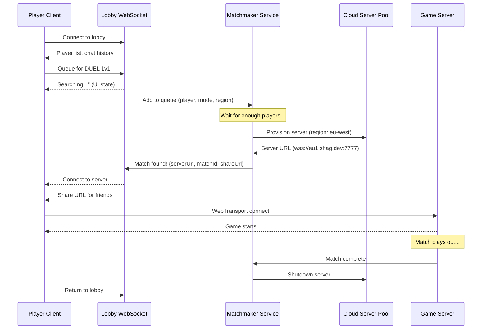

# Lobby UI & Matchmaking Research

## Vision

The main menu is a **player lobby** — not a traditional server browser. Players see game mode options, who's online, and a social chat. Matchmaking is queue-based: when enough players queue, an **on-demand server** spins up at the nearest geolocation, runs the match, then shuts down. No persistent servers running idle.

This is the "Valorant/Fortnite model" adapted for arena FPS: lightweight, modern, cloud-native.

## UI Layout

```
┌─────────────────────────────────────────────────────────────────────────┐
│  SHAG                                                    ⚙ Settings    │
├───────────────────────────────────────────┬──────────────────────────────┤
│                                          │                              │
│   ┌──────────┐┌──────────┐┌──────────┐   │  LOBBY                      │
│   │          ││          ││          │   │                              │
│   │  MAP     ││  MAP     ││  MAP     │   │  ● player1        🔍        │
│   │  SCREENSHOT  SCREENSHOT  SCREENSHOT   │  ● player2        🔍        │
│   │          ││          ││          │   │  ○ player3                   │
│   │          ││          ││          │   │  ● player4        🔍        │
│   │          ││          ││          │   │  ○ player5                   │
│   │          ││          ││          │   │                              │
│   │          ││          ││          │   │  ─────────────────────────   │
│   │          ││          ││          │   │                              │
│   │          ││          ││          │   │  💬 CHAT                     │
│   │  ╔══════╗││  ╔══════╗││  ╔══════╗│   │                              │
│   │  ║DUEL  ║││  ║TEAM  ║││  ║ FFA  ║│   │  player1: gg last game      │
│   │  ║ 1v1  ║││  ║ 2v2  ║││  ║      ║│   │  player4: anyone queue?     │
│   │  ╚══════╝││  ╚══════╝││  ╚══════╝│   │  player2: let's go          │
│   │ [FIND MATCH]│[FIND MATCH]│[FIND MATCH]│   │                              │
│   └──────────┘└──────────┘└──────────┘   │  [Type a message...     ]    │
│                                          │                              │
├───────────────────────────────────────────┴──────────────────────────────┤
│  🔍 = Looking for match                          v0.9.8 · 3 online     │
└─────────────────────────────────────────────────────────────────────────┘
```

### Left Side — Game Mode Panels (~60%)

Three **full-height vertical panels** side by side, each representing a game mode:

| Panel | Mode | Description |
|-------|------|-------------|
| 1 | **DUEL 1v1** | Competitive 1v1 arena duel |
| 2 | **TEAM 2v2** | Team deathmatch 2v2 |
| 3 | **FFA** | Free-for-all deathmatch |

**Visual design for each panel:**

- **Background**: Full-height map screenshot (darkened ~60% with glassmorphism overlay)
- **Subtle parallax**: Panels slightly skewed/perspective-shifted like fanned playing cards, creating depth
- **Mode label**: Large bold text at center-bottom with neon glow (cyan)
- **"FIND MATCH" button**: At bottom of each panel, glowing action button
- **Hover state**: Panel brightens, border glows, slight scale-up, screenshot parallax shifts
- **Active queue state**: Pulsing border animation + "SEARCHING... (0:42)" timer replaces button
- **Player count badge**: Small "3 in queue" indicator on each panel

### Right Side — Social Sidebar (~40%)

- **LOBBY header** with online player count
- **Player list**: Usernames with status icons
  - 🟢 Online/idle
  - 🔍 Looking for match (with gametype indicator)
  - 🎮 In match (clickable → spectate!)
- **Live matches ticker**: Scrolling list of ongoing matches

  ```
  ┌─ LIVE MATCHES ─────────────────────┐
  │ 🔴 DUEL  player1 vs player2  2:41  │
  │    wdm7 · Score: 5-3    [WATCH]    │
  │ 🔴 2v2   Team A vs Team B    1:12  │
  │    wdm2 · Score: 12-8   [WATCH]    │
  └────────────────────────────────────┘
  ```

- **Chat area**: Real-time lobby chat with timestamped messages
- **Chat input**: Text input at bottom

Clicking **[WATCH]** or a player's 🎮 icon connects as spectator to that match — the server URL is already known to the lobby service.

## Matchmaking Flow



### Queue States (per player)

| State | UI | Description |
|-------|-----|-------------|
| **IDLE** | Default panel view | Not searching |
| **QUEUED** | Pulsing border + timer | Actively searching |
| **MATCH_FOUND** | Flash + countdown | Server provisioning |
| **CONNECTING** | Loading animation | Connecting to match server |
| **IN_MATCH** | Hidden (in game) | Playing the match |

### Share URL System

When a match is found, players receive a **share URL**:

```
https://play.shag.dev/match/abc123
```

This URL can be sent to friends for:

- **Direct spectating** of the match
- **Team fill** (if team mode and slots available)
- **Late join** (if FFA with open slots)

## Architecture Decisions

### On-Demand Servers

**Why not persistent servers?**

- No idle server costs — pay only when matches are running
- Automatic geographic distribution — spin up closest to players
- Scales to zero when nobody's playing
- Scales to thousands during peak hours

**Server lifecycle:**

1. Matchmaker determines best region from player pings
2. API call to cloud provider → spin up container with game binary
3. Container starts, loads map, signals ready (~3-5 seconds)
4. Players connect via WebTransport
5. Match ends → container shuts down

### Lobby WebSocket

Separate from game servers. A lightweight always-on service that handles:

- Player presence (online/offline/in-match)
- Chat relay
- Queue management
- Match notifications

This can be a single cheap instance since it's just chat + queue state — no physics or game logic.

### Tech Stack Options

| Component | Option A | Option B |
|-----------|----------|----------|
| Lobby | WebSocket on Node.js | WebSocket on Cloudflare Workers |
| Matchmaker | Node.js + Redis | Cloudflare Durable Objects |
| Server provisioning | Fly.io Machines API | AWS Fargate / GCP Cloud Run |
| Game server | Current SHAG headless server | Same, containerized |

## Implementation Phases

### Phase 1: Beautiful UI (NOW)

- Lobby panel layout with mode buttons
- Player list and chat (mock data)
- Queue UI states (local only, no backend)
- Uses existing GamePanel styling system

### Phase 2: Lobby Backend

- WebSocket lobby server
- Player presence + chat
- Queue submission

### Phase 3: Matchmaking + Server Provisioning

- Matchmaker service
- Cloud server provisioning API
- Auto-connect flow

### Phase 4: Polish

- Share URLs
- Match history
- Player stats
- ELO/MMR system

## Visual Style Reference

Building on existing **GamePanel** aesthetic:

- Dark backgrounds with glassmorphism
- Neon cyan/magenta accent lines
- Floating particle effects
- Holographic edge animations
- Subtle CRT scanline effects
- Same design language as pause menu and settings panel
