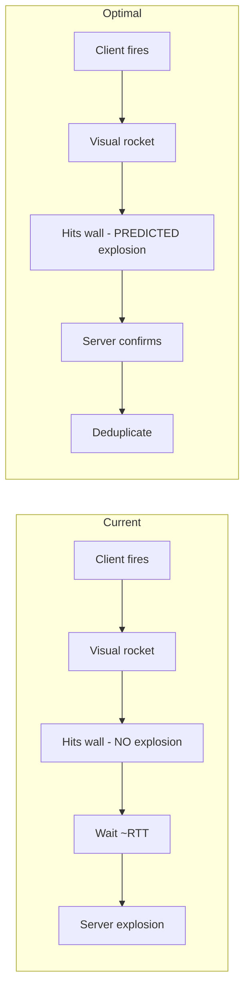
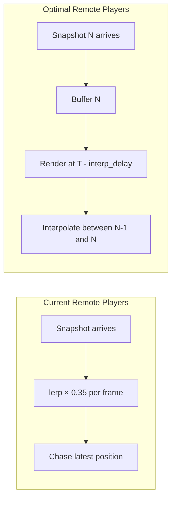

# Optimal Web FPS Networking Architecture

Research plan for bringing SHAG Engine's networked FPS to best-in-class for browser.

> [!NOTE]
> SHAG already implements many core Unlagged/Q3 principles. This document focuses on
> **what to refactor** in the existing code, not what to build from scratch.

---

## Current Architecture Audit

### What We Already Have (solid foundations)

| System | Status | Key Files |
|--------|--------|-----------|
| Client-side movement prediction | ✅ Working | [V2NetworkClient.ts](file:///c:/Users/sundf/Desktop/wash/shag/src/games/fps/client/V2NetworkClient.ts) |
| Q3-style reconciliation with input replay | ✅ Working | `V2NetworkClient.applySnapshot()` |
| Shared physics (client = server) | ✅ Working | [FPSMovementProfile.ts](file:///c:/Users/sundf/Desktop/wash/shag/src/games/fps/simulation/FPSMovementProfile.ts) |
| BSP collision in prediction | ✅ Working | `FPSGameManager.setBSPCollision()` |
| Server-side lag compensation | ✅ Working | [LagCompensation.ts](file:///c:/Users/sundf/Desktop/wash/shag/src/engine/server/lagcomp/LagCompensation.ts) |
| History buffer with rewind | ✅ Working | `HistoryBuffer`, `getRewindTick()` |
| Per-weapon lag comp flags | ✅ Working | [WeaponDef.ts](file:///c:/Users/sundf/Desktop/wash/shag/src/games/fps/server/weapons/WeaponDef.ts) `useLagCompensation` |
| WebTransport (QUIC/UDP) transport | ✅ Implemented | [WebTransportTransport.ts](file:///c:/Users/sundf/Desktop/wash/shag/src/engine/server/network/transport/WebTransportTransport.ts) |
| Dual channels (datagram + reliable) | ✅ Server-side | `sendDatagram()` for snapshots, `sendReliable()` for auth/events |
| WebSocket fallback | ✅ Working | [WebSocketTransport.ts](file:///c:/Users/sundf/Desktop/wash/shag/src/engine/server/network/transport/WebSocketTransport.ts) |
| Delta-compressed binary protocol | ✅ Working | [BinaryProtocol.ts](file:///c:/Users/sundf/Desktop/wash/shag/src/engine/network/protocol/BinaryProtocol.ts) |
| Predicted hitscan + muzzle flash | ✅ Working | `WeaponViewManager.fire()` |
| Predicted projectile visual spawn | ✅ Working | `ProjectileManager.spawn()` |
| Server-authoritative projectile sim | ✅ Working | [ProjectileSystem.ts](file:///c:/Users/sundf/Desktop/wash/shag/src/games/fps/server/systems/ProjectileSystem.ts) |

### What Needs Refactoring

---

## Phase 1: Gameplay Feel (Critical)

### 1.1 Predicted Projectile Explosions

**Problem:** Client spawns visual rocket → it hits wall → `spawnImpact()` returns early → waits ~RTT for server `projectile_impact` event → delayed explosion. Rocket appears to phase through wall.

**Root Cause:** [ProjectileManager.ts L575-578](file:///c:/Users/sundf/Desktop/wash/shag/src/engine/weapon/ProjectileManager.ts#L575-L578)

```typescript
// Rocket, grenade, and plasma explosions are now server-authoritative
if (projDefId === 'rocket' || projDefId === 'grenade' || projDefId === 'plasma_bolt') {
    return;  // ← NO LOCAL EXPLOSION
}
```

**Fix:**

#### [MODIFY] [ProjectileManager.ts](file:///c:/Users/sundf/Desktop/wash/shag/src/engine/weapon/ProjectileManager.ts)

- Remove the early return in `spawnImpact()` for local player's own projectiles
- Tag predicted explosions with position + timestamp
- Add `recentPredictedImpacts: { pos: Vector3, time: number, defId: string }[]` array

#### [MODIFY] [FPSGameManager.ts](file:///c:/Users/sundf/Desktop/wash/shag/src/games/fps/FPSGameManager.ts)

- In `projectile_impact` handler (L704-711): before spawning server explosion, check `recentPredictedImpacts` for a match within tolerance (~50 units, ~500ms)
- If match found → deduplicate (skip server explosion)
- If no match → show server explosion (correction case, or remote player's rocket)

**Effort:** ~2 hours

---

### 1.2 Snapshot Buffer Interpolation for Remote Players

**Problem:** [RemotePlayerRenderer.ts](file:///c:/Users/sundf/Desktop/wash/shag/src/games/fps/client/RemotePlayerRenderer.ts) uses `POS_SMOOTH = 0.35` fixed-factor lerp per frame. This is:

- Framerate-dependent (120fps clients interpolate faster than 60fps)
- Always chasing, never reaches target
- No time basis — doesn't know when snapshot was generated
- Freezes on packet loss

**Fix:**

#### [NEW] [SnapshotBuffer.ts](file:///c:/Users/sundf/Desktop/wash/shag/src/engine/network/client/SnapshotBuffer.ts)

Ring buffer storing last N timestamped entity snapshots:

```typescript
interface BufferedSnapshot {
    serverTime: number;
    entities: Map<string, { position, rotation, velocity }>;
}
```

- `push(snapshot, serverTime)` — add incoming snapshot
- `sample(renderTime)` — return interpolated state between two snapshots
- Adaptive render delay based on jitter (default: 2× snapshot interval)
- Velocity-based extrapolation when buffer runs dry (packet loss)

#### [MODIFY] [RemotePlayerRenderer.ts](file:///c:/Users/sundf/Desktop/wash/shag/src/games/fps/client/RemotePlayerRenderer.ts)

- Replace fixed-factor lerp with `buffer.sample(now - interpDelay)`
- Time-based interpolation between two known server states
- Remove `POS_SMOOTH` / `YAW_SMOOTH` constants
- Add `cl_interp` CVar for manual tuning

#### Prerequisite: [NEW] [ClockSync.ts](file:///c:/Users/sundf/Desktop/wash/shag/src/engine/network/client/ClockSync.ts)

- NTP-like ping/pong with server timestamp
- Maintains `serverTimeOffset` — difference between local and server clocks
- Used to timestamp incoming snapshots in local time
- Runs during connection handshake, re-syncs periodically

**Effort:** ~1 day

---

### 1.3 Reconciliation Visual Smoothing

**Problem:** When server corrects client position, camera teleports to corrected position instantly. Small corrections (1-3 units) cause visible jitter.

**Fix:**

#### [MODIFY] [V2NetworkClient.ts](file:///c:/Users/sundf/Desktop/wash/shag/src/games/fps/client/V2NetworkClient.ts)

- After reconciliation, store visual error: `visualOffset = posBeforeReconcile - posAfterReconcile`
- Each frame: `visualOffset *= (1 - smoothFactor * dt)` (decay toward zero)
- Expose `getVisualPosition() = logicalPosition + visualOffset`

#### [MODIFY] [FPSGameManager.ts](file:///c:/Users/sundf/Desktop/wash/shag/src/games/fps/FPSGameManager.ts)

- Camera reads `getVisualPosition()` instead of `getPosition()`
- Add `cl_smoothing` CVar (default: 1, 0 = disable)

**Effort:** ~1 hour

---

## Phase 2: Simulation Quality

### 2.1 Fixed Timestep with Render Interpolation

**Problem:** Client prediction runs once per `requestAnimationFrame`. Physics rate = framerate. 144Hz monitor → 144 physics steps/sec, 60Hz → 60. This causes:

- Framerate-dependent movement behavior (bunny hop height varies)
- Non-deterministic reconciliation (client/server step count mismatch)

**Fix:**

#### [MODIFY] [FPSGameManager.ts](file:///c:/Users/sundf/Desktop/wash/shag/src/games/fps/FPSGameManager.ts) — Input processing loop

```typescript
// Instead of: simulate once per rAF
// Do: fixed timestep accumulator
const FIXED_DT = 1/120;  // Match server tick
accumulator += frameDeltaTime;
while (accumulator >= FIXED_DT) {
    previousState = currentState.clone();
    v2Client.processInput(input, FIXED_DT);
    accumulator -= FIXED_DT;
}
const alpha = accumulator / FIXED_DT;
renderPosition = lerp(previousState.position, currentState.position, alpha);
```

#### [MODIFY] [V2NetworkClient.ts](file:///c:/Users/sundf/Desktop/wash/shag/src/games/fps/client/V2NetworkClient.ts)

- `processInput()` accepts explicit `dt` parameter instead of assuming frame time
- Input history stores the `dt` used for each input (for accurate replay)

**Effort:** ~1 day

---

### 2.2 Tick / Snapshot Rate Decoupling

**Problem:** Server runs at `DEFAULT_SNAPSHOT_RATE = 60` and sends a snapshot every tick. Over WebSocket this is high bandwidth. Over WebTransport datagrams it's 60 QUIC packets/sec.

**Fix:**

#### [MODIFY] [constants.ts](file:///c:/Users/sundf/Desktop/wash/shag/src/shared/server/simulation/physics/constants.ts)

```diff
-export const DEFAULT_SNAPSHOT_RATE = 60;
+export const DEFAULT_TICK_RATE = 120;     // Physics runs at 120Hz
+export const DEFAULT_SNAPSHOT_RATE = 30;  // Send snapshots at 30Hz
```

#### [MODIFY] [GameServer.ts](file:///c:/Users/sundf/Desktop/wash/shag/src/games/fps/server/GameServer.ts)

- Run simulation at `TICK_RATE`
- Send snapshots every `TICK_RATE / SNAPSHOT_RATE` ticks (e.g., every 4th tick at 120/30)
- Lag compensation still operates at tick resolution (full history fidelity)

**Effort:** ~half day

---

## Phase 3: Transport Optimization

### 3.1 Client-Side Reliable Channel

**Problem:** Client [WebTransportTransport.ts](file:///c:/Users/sundf/Desktop/wash/shag/src/engine/network/client/transport/WebTransportTransport.ts) `send()` ignores the `_reliable` parameter — everything goes through datagrams. Server already correctly separates datagrams and streams, but the client can't send reliable messages.

**Fix:**

#### [MODIFY] [WebTransportTransport.ts](file:///c:/Users/sundf/Desktop/wash/shag/src/engine/network/client/transport/WebTransportTransport.ts) (client)

```typescript
send(data: Uint8Array, reliable: boolean = false): void {
    if (reliable) {
        // Use unidirectional stream (guaranteed delivery)
        const stream = this.transport.createUnidirectionalStream();
        const writer = stream.getWriter();
        writer.write(data);
        writer.close();
    } else {
        // Use datagram (fire-and-forget, fast)
        this.writer.write(data);
    }
}
```

#### [MODIFY] [NetworkGameHost.ts](file:///c:/Users/sundf/Desktop/wash/shag/src/engine/network/client/hosts/NetworkGameHost.ts)

- Input commands → `send(data, false)` (unreliable, latest wins)
- Auth/handshake → `send(data, true)` (reliable)

**Effort:** ~2 hours

---

### 3.2 Input Command Redundancy

**Problem:** Each input command sent once. If a datagram is lost (real possibility with QUIC datagrams), the server misses that input frame.

**Fix:**

#### [MODIFY] [NetworkGameHost.ts](file:///c:/Users/sundf/Desktop/wash/shag/src/engine/network/client/hosts/NetworkGameHost.ts) — `sendCommand()`

- Send last 3 unacked commands in every packet
- Server deduplicates by sequence number (already has `seq` field)
- Tiny bandwidth cost: ~60 extra bytes per packet (3 × 20 byte command)

**Effort:** ~2 hours

---

## Phase 4: Performance Architecture

### 4.1 Network Worker (off main thread)

**Problem:** All networking runs on the main render thread. Complex frame → input/snapshot processing stalls.

**Architecture:**

```
┌────────────────────────────────┐
│       MAIN THREAD (rAF)        │
│  Renderer + Input Capture      │
│  Reads SharedArrayBuffer for   │
│  predicted position/velocity   │
│  Posts raw input via postMsg   │
├────────────────────────────────┤
│       NETWORK WORKER           │
│  V2NetworkClient               │
│  FPSMovementProfile            │
│  SharedCollisionWorld           │
│  Fixed timestep loop (120Hz)   │
│  WebTransport connection       │
│  Writes to SharedArrayBuffer   │
└────────────────────────────────┘
```

#### [NEW] [NetworkWorker.ts](file:///c:/Users/sundf/Desktop/wash/shag/src/engine/network/worker/NetworkWorker.ts)

- Hosts `V2NetworkClient` + `FPSMovementProfile` + collision
- Runs `setInterval` at tick rate, independent of render framerate
- Writes predicted position/velocity to `SharedArrayBuffer`
- Receives raw input from main thread via `postMessage`

#### [NEW] [NetworkWorkerBridge.ts](file:///c:/Users/sundf/Desktop/wash/shag/src/engine/network/worker/NetworkWorkerBridge.ts)

- Main-thread API: `sendInput()`, `getPosition()`, `getVelocity()`
- Reads `SharedArrayBuffer` for zero-copy position access
- Forwards events (weapon_fire, projectile_impact) to main thread

#### [MODIFY] [FPSGameManager.ts](file:///c:/Users/sundf/Desktop/wash/shag/src/games/fps/FPSGameManager.ts)

- Replace direct V2NetworkClient usage with `NetworkWorkerBridge`
- Camera reads position from SharedArrayBuffer

**Effort:** ~3 days — significant refactor, but makes prediction framerate-independent

---

## Phase 5: Player Experience

### 5.1 Ping Display / Net Graph

#### [NEW] [NetGraph.ts](file:///c:/Users/sundf/Desktop/wash/shag/src/engine/network/debug/NetGraph.ts)

- RTT display (ping)
- Packet loss percentage
- Incoming/outgoing bandwidth
- Snapshot receive timing histogram
- Reconciliation frequency
- `cl_netgraph` CVar

### 5.2 cl_timenudge

#### [MODIFY] [SnapshotBuffer.ts](file:///c:/Users/sundf/Desktop/wash/shag/src/engine/network/client/SnapshotBuffer.ts)

- `cl_timenudge` CVar: shifts render time forward/backward
- Negative = more aggressive (see enemies sooner, more extrapolation)
- Positive = more conservative (smoother, more latent)

### 5.3 Anti-Warp Detection

#### [NEW] [MovementValidator.ts](file:///c:/Users/sundf/Desktop/wash/shag/src/engine/server/anticheat/MovementValidator.ts)

- Track max distance per tick per player
- Flag anomalous speed (> max speed × tolerance)
- Reject teleport inputs
- Log violations for admin review

---

## Priority Order

| Phase | Impact | Effort | Priority |
|-------|--------|--------|----------|
| **1.1** Predicted explosions | Rockets feel broken without it | 2h | **Now** |
| **1.3** Reconciliation smoothing | Micro-jitter on corrections | 1h | **Now** |
| **1.2** Snapshot interpolation | Enemy movement quality | 1d | **Next** |
| **2.1** Fixed timestep | Physics determinism | 1d | **Next** |
| **3.1** Client reliable channel | Utilize existing WT streams | 2h | **Soon** |
| **3.2** Command redundancy | Input loss resilience | 2h | **Soon** |
| **2.2** Tick/snapshot decoupling | Bandwidth + physics quality | 0.5d | **Soon** |
| **5.1** Net graph | Essential debugging | 0.5d | **Soon** |
| **5.2** cl_timenudge | Competitive tuning | 2h | **Later** |
| **4.1** Network worker | Performance on weak hardware | 3d | **Later** |
| **5.3** Anti-warp | Cheat prevention | 1d | **Later** |

---

## Comparison: Current vs Optimal





---

## References

- [Quake 3 Unlagged](http://www.intunegp.com/unlagged/) — Server-side lag compensation
- [Valve's Source Multiplayer Networking](https://developer.valvesoftware.com/wiki/Source_Multiplayer_Networking) — Snapshot interpolation, cl_interp
- [Gabriel Gambetta: Fast-Paced Multiplayer](https://www.gabrielgambetta.com/client-server-game-architecture.html) — Client prediction, reconciliation
- [Glenn Fiedler: Fix Your Timestep](https://gafferongames.com/post/fix_your_timestep/) — Fixed timestep accumulator
- [WebTransport API](https://developer.mozilla.org/en-US/docs/Web/API/WebTransport) — Browser QUIC datagrams
- [Warsow / Warfork](https://github.com/nicholasgasior/ggsern) — AFPS networking patterns
