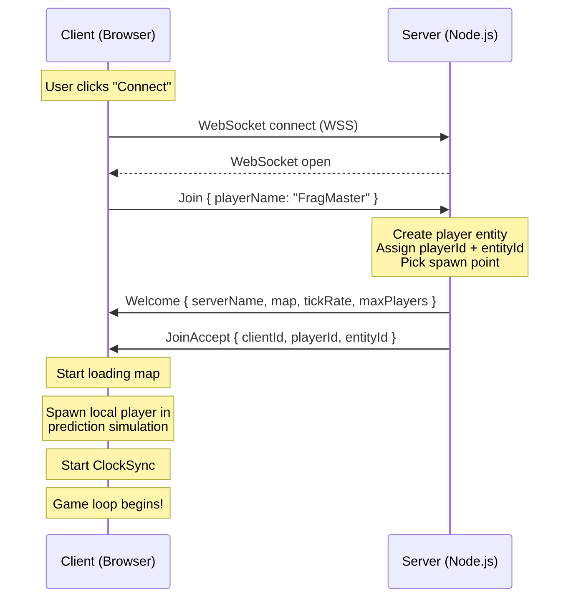
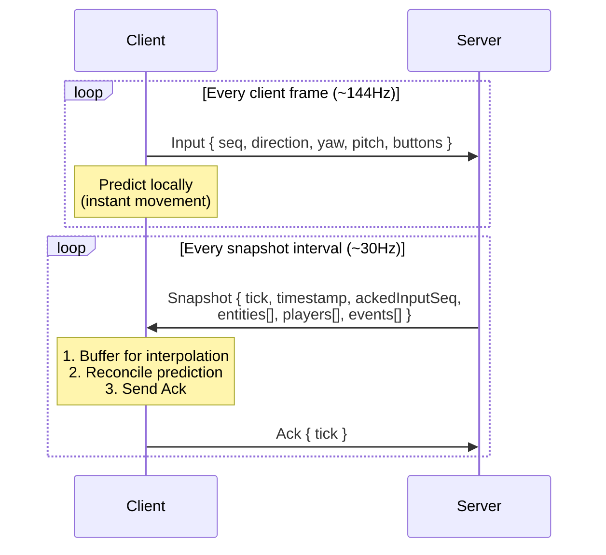
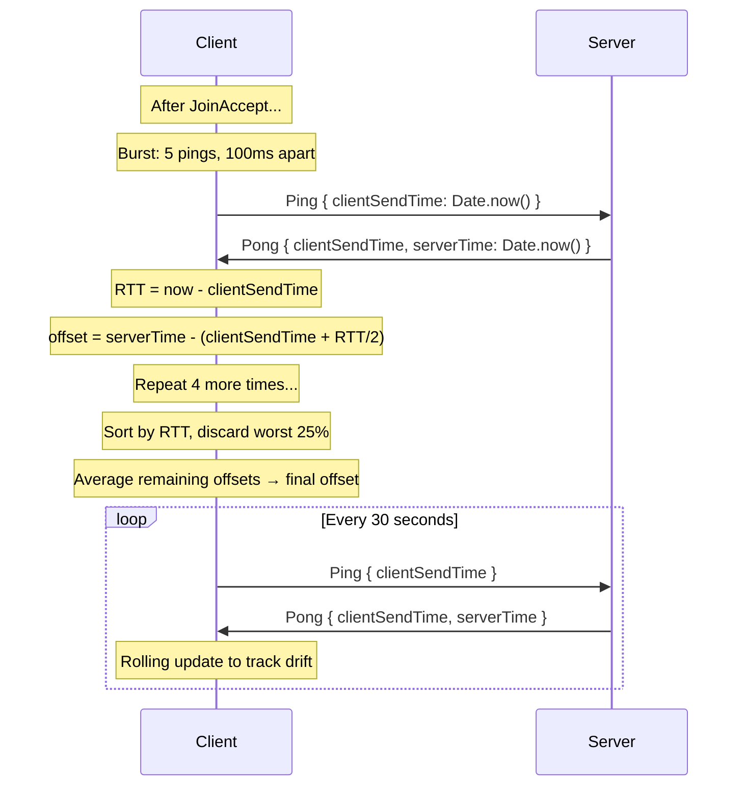

# Network Protocol Flow

> **Date:** 2026-02-18  
> **Status:** Living Document  
> **Scope:** Full server↔client message flow for the SHAG FPS networking stack

---

## The Big Picture

Everything runs over **WebTransport** (QUIC/HTTP3) when available, with **WebSocket** (WSS) as a fallback. WebTransport gives us true unreliable datagrams (UDP-like); WebSocket simulates this since all WS messages are reliable. Both transports expose the same interface with two logical channels:

- **Reliable** — for connection lifecycle messages (Join, Welcome, JoinAccept). These *must* arrive. WebTransport uses unidirectional QUIC streams; WebSocket uses regular messages.
- **Unreliable (datagrams)** — for game traffic (Snapshots, Input, Ack, Ping/Pong). Lost packets are fine — the next one replaces it. WebTransport uses QUIC datagrams; WebSocket sends as regular messages (no true unreliability, but the protocol handles it).

The server is **authoritative**. Clients predict locally and reconcile when the server disagrees. The whole thing is modeled after Quake 3 / Source Engine networking.

---

## Message Types

All messages start with a 1-byte type header. The rest is binary-encoded data (no JSON on the wire).

```text
enum MessageType {
  Snapshot   = 0x01   // Server → Client  (unreliable)
  Input      = 0x02   // Client → Server  (unreliable)
  Welcome    = 0x03   // Server → Client  (reliable)
  Join       = 0x04   // Client → Server  (reliable)
  JoinAccept = 0x05   // Server → Client  (reliable)
  Ack        = 0x06   // Client → Server  (unreliable)
  Ready      = 0x07   // Client → Server  (reliable)
  Ping       = 0x09   // Client → Server  (unreliable)
  Pong       = 0x0A   // Server → Client  (unreliable)
}
```

---

## Phase 1: Connection Handshake

This is the "getting into the game" flow. Everything here is **reliable** — we can't afford to lose these messages.



### What happens at each step

**Join** — Client sends its desired player name. Server creates a player entity in the ECS, picks a spawn point using the gametype's spawn strategy (e.g. furthest from enemies), and tracks the client.

**Welcome** — Server sends its identity: name, map name, tick rate, max players. The client uses the map name to load the correct BSP.

**JoinAccept** — Server confirms the client is in. Sends back the server-assigned `playerId` and `entityId`. The client stores these — `playerId` is used for input messages, `entityId` is used to identify "self" in snapshots.

> **Why both Welcome AND JoinAccept?**  
> Welcome arrives first so the client can start loading the map before the join is fully processed. JoinAccept confirms the player entity exists.

---

## Phase 2: The Game Loop

Once connected, the game settles into a simple loop. The server ticks at a fixed rate (e.g. 128Hz), and broadcasts snapshots at a potentially lower rate (e.g. 30Hz). The client sends inputs every frame.

### Server Tick Loop

```text
  1. Run simulation (physics, weapons, combat)
  2. Process pending damage (weapon hits, projectile impacts)
  3. Run gametype post-tick (kills, respawns, match state)
  4. Every N ticks → broadcastSnapshot()
```

### Client Frame Loop

```text
  1. Capture input (WASD, mouse, buttons)
  2. Send input to server (with sequence number)
  3. Apply input locally for instant prediction
  4. Render using predicted local state + interpolated remote players
```

### The Input → Snapshot Cycle

This is the core loop:



---

## Phase 3: What's In Each Message

### Input (Client → Server)

```text
[0x02] [playerId: string] [seq: uint32] [command: json]

command = {
  seq: number,          // Sequence number (for dedup + reconciliation)
  direction: { x, z },  // Movement vector (right, forward)
  yaw: number,          // Look direction
  pitch: number,
  buttons: number,      // Bitflags: fire=1, jump=2, crouch=4, sprint=8, ...
}
```

**Command redundancy:** The client sends the last 3 commands per tick, not just the current one. If a packet is lost, the server still gets the command in the next packet. The server deduplicates by sequence number — `seq <= lastProcessedSeq` → skip.

### Snapshot (Server → Client)

```text
[0x01] [tick: uint32] [timestamp: uint32] [ackedInputSeq: uint32]
```

This is the big one. The snapshot contains the **entire game state** — but delta-compressed against each client's last acknowledged baseline.

#### Delta Compression (Per-Client Baselines)

Instead of sending full state every time, the server compares against the last snapshot each client **acked**. Only changed values are sent.

The server maintains:

- **`lastAckedTick` per client** — updated when an Ack arrives
- **Snapshot history** (ring buffer, 64 entries) — recent GameStates keyed by tick

For each client:

1. Look up `snapshotHistory[client.lastAckedTick]` → baseline
2. Delta-encode current state against baseline
3. If no acked tick yet (first snapshot), send full state (no baseline)

```text
Per entity:
  [entityId: string]
  [componentFlags: uint8]    ← which components changed vs baseline
    0x01 = position changed  → 3 floats (12 bytes)
    0x02 = velocity changed  → 3 floats (12 bytes)
    0x04 = grounded changed  → 1 byte
    0x08 = rotation changed  → 2 floats (8 bytes)
```

If nothing changed for an entity, it's still listed (so the client knows it exists), but `componentFlags = 0x00` means zero data bytes for that entity. In a typical game with 2 players, a stationary player transmits only the entityId + 1 byte flags — **no position or velocity data**.

#### The `ackedInputSeq` Field

This is **critical** for client-side prediction. It tells the client: "I've processed all your inputs up to sequence #N." The client uses this to:

1. Discard old predicted inputs (they're confirmed)
2. Replay only unconfirmed inputs after reconciliation

#### Events

Events are one-shot, non-delta-compressed. They carry things like:

- `weapon_fire` — someone shot (for muzzle flash, tracers)
- `projectile_impact` — explosion at a position (for VFX)
- `item_pickup` — someone grabbed a weapon/powerup
- `player_death` — someone died (for killfeed, score)

Events are only sent once — if the packet is lost, the event is lost. This is fine because events are cosmetic (the simulation state is authoritative).

### Ack (Client → Server)

```text
[0x06] [tick: uint32]
```

Simple: "I received snapshot for tick N." The server:

1. Updates `client.lastAckedTick = tick` (only if tick > current value)
2. Uses `snapshotHistory[tick]` as the delta-compression baseline for that client's next snapshot

The client also stores a **clone of the received snapshot** as its decode baseline (`lastAckedSnapshot`). This must be the raw received state — not `localState`, which gets mutated by client-side prediction.

> **Lost Acks:** If an Ack is lost, the server's `lastAckedTick` stays at the older value. This is fine — deltas against an older baseline are slightly larger but still correct. The next Ack will catch up.

### Ready (Client → Server)

```
[0x07]
```

Just a 1-byte message. The server identifies the sender by the WebSocket connection. Used during warmup phase.

---

## Phase 4: ClockSync (NTP-like)

The client needs to know the server's clock to convert snapshot timestamps to local time. This gives us better interpolation than using local `performance.now()` at packet arrival.

### How It Works



### Why Not Just Use Arrival Time?

Network jitter makes arrival times unreliable. If a packet is delayed by 20ms due to a route change, the local reception timestamp is off by 20ms — and that 20ms shows up as a visible stutter in interpolation.

With ClockSync, we know the server's `Date.now()` at snapshot creation. We convert that to local time using the computed offset. Now even if the packet arrives late, we know *when* the server created it, and interpolation stays smooth.

### Message Format

```
Ping: [0x09] [clientSendTime: float64]    ← 9 bytes
Pong: [0x0A] [clientSendTime: float64] [serverTime: float64]   ← 17 bytes
```

We use `float64` because `Date.now()` (milliseconds since epoch) exceeds `uint32` range (~4.2 billion ≈ 49 days from epoch, long past).

---

## Phase 5: Client-Side Prediction & Reconciliation

This is how we get "zero latency" movement feel despite server authority.

### The Problem

Without prediction, pressing W means:

1. Send input to server (50ms)
2. Server processes it
3. Server sends back snapshot (50ms)
4. You see yourself move — **100ms later**

That feels terrible in an FPS.

### The Solution

```text
│                     Client Frame                         │
│                                                          │
│  1. Capture input (W pressed)                           │
│  2. Send to server                                      │
│  3. Predict locally — run same physics as server        │
│     → You see yourself move INSTANTLY                    │
│  4. Store input in history (seq #42)                    │
│                                                          │
│  ... 100ms later, snapshot arrives ...                   │
│                                                          │
│  5. Snapshot says ackedInputSeq = 40                    │
│     → Server has processed inputs 1-40                  │
│     → Inputs 41, 42 are still unconfirmed               │
│  6. Reset local position to server's authoritative pos  │
│  7. Replay inputs 41, 42 on top of server state         │
│     → Predicted position should match (if physics match)│
│  8. If prediction error < 0.5 units → ignore            │
│     If error < 100 units → smooth correction            │
│     If error > 100 units → snap (teleport/respawn)      │
└─────────────────────────────────────────────────────────┘
```

### Other Players (Interpolation)

The local player uses prediction. Everyone else uses **interpolation**: we render them slightly in the past (100ms behind), smoothly blending between the two most recent snapshots.

```text
  [snap t=0ms] ←─ before
  [snap t=33ms] ←─ after
  [snap t=66ms]    (newest)

  renderTime = now - interpDelay (100ms)

  If renderTime falls between snap0 and snap1:
    t = (renderTime - snap0.time) / (snap1.time - snap0.time)
    position = lerp(snap0.pos, snap1.pos, t)
    yaw = shortestAngleLerp(snap0.yaw, snap1.yaw, t)
```

When ClockSync is active, `snap.time` uses the server's timestamp (converted to local time) instead of `performance.now()` at packet arrival. This eliminates jitter from network delay variation.

---

## The Full Timeline

Here's what a typical 1-second window looks like:

```
Time    Server (128Hz tick, 30Hz snapshot)        Client (144Hz render)
──────  ─────────────────────────────────────     ─────────────────────────

0ms     tick #1000                                frame: capture WASD, send Input seq=500
                                                  predict locally → move 2 units
1ms     tick #1001
        ...                                       frame: send Input seq=501
8ms     tick #1008                                predict locally
        process Input seq=500
        ...

33ms    tick #1032                                frame: send Input seq=505
        SNAPSHOT! broadcast:
          tick=1032, ackedInputSeq=503            ← "I've processed your inputs up to 503"
          entities, players, events
        ...

66ms                                              frame: receive Snapshot tick=1032
                                                  → ackedInputSeq=503, discard inputs 1-503
                                                  → reconcile: replay inputs 504, 505
                                                  → send Ack(1032)
                                                  → interpolate other players at t = now - 100ms

100ms   receive Ack(1032)
        → store client.lastAckedTick = 1032
        → next snapshot deltas against snapshotHistory[1032]
```

---

## Transport Layer

```text
WebTransportServerTransport (server, primary)
  ├── start()                        ← listen on QUIC/HTTP3 port
  ├── onConnect(conn)
  ├── onDisconnect(conn, reason)
  ├── onDatagram(conn, data)         ← game traffic (QUIC datagrams)
  ├── onReliable(conn, data)         ← lifecycle traffic (QUIC streams)
  └── onError(conn, error)

WebSocketServerTransport (server, fallback)
  ├── start()                        ← listen on WSS port
  ├── same interface as above
  └── both channels use WS messages (no true datagrams)

Client Transport (auto-detected)
  ├── TransportFactory.create(url)   ← tries WebTransport first, falls back to WS
  ├── connect(url)
  ├── send(data, reliable?)
  ├── onMessage(callback)
  ├── onConnect(callback)
  ├── onDisconnect(callback)
  └── onError(callback)
```

Both sides use the same `MessageCodec` for encoding/decoding. The codec always prepends the message type byte, and `peekMessageType()` reads byte 0 to route the message without decoding the full payload. The transport layer is transparent — game code never knows which transport is active.

---

## Source Files

| File | Role |
| ---- | ---- |
| `src/engine/network/protocol/BinaryProtocol.ts` | Binary encoder/decoder, snapshot delta compression |
| `src/engine/network/protocol/MessageCodec.ts` | High-level encode/decode for all message types |
| `src/engine/network/core/GameState.ts` | The state object that flows between server and client |
| `src/engine/network/core/Entity.ts` | ECS entity with component bag |
| `src/engine/network/client/hosts/NetworkGameHost.ts` | Client-side message handling, prediction, reconciliation |
| `src/engine/network/client/SnapshotBuffer.ts` | Time-based interpolation buffer for remote players |
| `src/engine/network/client/ClockSync.ts` | NTP-like clock offset calculation |
| `src/engine/network/client/NetGraph.ts` | Real-time network stats overlay (ping, snap rate, loss %, clock offset) |
| `src/engine/server/network/transport/WebTransportTransport.ts` | Server QUIC transport (datagrams + streams) |
| `src/engine/server/network/transport/WebSocketTransport.ts` | Server WebSocket fallback transport |
| `src/engine/network/client/transport/Transport.ts` | Client transport interface + auto-detection factory |
| `src/engine/network/client/transport/WebTransportTransport.ts` | Client QUIC transport |
| `src/engine/network/client/transport/WebSocketTransport.ts` | Client WebSocket fallback transport |
| `src/games/fps/server/GameServer.ts` | Server tick loop, client management, snapshot broadcast |
| `src/games/fps/server/MovementValidator.ts` | Anti-warp input rate limiting (rate cap + time budget) |
| `src/games/fps/client/V2NetworkClient.ts` | Input history + reconciliation (Q3-style) |
| `src/games/fps/client/RemotePlayerRenderer.ts` | Model rendering for other players (uses SnapshotBuffer) |
| `src/games/fps/FPSGameManager.ts` | Orchestrates everything on the client side |

---

## Bandwidth Cheat Sheet

Rough per-tick sizes at 30Hz snapshot rate, 2 players:

| Direction | Message | ~Size | Rate | Bandwidth |
| --------- | ------- | ----- | ---- | --------- |
| S→C | Snapshot (full, no baseline) | ~80-200 bytes | first only | one-time |
| S→C | Snapshot (delta, both moving) | ~40-80 bytes | 30/s | ~1.2-2.4 KB/s |
| S→C | Snapshot (delta, one idle) | ~20-40 bytes | 30/s | ~0.6-1.2 KB/s |
| C→S | Input (×3 redundancy) | ~60 bytes × 3 | 144/s | ~25 KB/s |
| C→S | Ack | 5 bytes | 30/s | ~0.15 KB/s |
| C↔S | Ping/Pong | 9-17 bytes | 0.03/s | negligible |
| **Total** | | | | **~27-29 KB/s** |

With per-client delta baselines active, snapshot bandwidth drops **50-70%** compared to always sending full state. The biggest cost is now command redundancy (sending 3 copies of each input) — the price we pay for unreliable transport.

---

## Diagnostics: NetGraph

Toggled via `cl_netgraph` CVar (0=off, 1=text, 2=text+graph). Displays:

| Metric | Source | Display |
| ------ | ------ | ------- |
| Ping (RTT) | Server snapshot round-trip | `ping: 42ms` |
| Snapshot rate | Received snapshots/sec | `snap: 30/s` |
| Packet loss % | Tick gap detection (expected vs actual) | `loss: 0.0%` |
| Interp delay | SnapshotBuffer render offset | `interp: 100ms` |
| Command rate | Outgoing inputs/sec | `cmd: 125/s` |
| Reconciliation rate | Corrections/sec | `recon: 0.0/s` |
| Clock offset | ClockSync (server - client) | `clock: +12ms` |

**Packet loss detection** works by tracking snapshot tick gaps. If we expect snapshots every N ticks and see a gap of 2N, that's 1 lost packet. Loss is calculated over a rolling window of the last 100 snapshots.

---

## Anti-Warp / MovementValidator

Server-side cheat prevention that rate-limits client inputs to prevent speed hacking. Without this, a cheater could flood inputs faster than real-time and move at 2-5× normal speed.

### The Attack

The server processes **all inputs** in a client's queue per tick. A cheater sends 5 inputs per frame instead of 1 → 5× physics steps → 5× speed. Position hacking is already prevented (server runs authoritative physics), but input flooding is a real attack vector.

### Defense: Two Layers

The `MovementValidator` runs two checks on every input **after** dedup but **before** the input enters the physics queue:

**Layer 1 — Rate Cap** (hard limit):

```text
maxInputsPerTick = ceil(clientRate / serverRate) + 2
→ ceil(144/128) + 2 = 4 inputs/tick max

If client exceeds this → drop input, count strike
```

**Layer 2 — Time Budget** (soft, jitter-tolerant):

```text
Each accepted input "costs" 6.94ms (= 1000/144Hz)
Real elapsed time between inputs earns budget credit
Max banked budget: 200ms (prevents idle-banking exploits)

if timeBudget < inputCost:
  → client is sending faster than real-time
  → drop input, count strike
else:
  → deduct cost, accept input
```

### Why This Works

- **Normal play:** Budget stays positive. 1.125 inputs/tick average at 144Hz/128Hz — well under the rate cap. Zero false positives.
- **Network burst:** Budget absorbs bursts up to 200ms without dropping. Client jitter is normal.
- **Speed hack:** Budget drains instantly because inputs arrive faster than real-time allows. Movement stutters, strikes accumulate.
- **Silent drops:** Cheater gets no error — their movement just stops responding when flooding.

### Integration Points

```text
handleDatagram() → handleInput(client, data)
  1. Dedup check (seq ≤ lastInputSeq? skip)
  2. MovementValidator.validateInput(playerId)   ← NEW
  3. Push to entity.input.inputQueue[]

tick()
  0. MovementValidator.onTick()                  ← NEW (reset per-tick counters)
  1. Run simulation
  ...
```

| Parameter | Default | Rationale |
| --------- | ------- | --------- |
| `maxBudgetMs` | 200ms | ~2 frames at 144Hz, absorbs jitter |
| `inputCostMs` | 6.94ms | 1000/144 = one input's time cost |
| `maxInputsPerTick` | 4 | ceil(144/128) + 2 jitter buffer |
| `strikeWarnThreshold` | 50 | ~350ms of flooding before log warning |
