# Rendering Pipeline

> From zero to final frame — how a Warsow map becomes pixels on screen.

## Overview

The rendering pipeline takes Warsow/Quake 3 BSP maps packaged in PK3 archives and renders them using Babylon.js. The pipeline handles coordinate system conversion (Q3 Z-up → Babylon Y-up), Warsow's shader system (with template extensions), multiple material strategies, and a suite of post-processing effects.

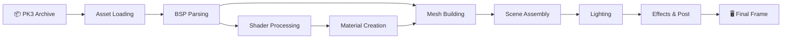

---

## 1. Asset Loading

Assets live in **PK3 archives** (ZIP files). The loader extracts textures, shaders, BSP maps, and models.

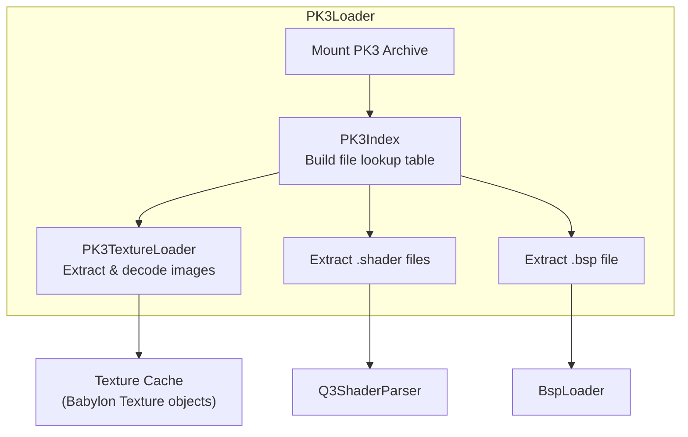

| File | Role |
|---|---|
| `PK3Loader.ts` | Mount ZIP archives, file extraction |
| `PK3Index.ts` | O(1) file path lookup across all mounted PK3s |
| `PK3TextureLoader.ts` | Load textures (TGA, JPG, PNG) from PK3 into Babylon `Texture` objects |

---

## 2. BSP Parsing

`BspLoader` parses both **IBSP v46** (Quake 3) and **FBSP v1** (Warsow/qfusion) binary formats.

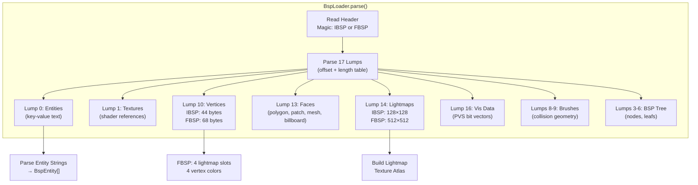

### FBSP vs IBSP Differences

| Feature | IBSP (Quake 3) | FBSP (Warsow) |
|---|---|---|
| Lightmap size | 128×128 | **512×512** |
| Lightmap slots per vertex | 1 | **4** (lightstyles) |
| Vertex colors | 1 RGBA | **4 RGBA** |
| Vertex size | 44 bytes | **68 bytes** |
| Face lightmap indices | 1 | **4** |

---

## 3. Warsow Shader System

Warsow shaders extend Q3's shader format with a **template system** for shader reuse.

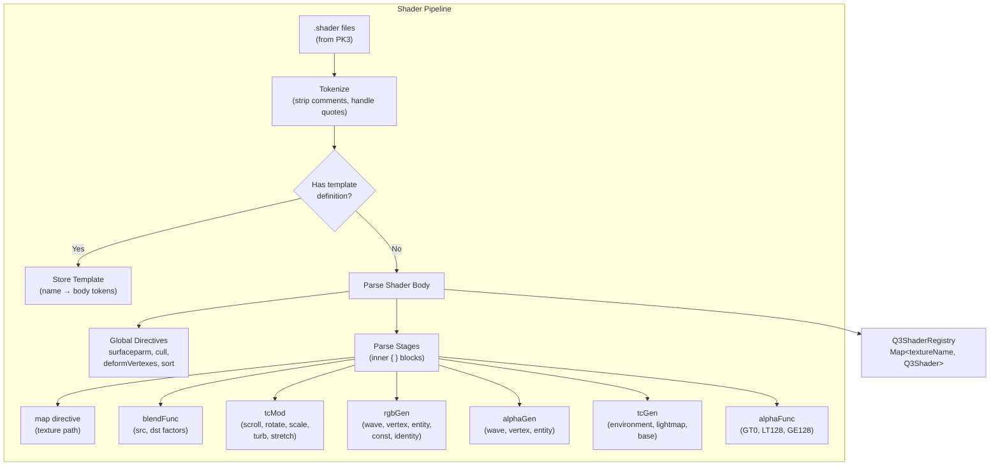

### Template Example (Warsow-specific)

```c
// Template definition
template mycoolshader,<base>,<glow>
{
    { map $1 }              // $1 = <base> parameter
    { map $lightmap }
    { map $2; blendFunc add } // $2 = <glow> parameter
}

// Template usage
textures/mymap/wall1
  mycoolshader,textures/mymap/wall1,textures/mymap/wall1_glow
```

---

## 4. Material Creation

`Q3ShaderMaterialFactory` detects shader patterns and routes to the optimal Babylon.js material type.

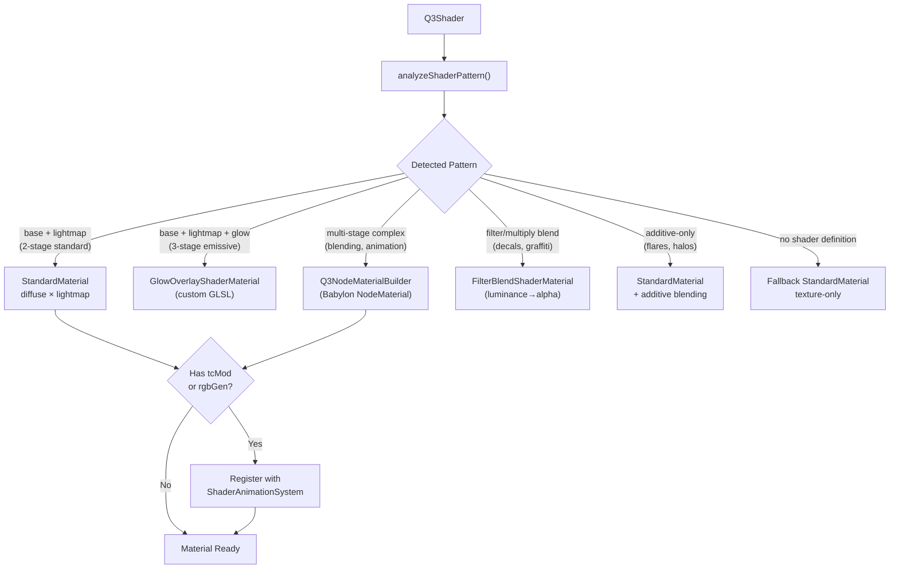

### Material Types Detail

| Material | When Used | How It Works |
|---|---|---|
| **StandardMaterial** | Simple base+lightmap, additive glow | Babylon built-in, `diffuseTexture × lightmapTexture` |
| **GlowOverlayShaderMaterial** | 3-stage: base + lightmap + glow | Custom GLSL: `(base × lightmap) + glow`. Supports additive and alpha blend modes |
| **Q3NodeMaterialBuilder** | Multi-stage shaders with complex blending | Babylon NodeMaterial graph: per-stage texture nodes with blend operations |
| **FilterBlendShaderMaterial** | Decals, graffiti (`blendFunc filter`) | Custom GLSL: computes alpha from inverse luminance (Q3's GL_DST_COLOR, GL_ZERO) |
| **Fallback** | No shader defined | StandardMaterial with just the diffuse texture |

---

## 5. Mesh Building

`BspMeshBuilder` converts BSP face data into Babylon.js meshes with proper coordinate transformation.

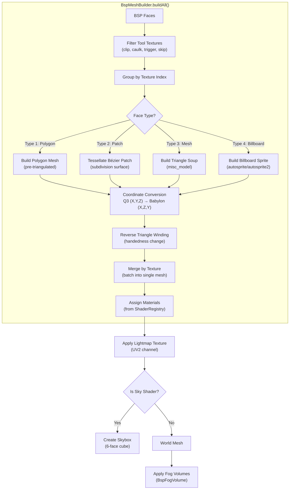

### Coordinate System

```
Q3 Engine (Z-up, right-handed):     Babylon.js (Y-up, left-handed):
    Z (up)                               Y (up)
    |                                    |
    |__ Y (forward)                      |__ Z (forward)
   /                                    /
  X (right)                            X (right)

Transform: (x, y, z) → (x, z, y) + reverse triangle winding
```

### Fog Volumes (BSP Effects Lump)

`BspFogVolume` extracts volumetric fog regions from BSP brush geometry. Each fog volume is a convex brush with a custom GLSL shader that computes distance-based fog:

```
fogFactor = clamp(cameraDistance / depthForOpaque, 0.0, 0.85)
```

---

## 6. Entity Rendering

`MapRenderer.renderEntities()` processes BSP entities into scene objects. `BspEntityHandlers` handles brush-model entities.

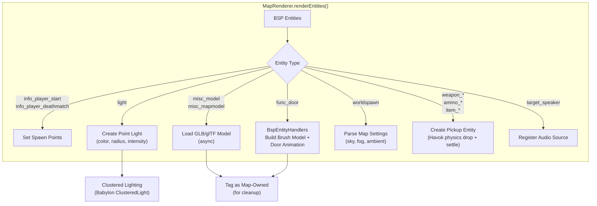

### Skybox Rendering

`SkyboxLoader` creates a Babylon skybox from Q3 sky shaders. Q3 sky shaders define 6 face textures (`_ft`, `_bk`, `_lf`, `_rt`, `_up`, `_dn`) which are assembled into a cube texture.

---

## 7. Lighting Systems

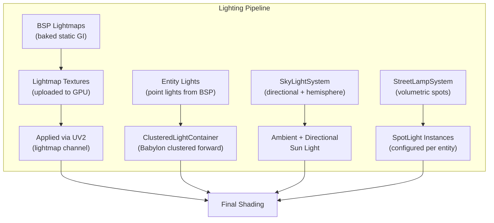

---

## 8. Shader Animation (Per-Frame)

`ShaderAnimationSystem` drives all runtime shader effects via a single `onBeforeRender` observer.

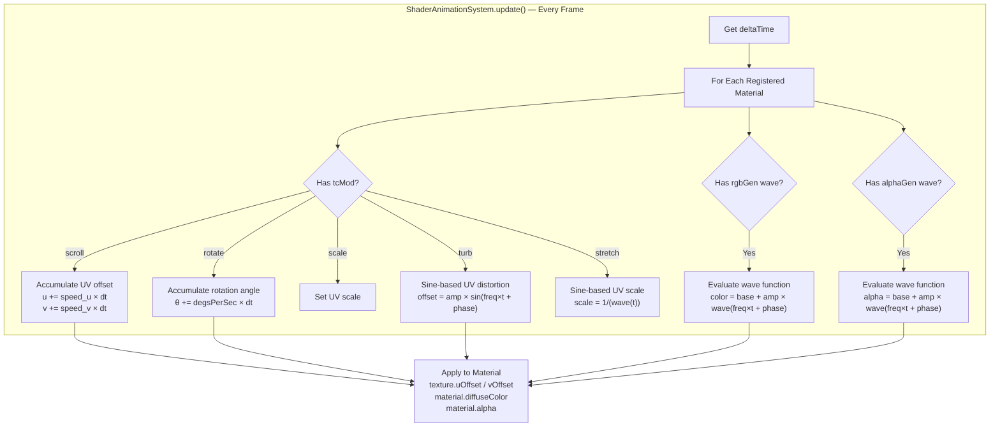

### Wave Functions

| Function | Formula | Used For |
|---|---|---|
| `sin` | `sin(2π × freq × t + phase)` | Pulsing lights, water |
| `triangle` | Triangle wave | Smooth oscillation |
| `square` | Sign of sine | Blinking |
| `sawtooth` | `frac(freq × t + phase)` | Scrolling |
| `inversesawtooth` | `1 - frac(...)` | Reverse scrolling |
| `noise` | Random per-frame | Flickering |

---

## 9. Game Effects Layer

Visual effects rendered on top of the world geometry:

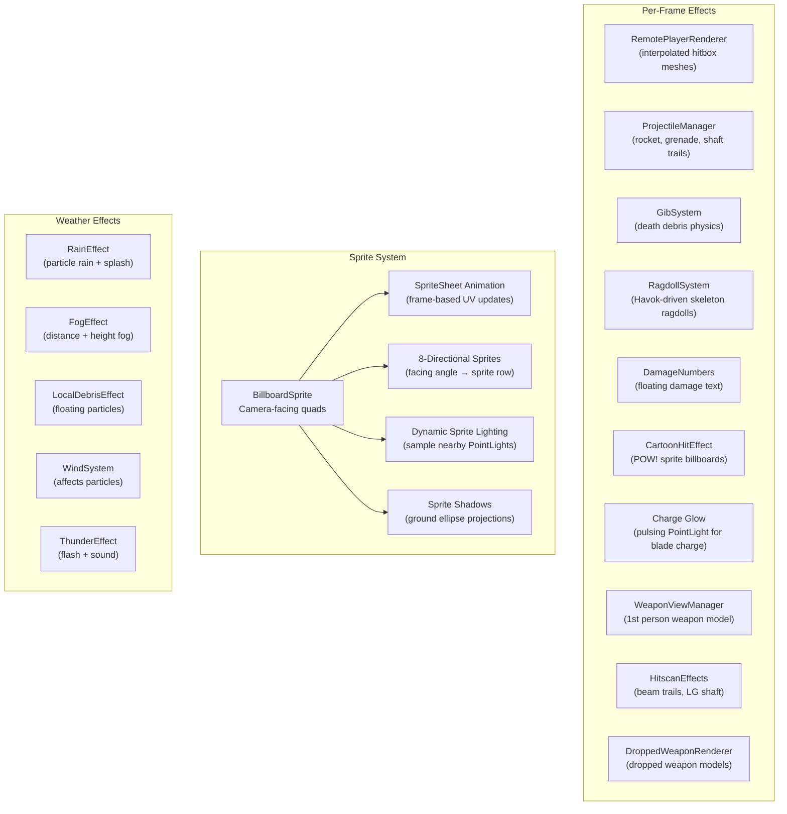

---

## 10. Runtime Configuration

`RenderVars` provides Q3/Warsow-style `r_*` console variables for runtime rendering tuning. Values persist to `localStorage`.

| Variable | Description | Range |
|---|---|---|
| `r_normalmap` | Normal/bump map intensity | 0–4 |
| `r_glossmap` | Gloss/specular intensity | 0–4 |
| `r_lightmap` | Lightmap brightness | 0–4 |
| `r_glow` | Additive glow intensity | 0–4 |
| `r_bloom` | Post-processing bloom multiplier | 0–3 |
| `r_exposure` | Exposure multiplier | 0–3 |
| `r_contrast` | Contrast adjustment | 0–3 |
| `r_daynight_*` | Day/night cycle parameters | varies |

---

## 11. Post-Processing Pipeline

Applied after all geometry and effects are rendered:

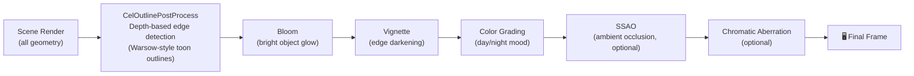

### CelOutlinePostProcess (Warsow-style)

Custom GLSL post-process that reads the depth buffer:

1. **Depth edge detection** — Samples 4 neighbors, computes depth gradient relative to center depth
2. **Normal reconstruction** — Reconstructs surface normals from depth, compares via dot product
3. **Bright fade** — Outlines fade on bright surfaces to avoid over-darkening
4. **Mesh exclusion** — Projectiles, particles, and UI elements are excluded from the depth pass

---

## Full Pipeline: End-to-End

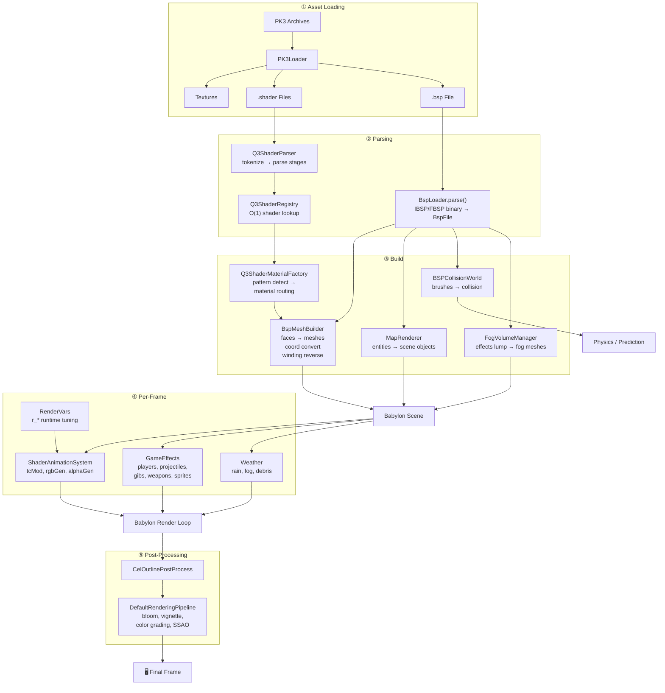

---

## Key Source Files

| Stage | File | Lines | Responsibility |
|---|---|---|---|
| Asset Loading | `PK3Loader.ts` | — | Mount ZIP, extract files |
| Asset Loading | `PK3Index.ts` | — | O(1) file path lookup |
| Asset Loading | `PK3TextureLoader.ts` | — | Load TGA/JPG/PNG from PK3 |
| BSP Parsing | `BspLoader.ts` | 1,107 | Parse IBSP/FBSP binary |
| Mesh Building | `BspMeshBuilder.ts` | 2,164 | Faces → Babylon meshes |
| Fog Volumes | `BspFogVolume.ts` | 867 | BSP fog → custom GLSL volumes |
| Entity Handlers | `BspEntityHandlers.ts` | 263 | func_door brush model + animation |
| Skybox | `SkyboxLoader.ts` | — | Q3 sky faces → cube texture |
| Shader Parsing | `Q3ShaderParser.ts` | 899 | Parse .shader syntax + templates |
| Shader Registry | `Q3ShaderRegistry.ts` | 366 | O(1) shader lookup, material props |
| Material Factory | `Q3ShaderMaterialFactory.ts` | 394 | Pattern detection + material routing |
| Node Materials | `Q3NodeMaterialBuilder.ts` | 326 | Multi-stage → NodeMaterial graph |
| Glow Overlay | `GlowOverlayShaderMaterial.ts` | 225 | Custom GLSL: base × lightmap + glow |
| Filter Blend | `FilterBlendShaderMaterial.ts` | 142 | Custom GLSL: luminance → alpha decals |
| Animation | `ShaderAnimationSystem.ts` | 415 | Per-frame tcMod/rgbGen/alphaGen |
| Sprites | `BillboardSprite.ts` | 492 | Camera-facing animated sprites |
| Sprites | `SpriteSheet.ts` / `SpriteManager.ts` | — | Frame-based animation + 8-dir |
| Entity Rendering | `MapRenderer.ts` | 979 | Entities → scene objects + lighting |
| Render Variables | `RenderVars.ts` | 858 | Q3-style r_* console variables |
| Lighting | `SkyLightSystem.ts` | — | Directional + hemisphere ambient |
| Lighting | `StreetLampSystem.ts` | — | Volumetric spot lights |
| Cel Outlines | `CelOutlinePostProcess.ts` | 364 | Depth-based toon outlines |
| Post-Processing | `PostProcessingManager.ts` | 578 | Bloom, vignette, SSAO, color grading |
