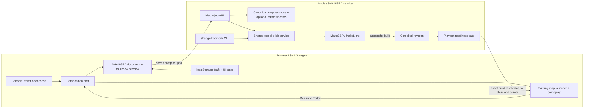
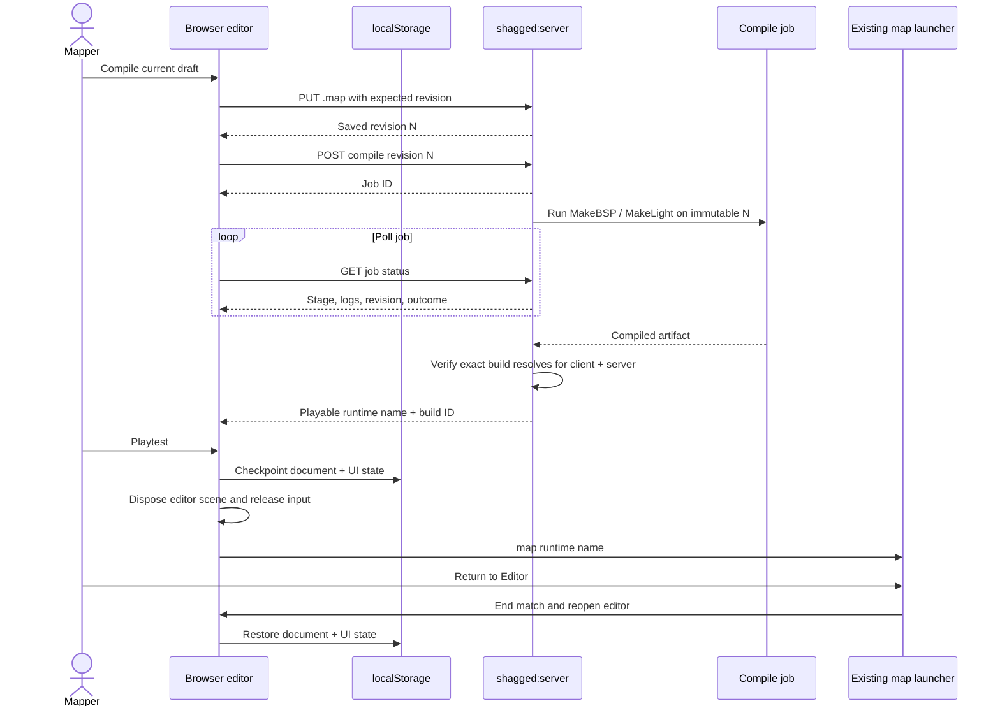
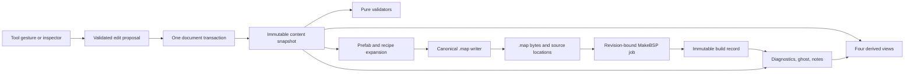

# SHAGGED — SHAG General Editor

**Status:** active M1 implementation, 2026-10-02. Closed-room MakeBSP compile acceptance and real-browser interaction are now both verified; see the checkpoint below for what remains.

## Implementation checkpoint

The first M1 slice now has the developer-gated `editor` command, a browser
host that suspends/restores the lobby game view, four panes (Babylon perspective
and XY/XZ/YZ canvas projections), grid-aligned box drawing and movement,
selection, undo/redo, named `localStorage` drafts with a chooser to reopen older
work, numeric XYZ bounds and shader
editing, duplication, recovered grid/zoom/tool/selection/camera state, and
deterministic `brushDef` export. Brush drags now capture an explicit work-plane
coordinate and one-grid thickness; a transient box and dimension readout
appear in all three orthographic panes and the perspective scene. The Room Template creates six enclosing
brushes and an `info_player_deathmatch` spawn for the eventual compiler check.
Compile, status, and Playtest are visibly unavailable — correctly, since no
compile service exists yet. A DOM/NullEngine smoke test covers perspective
picking and the main editing controls.

**Compiler acceptance, verified (2026-10-02):** a local NetRadiant Custom
install (`makebsp.exe`/`makelight.exe`, with this repository's own
`editor/makebspdata/washoi.json` already installed into it) compiled the
Room Template's exported `.map` with the documented Washoi FAST recipe
end to end — `makebsp -game washoi -fs_basepath <public/data> -leaktest
-fast -samplesize 8`, then the matching `makelight -fast` — with no leak,
and the resulting `.bsp` loads cleanly through SHAG's own `BspLoader`
(`npx vite-node src/cli/headless-bsp.ts info <file>` reports FBSP v1, 6
faces, 1 model, as expected for a sealed six-brush room). This closes the
M1 export-validity claim's compiler unknown. One finding to track rather
than a blocker: `BspLoader` warns of a light-grid count mismatch (3 actual
vs. 49 predicted from the map bounds) on this fixture, which has no light
entities at all; the room still loads and the warning already exists for
other maps, but it should be re-checked against a lit test room before
fully closing the P0 gate, in case MakeLight's grid compression on an
all-dark room is hiding a real exporter gap.

**Real-browser interaction, verified (2026-10-02):** headless Edge over CDP
confirmed `developer 1; editor open` opens the four-view editor from the
console; a real pointer drag in the XY pane creates a grid-snapped box
brush that renders correctly in all three orthographic panes and the 3D
perspective view; the inspector shows its exact bounds and shader; and
Exit/reopen round-trips the session (including recovering the same draft
after a full page reload, via `localStorage`). This pass found that opening
the editor silently closed the debug console (`src/main.ts`'s suspend-game
callback called `debugConsole.close()`), contradicting this document's own
"the console remains available in editor mode" contract (see **Console
launch and mode lifecycle** below) — fixed by removing that call; the
console's open/closed state is now left alone when the editor opens, like
every other composition.

M1 is **not fully complete**: general entity placement, face/UV editing, and
the server-side Compile/Playtest loop (M2/M3 scope) have not started. The
light-grid follow-up above is the one open compiler-side question.

Orthographic navigation now supports middle-drag pan and wheel zoom anchored
under the cursor. M1 uses a shared Quake-space view center and zoom across the
three projections, saved per draft; panning a visible axis moves it in the
companion panes too. Frame (`F`) centers all views on the selected brush, or all
brushes when nothing is selected. Frame All (`Shift+F`) always uses the whole
document. Framing respects the current zoom limits (0.25–4 pixels per unit)
and perspective radius limits (32–5000 units), so very large bounds may extend
outside the view. `EditorViewTools.ts` keeps projection, pan, zoom-anchor, and
combined-bounds calculations independent of Babylon and DOM.

## Decision

A focused brush editor inside SHAG is viable. The first useful version should provide NetRadiant's four-view workspace (perspective plus XY top, XZ front, and YZ side), create and edit axis-aligned box brushes on a grid, and export a deterministic Quake-family `.map` source file. MakeBSP remains the compiler; SHAGGED produces source and offers an editor preview. M1 should prove a closed-room export compiles with MakeBSP through an offline fixture check; M3 adds the server compile jobs and proves SHAG can play the exact result.

The UI and geometry editor should be an **engine-owned tool launched from SHAG's console** (proposed `src/engine/editor/` plus `editor` command), not a new game package or an FPS gametype. It takes over the active canvas/rendered scene while open. Save its draft and UI state before playtest, tear down the editor scene, then launch the compiled map through the existing gameplay command. Returning reconstructs the editor from that saved state. The console is the first entry point, not an optional integration. The current FPS shell scene may remain allocated but idle until the host is refactored; only one composition updates and renders at a time.

## Verified starting point

| Evidence | Consequence |
| --- | --- |
| [`raw-map-system.md`](../manual/guides/raw-map-system.md), `src/engine/loader/map/MapParser.ts`, `BrushGenerator.ts`, and `src/engine/MapRenderer.ts` already parse/render text-map brushes. | Useful for previews and round-trip checks, but the current parser normalizes `brushDef` to classic plane fields and discards the brush primitive UV matrix and trailing flags. It is **not** a lossless editor document model. |
| `src/engine/loader/map/MapLoader.ts` finds indexed BSP maps; its local `.map` branch is TODO. [`map-launching.md`](../manual/guides/map-launching.md) describes a separate gameplay launcher. | The editor previews source geometry itself. Playtest later uses normal `map <name>` after the compiled map has been made available to the existing game path. |
| `src/tools/MapGenerator.ts` writes six-plane box brushes in `brushDef` syntax with a UV matrix and shader name; `src/tools/generate-map.ts` writes `.map` files. | There is a local serialization example, but it is private to a procedural generator and its variables use Y as up. Build a pure Quake Z-up editor serializer and check its output with MakeBSP during M1. |
| `editor/gamepacks/washoi.game/basewashoi/default_shaderlist.txt` documents unprefixed face names and a MakeBSP lookup pitfall: a face named `textures/blx/blx_dark` is resolved as `textures/textures/blx/blx_dark`. | SHAGGED's shader picker and exporter must use the exact Washoi `.map` face-name convention. A map that merely compiles may still have missing textures or lightmaps. |
| `src/engine/loader/bsp/mesh/coordinates.ts` maps Quake `(x,y,z)` to Babylon `(x,z,y)` and reverses triangle winding. | Store editor geometry in Quake coordinates, where Z is up. Convert only at rendering/picking boundaries; never export Babylon coordinates. |
| `src/engine/EngineScene.ts` already uses Babylon orthographic camera mode. `src/main.ts` owns the active FPS scene/camera. | Orthographic support exists in Babylon, but the game camera system is not a four-view editor controller. |
| `editor/makebspdata/washoi.json` defines the Washoi profile from `qfusion`, with `FBSP` v1, 18 lumps, 512 px lightmaps, and root media directory. `editor/gamepacks/washoi.game/default_build_menu.xml` declares FAST, DEFAULT, and RELEASE MakeBSP + MakeLight commands. | The intended compiled target and command shape are known. The actual binary/version, executable location, file handoff, and end-to-end result still need a local spike. |
| `package.json` has `tools:map`, `cli:game`, `cli:bsp`, `typecheck`, and `test:run`. It has no SHAGGED or MakeBSP script. | Document and test an explicit compiler command once the binary and its arguments are located. |
| `src/engine/console/commands/index.ts` auto-discovers `*Command.ts`; `src/main.ts` enables `DebugConsole` and calls `registerEngineCommands()`. `CommandRegistry` supports help metadata, developer gating, explicit failures, and unregistering. | An engine `EditorCommand.ts` is the natural console surface. It should delegate visual startup to a registered browser host rather than assume every command composition has a DOM or GPU. |
| `src/main.ts` owns a render loop that always calls `player.update()` and `scene.render()`. `SceneCommand.ts` directly stops/replaces the engine render loop for its inspection scene. | Editor entry cannot be only a new command file. A deliberate mode switch in the browser composition is required, and it must not inherit `scene empty`'s render-loop takeover pattern. |
| `src/cli/lobby-server.ts` starts a separate Node service; `src/lobby/GameServerSpawner.ts` already uses child processes for game servers. `src/games/fps/client/FpsMapLauncher.ts` uses the lobby's development-server request. | A separate SHAGGED backend is a familiar repo pattern. It can own `.map` files and MakeBSP jobs without putting filesystem/process code in the browser or adding editor concerns to the lobby server. |
| `DebugConsole` lives in DOM, releases pointer lock on open, and remains usable over the canvas. `InputSystem` binds document and canvas listeners; `FPSController` has `setGameplayFrozen` and `setEnabled`. | Console access can remain available while editing, but gameplay input and pointer grabs must be suspended and restored explicitly. |

NetRadiant Custom is a **behavior and format reference**, not a porting base. Its source has separate [orthographic XY/XZ/YZ views and brush drag logic](https://github.com/Garux/netradiant-custom/blob/master/radiant/xywindow.cpp) and [window/layout composition](https://github.com/Garux/netradiant-custom/blob/master/radiant/mainframe.cpp). Its [README](https://github.com/Garux/netradiant-custom#features) lists axial, brush primitive, and Valve 220 brush formats and automatic conversion. Choosing one export dialect for milestone 1 is therefore deliberate. Use the upstream source to settle winding, texture axes, and edge cases; do not copy its GPL implementation into TypeScript without a separate licensing decision.

## Feature matrix and proposed order

This matrix describes **editor features to build**, not features already available in the UI. Existing SHAG parsers/renderers are listed only as reusable substrate. M1 is the export milestone below and includes visible Compile/Status/Playtest controls; M2 makes the editor practical for ordinary maps; M3 connects compilation to normal game playtest and return; M4 adds authored curved geometry. M2 and M3 can progress independently after M1; M4 authoring work can start earlier, but its full compiled-collision acceptance needs M3's playtest path.

| Feature | Target | First useful behavior | SHAG substrate / main gap |
| --- | --- | --- | --- |
| Console launch and four views | M1 | `editor open` gives perspective, XY, XZ, YZ; `editor close` restores the prior view. | Command auto-discovery and Babylon orthographic cameras exist; mode lifecycle and pane input do not. |
| Box brush creation and `.map` export | M1 | Drag snapped boxes, set hidden-axis extent, assign a shader, save deterministic `brushDef` source. | `MapGenerator` writes boxes and `MapParser` reads them; no editable document/serializer or MakeBSP-verified fixture. |
| Compile, status, and Playtest controls | M1 UI; M3 integration | Show all three controls. In M1, status accurately says when no compiler is configured and Playtest stays unavailable; M3 wires actual jobs and game launch. | Washoi build recipe and `map` launcher exist; packaging/discovery is deferred. |
| Selection and object movement | M1 | Click in any pane to select one brush; drag or enter XYZ to move/resize it; duplicate/delete; selection is shared by all panes. | Babylon picking is available in principle; editor hit testing, grid snapping, handles, IDs, and undo transactions are new. |
| Undo/redo and draft recovery | M1 | One gesture is one undo step; refresh restores a versioned draft and view state from `localStorage`. | New editor document/history work. Meshes must be regenerated from the document, never be the saved state; later server Save writes the canonical `.map`. |
| Textured, solid, wireframe, and textured+edge preview | M2 | Per-pane view modes; texture appearance in perspective, clear outlines in orthographic panes; selected edges remain visible over textures. | `BrushGenerator` and debug commands demonstrate wireframe; editor-specific materials/overlays, shader lookup, and UV fidelity are new. Scene-wide `forceWireframe` alone is insufficient for per-pane modes. |
| Face material editing | M2 | Pick one or multiple faces, assign a Washoi shader name, adjust basic shift/scale/rotation, preview and export the result. | PK3/shader loaders exist; current raw parser discards brush primitive UV matrices and flags, so editor needs lossless face data. |
| Multi-select and grouping | M2 | Shift-select, marquee-select, group/ungroup, move/duplicate a group, and preserve membership in the editable draft. | New editor-only hierarchy. `func_group` appears in Washoi `entities.def`, but its compiler semantics need proof before using it for persistence; grouping must not silently change game entity ownership. |
| Point entity placement | M2 | Place a spawn, light, pickup, or target marker in 2D/3D; edit `classname`, origin, angle, and class-specific keys in an inspector. | `.map` parser reads key/value entities; `entities.def` lists Washoi classes; runtime supports selected classes. Editor needs a catalog/parser, markers, validation, and exact export. |
| Brush entity placement | M2/M3 | Convert selected brushes into a brush entity (for example trigger/door), set keys, and show entity bounds and links. | Washoi definitions include triggers and movers; compiled BSP handlers exist. Ownership, origin rules, target links, and round-trip compile tests are new and class-specific. |
| Simplified modular Block Builder | Optional M2+ | Pick a sized room piece, snap compatible sockets/grid positions, rotate by quarter-turn, and detach it to editable brushes. | Babylon can preview/gizmo repeated pieces; pure Quake-space placement, versioned definitions, and deterministic expansion to `.map` are new. Its detailed proof is below. |
| Raw map preview | M1/M2 | Inspect the editable `.map` through the editor's 3D and orthographic views, with textured/wireframe options as they arrive. | Raw brush and patch renderers exist; editor previews need their own lightweight scene objects. No separate raw gameplay mode is required. |
| Compile and status | M3 | Save/submit a numbered `.map` snapshot to `shagged:server`, follow MakeBSP/MakeLight job status, and retain the last successful build. | Washoi build recipe exists; SHAGGED service, CLI process runner, and revision tracking are new. |
| Playtest and return | M3 | Save the editor session, close the editor scene, make the compiled BSP available to the normal game path, run `map <name>`, then exit the match and restore the editor from `localStorage`. | Existing `map` is server-backed. Browser index, server asset discovery, and a return route need integration later. |
| Curved patch surface editing | M4 | Create a 3×3 `patchDef2`, drag control points, adjust subdivisions and UVs, export and preview it. | `MapParser`, `PatchGenerator`, `MapGenerator`, BSP patch rendering, and BSP patch collision exist; authoring/selection/serialization round-trip are new. |
| Bevel and arch tools | M4 | Presets create editable patch control grids for quarter-round bevels and semicircular arches; user can change radius, width, direction, segments, and shader. | Build on the patch tool. These are patch **surface** presets, not a general modifier that rounds arbitrary solid brush edges. Their solids/collision need companion brushes or verified compiled patch collision. |
| Arbitrary convex brush/CSG tools | Later | Plane clipping, vertex/edge editing, hollow/subtract, and true solid beveling. | Requires robust convex geometry, invalid-brush repair, UV preservation, and extensive compiler tests; separate scope from patch bevel/arch presets. |
| `.map` import and faithful round trip | Later, before editing external maps | Open NetRadiant `.map` files without dropping unknown keys, face UVs, flags, patches, or unsupported entities. | Current `MapParser` is intentionally lossy for `brushDef`; a lossless parser and compatibility corpus are required. |

**Interaction rule:** brush, patch, point entity, brush entity, and group are different selection kinds with one shared selection model. Transforms must act in Quake coordinates and update every view in one undoable transaction. Groups are an authoring convenience; export should flatten editor-only group membership unless a compiler-tested `func_group` mapping is explicitly chosen. An entity is not merely a visual marker: the inspector must preserve arbitrary key/value pairs so the compiler and runtime can receive keys the editor does not yet understand.

**Preview rule:** distinguish editor preview from compiled truth. Solid/textured/wireframe are editor display modes; the compiled BSP view uses the real material, lightmap, collision, and entity paths. A patch may look correct in raw preview while compiled collision differs, so M4 acceptance must include a MakeBSP compile and an in-game walk/sweep test over representative arches and bevels.

### Development milestone gates

The table gives each milestone a reviewable outcome; the feature matrix above remains the detailed scope list. A gate is passed by the demonstrated behavior and evidence, not merely by files or UI controls existing. The implementation checkpoint above records current progress.

| Gate | Depends on | User-visible result | Evidence required to call it done | Outside this gate |
| --- | --- | --- | --- | --- |
| **P0: format and viewport probes** | Existing source/assets | No shipped editor UI; implementation risks become measured. | Find the intended MakeBSP binary and compile a known-good NetRadiant room; record face/shader conventions. Separately prove a disposable Babylon four-camera scene can label, resize, clear, and pick all panes. | Production editor document or server API. |
| **M1: box authoring and export** | P0 findings; host/view/document slices | Console-launched four-view editor; draw/select/move/resize boxes, undo/redo, Save Draft, Export .map; honest compile/playtest controls. | Reopen restores document and view state; export bytes repeat; a closed editor-exported room compiles offline with MakeBSP; open/close/reopen leaves one render loop and no input leaks. | General entities, prefab mode, import, real Compile or Playtest. |
| **M2: useful map assembly** | M1 document/export | Face shader/UV work, selectable entities, multi-select/groups, textured/wireframe previews; optional first box-only Block Builder kit. | Author a small room with spawn, light entity, grouped geometry, and textures; export and offline compile it; inspect shader/entity keys. Baked lighting appearance is checked with MakeLight/playtest in M3. Prefab kit has its own mixed-size snapping/compile proof if included. | Server jobs and playable BSP handoff. |
| **M3: server compile and Playtest loop** | M1; selected M2 entity support can land in parallel | Server Save/Open, Compile/Status, exact-build Playtest, Return to Editor with restored draft. | A numbered source revision compiles through the Node service; the exact build is available to browser and game server; game launches via normal `map`; return restores session; stale/failed builds cannot masquerade as current. | Live raw/BSP hot swap or background gameplay while editing. |
| **M4: authored curves and shape presets** | M1 geometry model and M3 playtest path for full gate | Editable patch curves, bevel/arch presets, export and preview. | Compile representative shapes, then verify collision and navigation in-game after Playtest. | Arbitrary convex CSG, true rounded solid edges, general external `.map` import. |

P0 may run alongside the M1 host/console slice; an unavailable MakeBSP binary blocks the M1 **export validity claim**, not all useful browser-host work. M2 and M3 can be developed in parallel after M1. If patch tools are built before M3, label them experimental until the in-game M4 collision gate can run. Future ideas in the sections below do not silently expand these acceptance gates.

## Future map-author experience ideas

These are proposals, not commitments or current SHAGGED features. [NetRadiant Custom](https://github.com/Garux/netradiant-custom#features) already offers capable texture painting, entity navigation, region builds, and 3D editing; the opportunity here is to connect authoring, compile diagnostics, and SHAG playtests in one UI. [Blender's asset browser](https://docs.blender.org/manual/en/4.4/editors/asset_browser.html) is a useful precedent for reusable authoring assets. “Earliest” below means the first sensible milestone after the required substrate exists, not a delivery promise.

| Author-facing feature | What the mapper does / sees | Earliest | Architecture seam and honest limit |
| --- | --- | --- | --- |
| Map Health tray | Click a warning such as invalid brush, missing shader, unsupported entity, duplicate target name, or no spawn; all four views frame and highlight the object. | M2 | Pure document validators plus an asset/entity catalog. Warnings must distinguish exporter errors from runtime advice. |
| Clickable compile diagnostics | Click a MakeBSP log message to select the implicated brush/face or show a leak path over the views. | M3+ | `MapWriter` should optionally emit object/face-to-source-line provenance; server stores logs by build ID. Compiler messages may lack reliable positions, so unmatched messages remain plain text. |
| Draft vs compiled ghost | Toggle translucent overlays showing which brushes/entities changed since the last playable build; status names both revisions. | M3+ | Compare immutable document snapshots by stable ID. The ghost is a source diff, not a promise about final BSP geometry. |
| Smart measurements | Pin distances, brush dimensions, door clearances, and height differences while drawing, with optional snap guides. | M2 | View-independent Quake-space measurements and transient overlays. Clearance against gameplay collision needs compiled data. |
| Entity-link canvas | See target/targetname connections as lines and a compact graph; click a broken link to edit the relevant key. | M2+ | Preserve arbitrary entity keys; parse known link conventions without rewriting unfamiliar classes. |
| Camera bookmarks and review tour | Save named 3D viewpoints and click through them during review; optionally export screenshot pairs before/after a build. | M2+ | Bookmarks live in editor metadata, never `.map` entities. Screenshots need viewport/render capture but no document change. |
| Material brush and palette | Paint selected faces with a shader, sample one from the scene, browse recent/favorite shaders, and preview missing assets before export. | M2+ | Face identity and UV data must survive edits; shader browser queries mounted PK3/shader assets, with fallback when a preview is unavailable. |
| Reusable room stamps | Drag a saved doorway, staircase, arena corner, or pickup arrangement into a pane; edit its parameters before committing one undo step. | M4+ | Store a versioned editor recipe or prefab source, generate ordinary brushes/entities, and make ID/target-name remapping explicit. Export only compiler-supported geometry. |
| Parametric shape handles | Adjust arch radius, stair count, bevel depth, or corridor width in the inspector while watching every pane update. | M4+ | Recipes remain editable in the draft and regenerate geometry deterministically; warn before destructive conversion to freeform brushes/patches. |
| Region test build | Draw a temporary region around a room and request a shorter compile/test cycle, with a clear “region build” badge. | M3+ spike | Requires proof of MakeBSP region behavior or a safe temporary `.map` generator, including sealing and spawn rules. Never replace the full-map build's ready status. |
| Spawn and sightline explorer | Pick two spawns or points and see approximate visibility, distance, and route notes; later compare against compiled collision/PVS. | M3+ | Raw-geometry ray checks are labeled preview estimates. Authoritative collision/PVS overlays require a compiled build and build-matched coordinates. |
| Playtest observations | During a SHAG playtest, drop a location note (“too dark,” “stuck here”) and see it as a pin after Return to Editor. | M3+ | Store note position, map ID, and build ID outside `.map`; transform/flag pins when source geometry changes. No live editor/game world is required. |
| Movement and combat heatmaps | Overlay death, pickup, route, or traversal density from recorded playtests to find dead zones and confusing paths. | Later | Ingest consented gameplay/demos by build ID, aggregate server-side, and draw read-only overlays. Never mix telemetry into canonical `.map` source. |
| Build comparison board | Choose two builds and compare screenshots, compile warnings, entity counts, and playtest notes from matching bookmarks. | Later | Immutable build records, deterministic camera bookmarks, and retained artifacts; metrics must identify their source and build. |

**Architecture check:** these ideas fit the proposed document → derived preview → export/build separation if M1 keeps stable object IDs, one undoable transaction per edit, and a versioned draft. M1 box faces can use stable axis keys (`+X`, `-X`, and so on); arbitrary convex faces will need persistent IDs before face painting or clickable face diagnostics. The exporter should be able to return a source-location map alongside `.map` text without embedding editor metadata in the file. Derived overlays (health, measurements, ghosts, links, heatmaps) need a view-layer interface that accepts Quake-space annotations; they should not mutate brushes just to display information. Reusable recipes and bookmarks belong in editor metadata with a deliberate flatten/export rule. Build-specific notes and telemetry belong to immutable build IDs, so an older result is never silently presented as current.

The M3 server Save contract needs one small extension before these features: save an optional, schema-versioned **editor sidecar** beside each canonical `.map` revision. It holds the corresponding editable document snapshot with stable IDs, groups/recipes, bookmarks, and other editor metadata; the `.map` remains the compiler input and standalone export. For SHAGGED-authored maps, the server can run the shared pure writer against the snapshot and reject a sidecar whose generated source differs from the submitted `.map`. `localStorage` remains the unsaved recovery copy. Without a sidecar, reopening a server-saved `.map` would regenerate IDs and break reliable ghost comparison and note attachment. An external `.map` without a sidecar remains source-only until the later lossless importer can create a matching editable snapshot. This is a future contract, not an M1 backend requirement.

**Best early bets:** Map Health, smart measurements, and camera bookmarks improve day-to-day mapping before a compiler backend exists. Clickable compile diagnostics and draft-vs-build ghosting are the most distinctive additions once M3 works. Region test builds and telemetry are valuable but should wait for measured compiler behavior and real playtest data.

## Simplified modular builder mode (future)

This could be an especially approachable second way to author the **same** map document: a Block Builder palette beside the normal Brush tools. Authors drag room pieces into the 3D or orthographic view, see a ghost snap to a compatible edge, rotate in 90° steps, and click to place. Switching between Block Builder and Freeform never converts or discards geometry. Start after the M1 box/document/export contract is working; box-only modules could arrive in M2+, with arches/curves joining after M4.

| Babylon capability | Useful role in SHAGGED | Boundary |
| --- | --- | --- |
| [GizmoManager](https://github.com/BabylonJS/Babylon.js/blob/master/packages/dev/core/src/Gizmos/gizmoManager.ts) and [position snap controls](https://github.com/BabylonJS/Babylon.js/blob/master/packages/dev/core/src/Gizmos/positionGizmo.ts) | Show move/rotate handles on a selected placed module; Babylon 9.17's installed types expose `positionGizmo.snapDistance` and manual `attachToMesh`. | Use manual attachment and translate gizmo movement back into an integer Quake-space placement proposal. SHAGGED, not the gizmo, decides socket compatibility, collision, and the committed document transaction. Prototype gizmos with four camera viewports before relying on them. |
| [Mesh instances](https://github.com/BabylonJS/Documentation/blob/master/content/features/featuresDeepDive/mesh/copies/instances.md) | Draw repeated, identical block-preview meshes cheaply while keeping each placement transformable. | Each instance still maps to a stable editor ID. Begin with ordinary meshes/instances for easy picking; consider thin instances only after profiling large maps and their picking behavior. Rendering instances are never `.map` instances. |
| [AssetContainer templates](https://github.com/BabylonJS/Documentation/blob/master/content/features/featuresDeepDive/importers/assetContainers.md) | Later, keep decorative glTF model previews loaded once and instantiate them into the editor scene. | A glTF preview does not become compile-ready brush geometry automatically. Model entities need their own tested `.map`/runtime contract; v1 modular blocks are typed brushes. |

**First kit:** floor tiles (64×64, 128×128, 256×256 Quake units), matching wall segments, a doorway surround, and a simple platform or stair made from boxes. These sizes are proposals, not a fixed engine unit system. Pick one kit base cell (for example 64 units); every footprint, height, and socket coordinate is an integer multiple of its subdivision. A 128-unit side can expose two separate 64-unit sockets, allowing two 64-unit pieces to attach without a half-cell offset. Opening/door sockets carry an opening kind and full cross-section so a wall cannot silently fill a doorway.

The palette shows a thumbnail, footprint/height, and connection type. While hovering, draw a translucent module ghost in every pane, highlight the candidate socket and its mate, show its snapped XYZ and quarter-turn, and distinguish valid, blocked, and unmatched placement with both color and text. `Q`/`E` rotate by 90°; `Alt` temporarily disables socket magnetism but keeps the grid; clicking commits one undo step. A brush drawn freeform can sit beside modules. No arbitrary scaling in Block Builder: choose a size variant or edit the module's parameters, because free scaling can break door clearances and connector alignment. The normal inspector can offer **Detach to Brushes** for a module the author wants to edit freely.

The pure authoring model needs a versioned `PrefabDefinition` (local brush parts, integer footprint, anchor, sockets, allowed quarter-turns, shader defaults) and `PrefabInstance` (stable ID, definition ID/version, integer Quake translation, quarter-turn, parameters). Socket placement tries compatible opposing normals, matching kind and cross-section, and exact grid alignment; otherwise it falls back to the base grid. Positive-volume overlap with existing solids is blocked in simplified mode unless a definition explicitly allows it; face-to-face contact is fine. The preview also flags gaps or mismatched heights, while a later MakeBSP check remains the final seal/compile proof.

On export, a pure `PrefabExpander` turns each instance into ordinary brushes (and later supported entities/patches), deriving stable child IDs from instance and part IDs. Then the existing `MapWriter` serializes the expanded document through the same Washoi `brushDef` path. Preserve the editable instance, definition version, and parameters in the local draft and later editor sidecar; the `.map` contains only compiler-understood output. A prefab-library update must never silently reshape an old map: pin each placed instance to its definition version and offer an explicit update preview. A 90° Z rotation of a box kit stays axis-aligned, so the first kit does not require arbitrary-convex/CSG export.

**Proof before committing to the mode:** place 64- and 128-unit pieces along the same edge, rotate every variant, undo/redo, save/reopen, export twice for identical bytes, and compile a sealed sample room. Test intentional doorway openings and accidental overlaps separately. This proves modular snapping and map output, rather than only an attractive Babylon ghost.

## Console launch and mode lifecycle

Recommended console contract for the first milestone:

```text
developer 1
editor open          // `editor` can be a shortcut
editor status
editor close
```

`editor` should be an engine command with `developer: true`, help text, and subcommands. The developer gate follows the existing `map` authoring/debug path; it is a product choice to revisit if map making becomes a normal player feature. `editor open` creates or resumes an editor session; a repeated call focuses the current session instead of allocating another scene. `editor close` returns to the previous UI and rendered scene. The editor also needs a visible Exit control. `editor status` reports open/closed and draft state. The console remains available in editor mode, so the same command can close it. Unknown subcommands and unavailable visual hosts should return `fail(...)` for correct headless batch exit status.

Use the existing [gameplay launcher registration pattern](../manual/guides/map-launching.md) as a small boundary: `EditorCommand.ts` obtains a registered `EditorLauncher` (`open`, `close`, `status`), while `src/main.ts` registers the browser implementation after the engine, canvas, and scene are ready. The command can be auto-discovered in every composition without importing DOM/Babylon editor UI in the headless CLI. In `cli:game`, `editor status` may report unavailable and `editor open` should fail clearly. This is a **console command integration**, not a separate downloadable console plugin package; SHAG's present extension point is the command registry.

The browser host should own one explicit mode state (`game`/`editor`) in the existing render loop: update/render only the active composition. The editor owns its entire scene while active; the current base FPS scene may stay allocated and idle because `src/main.ts` captures its scene/player in a fixed closure. This does not mean an active game runs beside the editor. The host must stop player updates and gameplay input while editing, release pointer lock, and clean up editor observers/cameras on exit. `editor close` returns to the prior lobby/menu composition; Playtest follows the separate compile-and-`map` handoff below. A connected multiplayer match needs an explicit policy before implementation (recommended first slice: refuse `editor open` until that match ends). Do not use `scene empty` as a host: its command owns and replaces the render loop and initializes camera/physics state for BSP inspection.

This adds a small but real integration task beyond the standalone-editor estimate: command registration is easy; reversible mode handoff, input ownership, and preserving the active session need a focused prototype. Put console launch/close in the first vertical slice rather than wiring it after export.

## Architecture review

The proposed ownership split is sound: the engine owns the console command and browser composition host; the editor owns its document, tools, and Babylon preview; the Node service owns canonical files and compiler processes; the existing gameplay launcher owns Playtest. Keep one active update/render composition. An idle base FPS shell scene can remain allocated while the editor is open; a playtest match itself must be ended before Return to Editor. A single Babylon scene with four cameras is a prototype choice, subject to pane picking and overlay tests, rather than a permanent architecture requirement.



The readiness gate is a **contract**, not a BSP delivery design: it must report the exact built revision, a runtime map identifier accepted by `map <name>`, and confirmation that the browser client and lobby-spawned game server will resolve that build. `MakeBSP` exit code 0 alone is only **compiled**. If indexing, delivery, or verification fails, status remains **compiled but not playable** and Playtest stays disabled. This also prevents a same-name map already in a PK3 or cache from being mistaken for the new build. M3 can choose immutable runtime names or explicit index/cache invalidation after a delivery spike.

Before compilation, the editor saves a snapshot to the server with an expected revision. The compile request names the returned saved revision, never the mutable in-memory draft. If saving conflicts or fails, compilation does not start. Before Playtest, checkpoint the draft and UI state to `localStorage`; if that write fails, keep the editor open and offer a fresh `.map` export or retry so the user can retain the working state. These gates make Save, Compile, and Playtest distinct operations with visible outcomes.

## Playtest handoff: save editor, compile, launch game, return

The editor owns the active scene while it is open. It previews the editable `.map` document in four views; there is **no separate raw gameplay world** and no live raw/BSP hot swap. Playtest leaves the editor, starts the normal compiled-map game flow, and returns by rebuilding the editor from saved state. This reduces scene and input lifecycle work while retaining the important edit → compile → test → edit loop. The sequence below shows the successful M3 path; each failed gate stops before the next step and leaves the editor open.



### First milestone controls

Show **Compile**, **Compile Status**, and **Playtest** in the editor toolbar from M1, alongside Save/Export and Exit. The first milestone only has to make their state honest: Compile may show `Server compile not connected yet` while still offering `.map` export; Compile Status shows `Not configured` until a job API exists; Playtest is disabled until the server reports a compatible compiled map ready for SHAG's normal map path. Do not display a fake success or launch an older map under the same name without saying so. A later milestone wires Compile to the server-side CLI and Playtest to the normal launcher.

The intended completed flow is: save a numbered `.map` revision through `shagged:server`; request its compile job; the shared Node compile service starts MakeBSP and then MakeLight as child processes; the editor follows job status and errors; the server verifies that the exact compiled revision is playable; persist editor state; tear down the editor scene; invoke the existing `map <name> [gametype]` gameplay launcher with the returned runtime name; then expose **Return to Editor** in the game/escape UI and as `editor return`. Return ends the playtest match, unloads gameplay, reopens SHAGGED, and restores its state. The game uses its normal spawn and camera behavior. We do **not** promise camera-pose continuity across editor and gameplay.

### Saved editor state

Use one versioned `localStorage` record per map for the authoring document and UI session: stable map ID/name, document revision, brushes/entities/patches/groups, current selection/tool, grid and snap settings, 3D camera pose, three orthographic pan/zoom states, pane layout, preview mode, and a return-to-editor marker. Write at deliberate checkpoints and a short debounced interval; flush synchronously before Playtest/Exit. On return, validate the schema and restore the last good draft. Keep a separate downloadable `.map` export; `localStorage` is convenient recovery, not the only durable copy and not a place for BSP binaries. Handle quota/write failures visibly and leave the in-memory draft usable.

Compile jobs use an immutable copy of a server-saved `.map` revision and a server-issued job ID. The server owns process execution, logs, exit status, and artifact/readiness state; the editor follows status by polling initially and can reconnect to the job after a UI reload. If the draft changes while a build runs, keep showing `Compiled revision N; draft revision N+1` and require an explicit choice before playtesting stale output. A failed build leaves the draft and last successful status intact, but a prior successful build must be labeled with its own revision. Automatic background compile can be added after timings and process cancellation are understood; the first working integration can be button-triggered.

### The remaining game-path boundary

`map <name>` is not a local scene load: `FpsMapLauncher` asks the lobby to spawn a server and the client then joins it. The server-side CLI can own the MakeBSP build and compiled artifact, but the browser client and spawned game server must both be able to resolve that same revision before `map <name>` succeeds. SHAG currently indexes BSPs inside PK3s. The exact delivery/index step is **deferred from M1**, as requested; M3 must prove it before enabling Playtest. No browser-side MakeBSP execution or separate raw gameplay loader is planned.

The active application render loop currently always updates the player and renders the FPS scene. Editor takeover still needs a small composition switch, plus reliable disposal/recreation on entry, Playtest, and return. It does **not** need two simultaneously live worlds, staged BSP replacement, or collision-backend hot swapping. A live match should be left before opening the editor; Playtest creates its own normal development match.

**M3 acceptance:** build a room, save editor state, compile it, see the correct revision/status, enter it with Playtest using normal `map <name>`, exit through Return to Editor, and recover the same draft, selection, cameras, layout, and view mode. Repeat the cycle and verify no extra render loops, input listeners, servers, or scene resources remain. Test failed compile, stale revision, unavailable map, and `localStorage` quota failure with clear messages.

## Proposed SHAGGED backend and CLI

Yes: a separate editor service is a good fit. `lobby:server` shows how this repo starts a long-running Node service; SHAGGED would have its own process and small API. The browser still owns the interactive document, four views, selection, and preview. The backend owns durable `.map` files, MakeBSP/MakeLight processes, job status/logs, and eventually the handoff that makes a compiled map playable. Do not put editor build endpoints inside the lobby server merely because the lobby later starts the playtest match.

Proposed **future** package scripts (neither exists today):

```text
npm run shagged:server
npm run shagged:compile -- <mapname>
```

`shagged:compile` reads a server-saved map by name and uses the same compile service as the API; it is useful for headless validation and CI. With npm, the `--` separator forwards `<mapname>` to the script. The HTTP server should call that shared compile service directly, not shell out to `npm run shagged:compile`, so logs, cancellation, and process ownership stay with one job manager. That service invokes MakeBSP and MakeLight using explicit argument arrays and the existing Washoi FAST recipe.

### Compiler configuration and server boundary

Resolve one Node-only `CompilerConfig` at process startup; both `shagged:server` and `shagged:compile` call the same resolver and shared job/recipe code. Proposed precedence is **CLI flag → `SHAGGED_*` environment variable → documented local default**. No browser setting or compile request may choose an executable, arbitrary command-line argument, media path, or output directory. Start with the Washoi profile only; other game profiles require their own compile proof later.

| Setting | CLI flag / environment | Proposed default | Startup behavior |
| --- | --- | --- | --- |
| MakeBSP executable | `--makebsp-bin` / `SHAGGED_MAKEBSP_BIN` | `makebsp` resolved from the server's `PATH` (`makebsp.exe` on Windows) | Resolve and report availability; record a version if the selected binary exposes one. If missing, Save/Open still work but Compile is unavailable. |
| MakeLight executable | `--makelight-bin` / `SHAGGED_MAKELIGHT_BIN` | `makelight` from `PATH` (`makelight.exe` on Windows) | Required for a full playable build; missing binary disables Compile/Playtest readiness. |
| Media root for `-fs_basepath` | `--media-root` / `SHAGGED_MEDIA_ROOT` | repository `public/data` | Resolve to an absolute directory and verify it exists; the clean checkout may lack external assets. Do not add `-fs_game` for the current Washoi layout. |
| Canonical map store | `--maps-root` / `SHAGGED_MAPS_ROOT` | repository `server-data/shagged/maps` | Resolve outside browser-served assets; create/check the directory before accepting Save. |
| Server listener | `--port` / `SHAGGED_PORT` | `9010` on loopback | API port only; independent of lobby port `9000`. CLI compile does not listen. |
| Allowed browser origin | repeatable `--ui-origin` / comma-separated `SHAGGED_UI_ORIGIN` | local Vite origins `http://localhost:3000` and `http://127.0.0.1:3000` | Allow only configured origins for browser API calls; do not accept arbitrary cross-origin requests. |
| Default build quality | `--default-quality` / `SHAGGED_DEFAULT_QUALITY` | `fast` | UI may request `fast`, `default`, or `release`; unknown values fail before spawning a process. |

Example local override (proposed scripts, not yet implemented):

```text
npm run shagged:server -- --makebsp-bin C:\tools\makebsp.exe --makelight-bin C:\tools\makelight.exe --media-root ./public/data --maps-root ./server-data/shagged/maps --port 9010
npm run shagged:compile -- mymap --quality fast --makebsp-bin C:\tools\makebsp.exe --makelight-bin C:\tools\makelight.exe
```

The recipe follows `editor/gamepacks/washoi.game/default_build_menu.xml` rather than a browser-supplied command string:

| Quality | MakeBSP arguments after `-game washoi -fs_basepath <media-root>` | MakeLight arguments after the same prefix |
| --- | --- | --- |
| `fast` | `-leaktest -fast -samplesize 8 <snapshot.map>` | `-fast <snapshot.map>` |
| `default` | `<snapshot.map>` | `<snapshot.map>` |
| `release` | `<snapshot.map>` | `-upscale <snapshot.map>` |

The server runs binaries with argument arrays and no shell, from a controlled job workspace containing an immutable saved revision. Jobs for the same map must not overwrite one another's input or output; return an existing job for a duplicate map/revision/quality request or queue a separate build as policy dictates. Record the resolved binary identity (and version if available), media root, quality, exact argument arrays, exit codes, and artifact ID in job metadata/logs. Both entry points should support `--help` and a one-shot `--check-config` that reports resolved paths/profile/media and exits nonzero if a full compile cannot run. P0 must first prove how the chosen MakeBSP distribution finds `makebspdata/washoi.json` and where it writes BSP files; add a tested toolchain-root flag only if that distribution needs one. Do not invent a working directory assumption before that probe.

The UI calls `GET /api/status` for `saveAvailable`, `compilerAvailable`, supported qualities, and a short reason when unavailable; it does not receive private executable paths. It sends `POST /api/maps/:name/compile` with only the **saved source revision** and a quality tier, receives a job ID, and polls that job. The server refuses a missing revision or unavailable compiler immediately. `compiled` means the tools completed; `playable` still waits for the exact-build client/server discovery gate described above. This keeps a disabled Compile button explainable without requiring the browser to understand MakeBSP flags.

For local browser development, `ShaggedApi` receives a base URL from the browser composition: proposed `VITE_SHAGGED_API_URL`, defaulting to `http://127.0.0.1:9010`. The Node service binds loopback and permits only the configured UI origin(s); a nonlocal browser or deployment needs an explicit URL/origin setup later. Keep this address out of the editable map document. If the service is offline, the editor still opens, edits, saves its local draft, and exports `.map`; Server Save/Compile/Playtest show a connection error and retry. The client must not silently substitute an older compiled build. A same-origin proxy can replace the direct local URL when the app's deployment path is designed, without changing map or job APIs.

Minimal API shape to prototype:

| Request | Purpose |
| --- | --- |
| `GET /api/status` | Report Save/Compile availability, supported quality tiers, and a concise unavailable reason without exposing binary paths. |
| `GET /api/maps` and `GET /api/maps/:name` | List/load server-saved `.map` source, its revision, and matching editor sidecar when available. |
| `PUT /api/maps/:name` with `.map` text, expected revision, and optional versioned editor sidecar | Commit source and matching sidecar as one revision only after both writes succeed; return new revision or a conflict. The `.map` alone remains sufficient for MakeBSP. |
| `POST /api/maps/:name/compile` with revision and quality | Start one immutable compile job for that saved revision; return job ID immediately. |
| `GET /api/compiles/:jobId` | Return queued/running/failed/compiled/playable state, stage, short log tail, source revision, build ID, and runtime map name when playable. Polling is enough initially; streaming can come later. |

Use a configured maps root and validate names as identifiers, not paths. The server is the canonical saved `.map` source once this API exists; `localStorage` remains the fast recovery copy of the unsaved draft and editor UI state. Show a dirty/revision indicator, and do not overwrite a newer server revision silently. For a local development service, bind to loopback initially; remote access and authentication are a separate decision. The game-facing BSP installation/discovery step remains an M3 integration question, not part of this API's M1 UI skeleton.

Implementation boundary: `src/cli/shagged-server.ts` and `src/cli/shagged-compile.ts` can be thin entry points over a Node-only map store and compile-job service. Keep Node filesystem/process imports out of the browser editor package. M1 can ship the toolbar and `localStorage` recovery without running this service; the next backend slice can add Save/Open and a real Compile Status, followed by compile jobs and Playtest.

## Milestone 1: draw brushes and export `.map`

### Workspace

Use a resizable 2×2 grid with one 3D perspective view and three labeled orthographic views: XY top, XZ front, YZ side. All panes show the same document, selection, and brush outlines. Each orthographic view has independent pan and zoom and a grid scale indicator. A single Babylon editor scene with four cameras and camera viewports is a plausible first implementation; input routing must explicitly map pointer coordinates to the correct viewport. DOM splitters, labels, toolbar, and property fields can sit over the canvas. If viewport picking or per-camera overlays prove awkward, separate canvases are a fallback, not an initial commitment.

Proposed default arrangement: full-width toolbar at top; perspective upper-left, XY upper-right, XZ lower-left, YZ lower-right; a narrow brush inspector to the right; status bar below. Pane dividers resize the views and their camera viewports together. Remember divider positions per draft, and provide a Reset Layout action so a collapsed pane can be recovered.

The document uses Quake X/Y/Z coordinates; each orthographic pane only changes projection. Fix the pane axes before implementing drags:

| Pane | Horizontal | Vertical | Hidden dimension set by work plane / numeric extent |
| --- | --- | --- | --- |
| XY top | X | Y | Z |
| XZ front | X | Z | Y |
| YZ side | Y | Z | X |

Define positive screen directions and the Quake-to-Babylon transform once in the view layer, then test a box with unequal X/Y/Z lengths in every pane to expose mirrored axes. Hit-test splitters and toolbar first, then a pane; convert pointer CSS pixels using the canvas bounds and device pixel ratio before camera picking. A drag captures its starting pane and work plane until pointer-up, even if the pointer crosses a splitter.

Prefer a simple, unlit editing preview over the gameplay renderer. Render each convex brush as faces/edges in 3D and projected outlines in side views; selection highlights are editor-owned objects. Do not run BSP culling, baked lighting, postprocessing, collision, or the gameplay camera stack in this workspace. The source document, rather than Babylon meshes, is authoritative.

### Editing interaction

1. Select **Brush**; drag a rectangle in any orthographic pane. Snap its two visible dimensions to a configurable grid (start at 8 or 16 Quake units).
2. Give the hidden axis a default one-grid span from the pane's snapped work plane toward its positive axis. Show its extents in the other two panes; drag a face or edit numeric min/max fields to set height/depth precisely.
3. Support select, move, resize, duplicate, delete, pan, zoom, and undo/redo. One active selection is enough at first. Keep all changes as document commands so one gesture becomes one undo step.
4. Let the user choose a face shader from a short known-good palette; one shader on all six faces is acceptable initially. Require a nonempty shader path and show missing assets clearly.
5. Create `worldspawn` automatically. M1 may expose one optional numeric test-spawn origin/angle and export it as `info_player_deathmatch`; this is a narrow fixture aid, not the general entity-placement tool planned for M2. A sealed six-wall room can be a starter template for compile verification; a single free-standing box may compile yet leak and is a poor whole-map test.

For milestone 1, **axis-aligned boxes only**. Plane clipping, arbitrary convex solids, CSG, patches, prefab models, per-face UV editing, complex entities, and multiplayer collaboration belong to later milestones.

### M1 toolbar and shortcuts

These are proposed defaults, displayed as tooltips and in a small Help panel. Shortcuts act only while the editor workspace owns focus; text inputs, the SHAG console, menus, and dialogs receive their own keys. The console keeps its existing backquote binding. `Escape` first cancels an active gesture, then closes an editor popover; Exit remains an explicit button/`editor close` command. Intercept browser save/undo shortcuts only while the workspace owns focus, and let `InputSystem` clear held game keys when focus changes.

| Toolbar action | Shortcut | M1 behavior |
| --- | --- | --- |
| New draft | None | Checkpoint the current draft, then create an untitled document with its own stable ID; remain on the current draft if storage fails. |
| Save Draft | `Ctrl/Cmd+S` | Write the versioned document and UI state to `localStorage`; show saved/failed status. |
| Export .map | `Ctrl/Cmd+Shift+S` | Validate and download current `.map`; show the filename and validation errors. |
| Undo / Redo | `Ctrl/Cmd+Z` / `Ctrl/Cmd+Shift+Z` (`Ctrl+Y` also redoes) | Undo/redo committed document edits, including a whole drag as one step; disabled with no history. |
| Select / Brush tools | `V` / `B` | Switch the left-drag behavior in orthographic panes; active tool is visibly selected. |
| Delete / Duplicate selection | `Delete` / `Ctrl/Cmd+D` | Remove or duplicate the selected brush as one undoable edit; no action with no selection. |
| Grid size / Snap | Toolbar control; `[` / `]` for grid size | Choose power-of-two grid spacing and toggle snap; show the active value in each orthographic pane. |
| Frame selection / all | `F` / `Shift+F` | Center all views on the selected brush / all brushes; with no selection, `F` also frames all. Fit within the editor's zoom and camera-distance limits. |
| Reset Layout / Help | Buttons | Restore the default pane split and show the shortcut/gesture reference. |
| Compile / Compile Status / Playtest | Buttons only | Visible from M1 with the truthful unavailable states described above. |
| Exit Editor | Button or `editor close` | Flush draft state, dispose the editor session, and restore the previous composition. |

Group the top bar as File (New, Save Draft, Export), Edit (Undo, Redo, Delete, Duplicate), Tools (Select, Brush, grid/snap), View (Frame, Reset Layout), Build (Compile, Status, Playtest), then Help and Exit. The narrow status bar shows active pane, cursor Quake coordinates, work-plane coordinate, grid/snap, selected brush bounds, draft saved/dirty state, and compile state. The M1 inspector exposes editable min/max X/Y/Z, the active pane's work plane, one shader applied to all six faces, and the optional numeric test spawn. Later milestones can add per-face shader/UV fields without changing the basic brush gesture. Wireframe/textured preview controls appear when their rendering modes work in M2; do not ship inert toggles as though they are implemented.

### Three styling and UX concepts to explore

These are design proposals, not M1 acceptance gates. They keep the four-pane identity while making the editor feel less like a row of permanent forms. [Blender's maximized area](https://docs.blender.org/manual/en/5.2/interface/window_system/areas.html) and [Godot's distraction-free viewport](https://docs.godotengine.org/en/stable/getting_started/introduction/first_look_at_the_editor.html) show that temporary focus can coexist with a saved layout; [Substance 3D Modeler's contextual actions](https://helpx.adobe.com/substance-3d-modeler/desktop/interface/actions-menu.html) are a precedent for tools appearing near the work. The SHAGGED designs below are our proposed adaptations.

| Idea | Mapper experience and visual treatment | Plan adjustment | Cost / test |
| --- | --- | --- | --- |
| **Focus pane with live companions** | Double-click a pane label to make that view dominant while the other three become narrow, live labeled strips; click a strip to promote it. A second double-click restores the exact 2×2 split. The active pane has a stronger border and axis label, not a separate document or camera. | `FourViewLayout` stores normal split and focused pane separately in UI state; all four views continue to reflect edits. Add after basic four-pane resize works, as M1 polish or M2. | Test readability at small widths, pointer routing, keyboard focus, and restoration after refresh. Fall back to a simple maximize/restore if live strips cost too much rendering. |
| **Precision bubble at the cursor** | During brush creation/move/resize, a quiet floating badge shows X/Y/Z dimensions, snap size, and the hidden work-plane value beside the ghost shape. Clicking a number, or pressing `Tab` during a gesture, lets the mapper type an exact value; Enter commits and Escape cancels. The inspector remains available for deliberate editing. | `ViewportInput` publishes a transient gesture model; `EditorShell` renders the bubble without writing to the document until commit. Prototype visual readout in M1; add inline numeric entry only after pointer cancellation/history is reliable. | Keep badge out of the pointer target and away from pane edges. Test typed values, focus transfer, and one undo step when mouse and keyboard are mixed. |
| **Build runway** | The right side of the top bar shows a compact, labeled state path: Local Draft → Server Saved → Compiled → Playable. Each step shows revision/status and opens its detail or error log. Compile and Playtest stay visible but make their prerequisites understandable at a glance. | M1 shows Local Draft plus explicit `Compiler not connected`/`Playtest unavailable`; M3 binds the later steps to server job and exact-build readiness. This replaces a generic spinner or ambiguous green success toast. | Keep source and build revisions distinct, expose text as well as color, and never imply that Export .map is a server Save. Test stale build, failed job, and offline states. |

Use a calm, low-glare workspace surface so grids, brush edges, and shader previews dominate. Scope editor CSS under `.shagged-root` and derive its base surfaces/text from the existing `UITheme` tokens; use a compact numeric font for coordinates and dimensions. Give X/Y/Z consistent accent colors **and letter labels**, use one separate selection accent, and reserve warning/error colors for actual problems. Do not rely on color alone to distinguish axes, build states, or selected faces. Keep pane headers and the precision bubble visually light; avoid heavy translucent panels over the geometry. Icons need labels or tooltips, especially for Save Draft, Export .map, Compile, and Playtest, whose meanings differ.

### Pointer gestures and brush drawing

| Context | Pointer gesture | Result |
| --- | --- | --- |
| Orthographic pane, Brush tool | Left drag | Create a box from the two visible snapped corners; the third axis uses that pane's work plane and thickness. |
| Orthographic pane, Select tool | Left click / left drag on brush body | Select a brush / translate the selection in the two visible axes. Click empty space to clear selection. |
| Selected brush edge/handle in an orthographic pane | Left drag | Resize the corresponding visible-axis bound; the other axes stay fixed. Numeric min/max fields handle exact hidden-axis edits. |
| Any orthographic pane | Middle drag / wheel | Pan the linked view center / zoom the linked projections, keeping the active pane's world point under the cursor stable when zooming. |
| Perspective pane | Left click / right drag / wheel | Select a visible brush / orbit the editor camera / dolly. Brush creation stays in orthographic panes for M1. |
| Any active drag | `Escape` or pointer cancel | Drop the preview and return to the pre-drag document without a history entry. |

Brush gesture contract: on pointer-down, record the pane, work plane, snapped start point, document revision, and current tool, then capture the pointer. While dragging, project onto the same pane plane even if the cursor leaves its rectangle, snap both endpoints, normalize min/max regardless of drag direction, and show a translucent preview plus dimensions in all four views. This preview is not yet a document object. A click or drag that collapses to zero grid cells creates nothing; show a minimum-size hint. On pointer-up, validate all three extents, assign a stable ID, commit exactly one document transaction, select the new brush, and autosave after the debounce. If the tool changes, focus moves to the console, or pointer capture is lost mid-gesture, cancel safely. A move/resize drag uses the same preview/commit pattern and never allows an inverted or zero-thickness brush.

### Document and export contract

Start with a typed document of `{ worldspawn, objects, testSpawn? }` in Quake units, where M1 objects are box brushes and the type can later grow to point entities, brush entities, patches, and editor-only groups. The optional M1 test spawn stores numeric origin/angle and serializes to one `info_player_deathmatch` entity; M2 replaces that narrow field with general entity placement and a migration. A box stores snapped minimum/maximum XYZ, stable ID, and per-face shader plus texture transform metadata. Keep `worldspawn` separate from point entities. Validate finite coordinates, `min < max` on all axes, grid limits, safe shader names, and serialization of quotes/newlines in entity values before export. Only committed content edits increment the document revision; selection, camera, pane sizes, and tool choice are UI state and do not change exported bytes. Sort exported objects by stable ID, not selection or mesh insertion order.

Export one canonical dialect: **Quake 3 `brushDef`** using six outward-facing plane triples, a brush primitive 2×3 UV matrix, shader name, and trailing content/surface/value fields. This matches the local generator's shape, but face order, plane orientation, default UV scale, and texture naming must be confirmed with the target MakeBSP parser. For Washoi, the local shader-list guidance says `.map` faces use unprefixed names such as `blx/blx_dark`, while asset resolution supplies `textures/`. Avoid deriving export planes from Babylon vertex buffers, since axis conversion changes handedness. Use deterministic ordering and number formatting so save/reopen diffs are stable. Browser delivery can be a `.map` download; native save integration is a later convenience.

An illustrative file shape (plane values omitted intentionally until the MakeBSP spike fixes canonical winding):

```text
{
"classname" "worldspawn"
{
brushDef
{
<six plane triples, UV matrices, shaders and flags>
}
}
}
```

Import is not required for the first export-only slice, but losing work on refresh is unacceptable for an editor. Store the versioned JSON draft and editor UI state in `localStorage`, and offer a `.map` download; later add a lossless `.map` importer. The existing `MapParser` can inspect exported geometry, but cannot be the editing or round-trip source of truth because its `brushDef` preprocessing drops UV and flag data.

For M1, **Save** explicitly checkpoints the local draft and reports storage failure; **Export .map** downloads a fresh serialization of the current document. Neither implies a server save. On reopen, restore a validated draft and UI record, then regenerate all meshes; never persist Babylon objects. A new untitled map gets a stable draft ID before its first edit, and a named map keeps that ID across renames so draft lookup does not silently lose work.

## Implementation file plan

These are **proposed files, not files that exist today**. This layout is enough to start M1 without committing to the later compiler transport. Create files as their first vertical slice needs them; avoid empty barrels and placeholder classes. Keep the pure document and exporter free of Babylon, DOM, and Node imports so the same geometry rules can be checked headlessly.

### M1 browser and pure editor core

| Proposed file | Purpose | First slice |
| --- | --- | --- |
| `src/engine/console/commands/EditorCommand.ts` | Auto-discovered developer command for `editor open\|close\|status`; ask the registered launcher and return a clear failure in headless mode. | 1 |
| `src/engine/editor/EditorLauncher.ts` | Small registration/interface module (`open`, `close`, `status`) with no DOM or Babylon imports, following `GameplayMapLauncher.ts`. | 1 |
| `src/engine/editor/BrowserEditorHost.ts` | Browser implementation of the launcher; owns the game/editor mode, active session, input handoff, and idempotent open/close. It receives existing game update/render callbacks rather than importing FPS classes. | 1 |
| `src/engine/editor/EditorSession.ts` | Own one editor opening: document, view, UI, subscriptions, frame update, and disposal. Reopen builds a new session from a draft. | 1 |
| `src/engine/editor/view/EditorScene.ts` | Create/dispose the Babylon editor scene, four cameras, grids, and brush preview meshes; no gameplay renderer or BSP load. | 1–2 |
| `src/engine/editor/view/FourViewLayout.ts` | Pane rectangles, camera viewports, resize/high-DPI measurements, and named XY/XZ/YZ/perspective views. | 1 |
| `src/engine/editor/view/Coordinates.ts` | One Quake Z-up ↔ Babylon projection/conversion boundary shared by the four cameras, previews, and picking; never imported by map export. | 1–2 |
| `src/engine/editor/document/EditorTypes.ts` | Versioned Quake-space document types: stable IDs, box bounds, six face shaders, worldspawn, and optional numeric test spawn. Extend the schema with general entities, patches, and groups when those tools arrive. | 2 |
| `src/engine/editor/document/EditorDocument.ts` | Apply validated create/select/move/resize edits and publish one document-change signal consumed by all four views. Babylon meshes are derived, never authoritative. | 2–3 |
| `src/engine/editor/view/ViewportInput.ts` | Route pointer coordinates to a pane, project drags onto that view's Quake plane, apply grid snap, and manage selection/drag gestures. | 3 |
| `src/engine/editor/document/EditorHistory.ts` | Undo/redo of document transactions; a drag is one transaction rather than one entry per pointer move. | 3 |
| `src/engine/editor/map/BoxBrushPlanes.ts` | Pure six-face plane/winding generation and rejection of invalid or zero-thickness boxes. | 4 |
| `src/engine/editor/map/MapWriter.ts` | Deterministic `worldspawn`/`brushDef` `.map` serialization from the document, with stable ordering and exact face shader names. | 4 |
| `src/engine/editor/document/DraftStore.ts` | Versioned `localStorage` recovery record plus UI state; injected storage adapter for tests, schema validation, migration hook, debounce, and explicit flush before Exit/Playtest. | 4 |
| `src/engine/editor/ui/EditorShell.ts` | DOM pane labels/splitters, tool and inspector areas, console focus coordination, and Exit; owns and removes its listeners. | 1–5 |
| `src/engine/editor/ui/EditorToolbar.ts` | Save/Export, Compile, Compile Status, Playtest controls; M1 shows honest unavailable build/playtest states. | 4–5 |
| `src/main.ts` (edit) | Register `BrowserEditorHost` after engine/canvas setup and dispatch the existing render loop to game or editor. Keep the base FPS shell idle while editing. | 1 |
| `src/engine/console/__tests__/EditorCommand.test.ts` | Check launch/status/close and unavailable-host failure through the real registry. | 1 |
| `src/engine/editor/map/__tests__/MapWriter.test.ts` | Check deterministic bytes, six valid faces, shader names, and invalid-brush rejection against fixed geometry fixtures. | 4 |

`EditorScene.ts` and `FourViewLayout.ts` are separate because visual scene lifetime and pane geometry change for different reasons. If the four-camera experiment fails, pane rendering can change without rewriting the document, exporter, command, or host. A thin `src/engine/editor/index.ts` is optional only when imports actually benefit from it.

### M3 server and Playtest additions

| Proposed file | Purpose |
| --- | --- |
| `src/engine/editor/client/ShaggedApi.ts` | Browser HTTP client using an injected API base URL for health, Server Save/Open, compile request, status polling, revision conflicts, and offline errors. Contains no Node process code. |
| `src/engine/editor/server/MapStore.ts` | Node-only map-name validation, revisioned `.map` plus optional sidecar save, revision lookup, and immutable compile snapshots. A revision becomes visible only when both files succeed. |
| `src/engine/editor/server/CompilerConfig.ts` | One Node-only resolver for flags/env/defaults, binary/media/maps-root checks, and health reasons shared by server and CLI. |
| `src/engine/editor/server/BuildRecipe.ts` | Pure Washoi quality-tier to MakeBSP/MakeLight argument-array mapping; no browser-provided raw flags. |
| `src/engine/editor/server/CompileJobs.ts` | Shared job manager for API and CLI: queued/running/failed/compiled/playable states, logs, cancellation policy, and child-process ownership. |
| `src/engine/editor/server/BuildReadiness.ts` | Verify that the exact compiled build is resolvable by both game client and lobby-spawned server; return its runtime map name/build ID. Delivery details remain an M3 spike. |
| `src/cli/shagged-server.ts` | Start the loopback editor API, using `MapStore` and `CompileJobs`; independent of `lobby:server`. |
| `src/cli/shagged-compile.ts` | Headless CLI over the same save/compile service, using an already saved map name. |
| `package.json` (edit) | Add `shagged:server` and `shagged:compile` scripts only when their entry points work. |
| `.env.example` (edit) | Document `VITE_SHAGGED_API_URL` for the browser and Node-only `SHAGGED_*` compiler/storage options. |
| `src/engine/editor/PlaytestHandoff.ts` | Check playable revision, checkpoint draft/UI, close the editor session, launch the returned runtime map name, and handle failed launch/Return to Editor. |
| Existing game/escape UI (edit after locating owner) | Add Return to Editor when the active match was started by SHAGGED; do not make a global return route for ordinary matches. |

The `server/` modules must stay out of browser imports and browser barrels. Shared data contracts can be placed in a browser-safe `src/engine/editor/protocol/` module when the API is implemented; never make the browser import the Node job manager for its status types.

### Later authoring extensions

| Proposed file | Purpose | Milestone |
| --- | --- | --- |
| `src/engine/editor/document/EntityCatalog.ts` | Read a vetted subset of Washoi entity definitions for point/brush entity placement and key editing; keep unknown keys in the document. | M2 |
| `src/engine/editor/document/Groups.ts` | Authoring-only group membership and grouped transforms; flatten on export until `func_group` behavior is proved. | M2 |
| `src/engine/editor/view/TexturePreview.ts` | Editor material/texture and wireframe display modes, independent of compiled lightmaps. | M2 |
| `src/engine/editor/document/PatchGeometry.ts` | Editable `patchDef2` control grids and bevel/arch presets, with validation before export. | M4 |
| `src/engine/editor/prefab/PrefabCatalog.ts` | Versioned brush-kit definitions, dimensions, sockets, allowed variants, and thumbnails for Block Builder. | M2+ |
| `src/engine/editor/prefab/PrefabPlacement.ts` | Pure integer Quake-space socket/grid matching, quarter-turn transforms, overlap checks, and placement validity. | M2+ |
| `src/engine/editor/prefab/PrefabExpander.ts` | Deterministically flatten placed module instances to ordinary brushes/entities before `MapWriter`; preserve stable child IDs. | M2+ |
| `src/engine/editor/view/PrefabPreview.ts` | Babylon ghost, socket highlights, instance rendering, and optional gizmos driven by pure placement results. | M2+ |
| `src/engine/editor/view/AnnotationOverlay.ts` | Project read-only Quake-space health issues, measurements, entity links, build ghosts, and playtest pins into each pane without changing document objects. | M2+ |
| `src/engine/editor/protocol/EditorSidecar.ts` | Versioned browser/Node contract for an editable snapshot and editor-only metadata matched to one canonical `.map` revision. | M3+ |

Build M1 in vertical slices: (0) identify the target MakeBSP binary/profile, compile a known-good room, and prove basic four-pane camera/picking behavior before freezing exporter/view details; (1) `editor open`/`close` and a blank four-pane scene with a single render-loop owner; (2) one document box rendered in all panes; (3) drag creation, numeric resize, selection, and undo; (4) deterministic export, `localStorage` recovery, and an offline MakeBSP check of an editor-exported closed room; (5) Compile/Status/Playtest controls with truthful unavailable states. Slice 0 can run beside host work, but do not leave it until after the writer is built. Do not pre-create the M3 server or later authoring files during M1. The M3 sequence is server Save/Open, shared compile job and CLI, exact-build readiness, then Playtest/Return.

## M1 code contracts and first integration sequence

The source check narrows the first edit points: `src/engine/console/commands/index.ts` uses an eager `import.meta.glob("./*Command.ts")`; `src/main.ts` creates the active engine/canvas/scene, registers the FPS launcher, then runs one loop that always updates `FPSPlayer` and renders the captured scene. `FPSController.setEnabled(false)` clears movement and releases pointer lock, but the original Babylon camera was also attached to the canvas. `DebugConsole` handles backquote/Escape on document capture, while `CommandBindings` listens on window. These are real integration boundaries, not work for `MapWriter` or the editor document.

### Browser host contract

The following shapes are illustrative TypeScript contracts to settle ownership before implementation:

```ts
type EditorMode = "closed" | "opening" | "open" | "closing";
type EditorStatus = { mode: EditorMode; draftId?: string; dirty: boolean };

interface EditorLauncher {
  open(draftId?: string): Promise<EditorStatus>;
  close(): Promise<EditorStatus>;
  status(): EditorStatus;
}

interface EditorSession {
  update(deltaSeconds: number): void;
  render(): void;
  dispose(): void;
}
```

`EditorCommand.ts` imports only the launcher registration and command types; the eager command loader must not import the editor UI, `window`, or Babylon scene construction. The browser registers one launcher after the final `renderer.canvas`, game scene, player, controller, and lobby are ready. `main.ts` keeps one `engine.runRenderLoop`: in `open`, only `session.update/render` runs; otherwise the existing `player.update/scene.render` runs. Do not install a second loop or call `stopRenderLoop` from the editor. After a successful `editor open` from the console, close the console and focus the workspace root; backquote can reopen it at any time.

In `main.ts`, inject callbacks rather than importing FPS objects into `BrowserEditorHost`: `canOpen` reads the registered FPS connection state; `suspendGame` captures controller enabled state, camera attachment, and lobby visibility and returns a restoration closure; `updateAndRenderGame(dt)` runs the two existing loop calls. The loop then calls one `host.frame(dt)` dispatch method. This keeps the render-loop change small and makes host transitions testable with fake callbacks. Use the final `renderer.canvas` for all editor pointer and camera wiring, because renderer initialization can replace the original canvas.

Treat open/close as serialized transitions. `open` during `opening` returns the same pending result; `open` while `open` focuses the existing session; `close` during `opening` waits and then closes; a second `close` is harmless. First reject a connected match via an injected `canOpen` callback (the FPS layer already exposes a connection check), then save prior lobby visibility and FPS-controller enabled state, release pointer lock and camera control, and create the editor session. On close or failed open, dispose partial editor resources and restore exactly the captured UI/input state. `editor status` reports mode, active draft ID, and dirty state; the command maps a rejected transition to `fail(...)` so headless batches exit nonzero.

### Document, transactions, and derived views

```ts
type FaceKey = "+X" | "-X" | "+Y" | "-Y" | "+Z" | "-Z";
type Vec3q = { x: number; y: number; z: number }; // Quake units, Z up

interface BoxBrush {
  id: string;
  min: Vec3q;
  max: Vec3q;
  faces: Record<FaceKey, {
    shader: string;
    uv: [number, number, number, number, number, number];
    flags: [number, number, number]; // M1 defaults to 0/0/0
  }>;
}

interface EditorDocumentData {
  schemaVersion: 1;
  draftId: string;
  revision: number;
  worldspawn: Record<string, string>;
  brushes: BoxBrush[];
  testSpawn?: { origin: Vec3q; angle: number };
}
```

Keep selection, active tool, cameras, work planes, pane sizes, and build status in a separate `EditorUiState`; they do not affect `.map` bytes. `EditorDocument` exposes validated operations, never writable brush arrays. For M1's small maps, `EditorHistory` can hold bounded before/after document snapshots per committed operation; optimize to deltas only if memory measurements justify it. Creation/move/resize previews live in gesture state, not in document history. A successful pointer-up or numeric edit commits once; undo/redo each produces a new local revision while restoring prior content. The saved-server revision introduced in M3 is a separate value. The view observes committed document changes and optional gesture previews, then replaces/repositions meshes by stable brush ID.

One Quake-to-Babylon conversion module serves all four cameras, previews, picking, and editor annotations; the exporter never calls it. `FourViewLayout` owns CSS pane bounds and camera viewport rectangles. `ViewportInput` first checks the editor shell's hit regions, then maps the pointer into the chosen pane and Quake work plane. A focusable workspace root receives editor shortcuts and stops propagation for consumed keys before global game bindings; it yields to the console, text fields, and dialogs. The existing debug console keeps backquote/Escape precedence. Verify this event routing in a browser before adding all shortcuts.

### Contracts that keep later tools possible

M1 needs only boxes, but its internal boundaries should admit entities, patches,
prefabs, diagnostics, and playtest data without replacing the document or
writer. These are extension contracts, **not** a request to implement every
future subsystem in M1.



| Contract to settle | M1 implementation | Later feature enabled | Failure if skipped |
| --- | --- | --- | --- |
| Stable authoring identity | Assign a never-reused ID at creation; boxes use six axis face keys. Keep IDs independent of array position and Babylon mesh identity. | Groups, face paint, source diff, diagnostics, notes. Arbitrary convex faces gain their own persistent IDs when introduced. | Selection and annotations drift after reorder, undo, or reload. |
| Explicit ownership and references | `worldspawn` owns M1 boxes. Leave room in the next schema for brush-entity ownership and authoring-only group membership by ID; reject missing references and group cycles. | Doors/triggers, groups, entity links, reusable rooms. | A group transform or export silently changes which entity owns a brush. |
| One validated edit path | Tools propose changes; `EditorDocument` validates and commits one transaction, emits changed IDs, and advances a local content revision. Preview drags remain transient. M1 history may store bounded snapshots. | Gizmos, numeric inspector, prefab placement, patch handles, multi-select. | Different tools bypass undo/validation or emit a history step per pointer move. |
| Pure geometry and export | Keep Quake-space geometry operations, prefab expansion, validators, and `MapWriter` independent of Babylon/DOM/Node. The writer consumes an immutable expanded snapshot and emits bytes plus optional object/face-to-line ranges. | Alternate view modes, headless compile checks, clickable compiler errors, region builds. | Render mesh topology or pane state changes exported source. |
| Derived view registry | Each pane projects the same snapshot and transient gesture. Read-only annotations carry a document ID, target ID or Quake-space position, and optional build ID. A pane may render or pick an annotation without changing the map. | Health tray, measurements, links, ghosts, heatmaps, playtest pins. | Analysis data contaminates `.map` or becomes stale without a visible warning. |
| Versioned source and metadata | M1 draft schema has migrations; `.map` remains the standalone compiler source. M3 sidecar stores IDs, groups, recipes, and bookmarks next to the exact source revision. | Reopen editable server maps, prefab updates, build comparisons. | Reimport regenerates IDs; old notes and prefab parameters lose their targets. |
| Exact build identity | M3 records source revision, a hash of the exported bytes, compiler profile/version, quality, and output artifact under one build ID. Job status and Playtest refer to that ID. | Diagnostics, draft-versus-build ghost, reproducible comparisons, telemetry. | A successful compile of an older same-name map appears current. |

M1 can retain `brushes: BoxBrush[]` in schema version 1. Before general entities
or prefabs ship, migrate to an authoring-object union keyed by stable ID. A
brush entity owns brush IDs; a group references object IDs without taking map
ownership. The exporter first resolves owner relationships, expands recipes,
validates the resulting compiler objects, then writes them in deterministic
order. Unknown entity keys survive unchanged. A prefab instance remains one
editable source object; generated child IDs derive from the instance and part
IDs and are **never** independently edited. Detach to Brushes is an explicit,
undoable conversion. Pin a definition version and retain its data or an
immutable library reference so removing a kit cannot reshape an old draft.

Tool authors should implement a small gesture lifecycle: `begin` captures the
base revision and targets, `preview` produces temporary geometry, `commit`
submits one edit proposal, and `cancel` discards it. If the base revision or a
target changed meanwhile, reject/rebase explicitly; do not apply stale pointer
coordinates to new objects. Inspector edits and keyboard commands use the same
proposal path. This gives future shape handles and Babylon gizmos identical
undo, validation, and dirty-state behavior without making a gizmo authoritative.

| Future slice | New data and pure operation | UI adapter | Proof before calling it complete |
| --- | --- | --- | --- |
| M2 entities and groups | Point/brush entity records, owner references, arbitrary key/value fields, group ID sets, link validation. | Markers, inspector, link overlay, multi-select transform. | Compile a map with one point entity and one brush entity; group/ungroup does not alter exported ownership or bytes. |
| M2 materials and health | Stable face keys, shader catalog lookup, pure validation issues with target IDs and severity. | Face picker, textured/edge modes, clickable Health tray. | Paint one face, undo/reload/export; missing shader remains visible and blocks only where export truly fails. |
| M2+ Block Builder | Versioned prefab definitions and instances; pure socket solver and deterministic expansion. | Palette, placement ghost, optional Babylon gizmo. | Mixed-size sockets, rotation, overlap, undo, reopen, and a sealed compiled room. |
| M3 compile and review | Immutable save/build records, source-line provenance, document/build diff, build-bound annotations. | Status, clickable logs, ghost overlay, Playtest/Return notes. | Old logs and pins visibly retain their old build ID; Playtest never launches stale output. |
| M4 patches and shape recipes | Control-grid IDs, `patchDef2` writer, deterministic arch/bevel recipe expansion. | Control handles and parameter inspector. | Round-trip editable recipe, compiler acceptance, and in-game collision walk/sweep. |
| Later CSG and telemetry | Persistent plane/face IDs and robust convex validation; separately, aggregated build-bound event samples. | Vertex/edge tools or heatmap overlays. | Degenerate brushes cannot export; old telemetry cannot masquerade as current source. |

The main technical risk beyond M1 is **topology change**. Box faces have stable
axis keys, but clipping, subtraction, and arbitrary convex editing create and
destroy faces. Do not promise persistent face painting or face-level diagnostic
links for those tools until a face-ID transfer rule and invalid-brush repair
strategy are tested. This is a later geometry project, not a hidden M1 task.

### Export, persistence, and failure behavior

`BoxBrushPlanes` receives Quake-space bounds and returns the six face triples in a fixed order. `MapWriter` receives a validated snapshot and returns deterministic UTF-8 text with LF newlines, fixed numeric formatting, fixed face/object order, and no timestamps or Babylon data. Start with the MakeBSP-proven UV/shader convention from slice 0. It may also return face-to-line provenance for future clickable diagnostics; this metadata is not written into `.map`. The M1 download uses only the text result. A failed validation leaves the editor open with the offending brush selected and does not download a partial file.

`DraftStore` takes an injected storage adapter for headless tests and the browser's `localStorage` in production. It saves a versioned document/UI pair under a stable draft ID, reports quota/schema errors, and never silently overwrites the in-memory session after a bad load. Debounced autosave runs after commits; Save and Exit call a synchronous flush. If Exit cannot persist the current draft, keep the editor open and offer Export .map or retry. The same rule later applies before Playtest. M1 does not need the M3 HTTP client or server sidecar.

| Slice | Main files/area | Reviewable outcome | Proof before moving on |
| --- | --- | --- | --- |
| 0: compiler + viewport probes | Washoi build recipe and test room; disposable Babylon view probe | Known-good NetRadiant room, exact MakeBSP command/version, shader name, and output recorded; four-pane viewport/picking feasibility measured. | Reference room compiles; four panes clear, resize, and pick correctly. If either fails, revise exporter/view design before broad implementation. |
| 1: host/console | `EditorCommand`, `EditorLauncher`, `BrowserEditorHost`, `EditorSession`, `EditorShell`, `main.ts` | `developer 1; editor open` shows a disposable blank workspace; close restores lobby/game shell. | Headless command fails clearly without a visual host; repeated open/close leaves one loop and no extra listeners. |
| 2: four views/document | `EditorTypes`, `Coordinates`, `FourViewLayout`, `EditorScene` | One asymmetric box appears in all panes from one Quake-space snapshot. | Axis signs, resize, high-DPI pane coordinates, and camera picking are checked in a browser. |
| 3: gestures/history | `EditorDocument`, `EditorHistory`, `ViewportInput`, inspector | Draw, select, move, resize, cancel, undo/redo, and numeric edits work. | Inverse drags normalize bounds; canceled gestures create no history; each completed gesture creates one step. |
| 4: persistence/export | `BoxBrushPlanes`, `MapWriter`, `DraftStore`, serializer fixtures | Save Draft, refresh recovery, deterministic `.map` download, and closed-room fixture. | Raw parser accepts source and target MakeBSP compiles the editor-exported room. |
| 5: toolbar/hardening | `EditorToolbar`, Help/status UI, lifecycle cleanup | Compile/Status/Playtest buttons show accurate unavailable states and Help lists real shortcuts. | No button implies a successful compile or launches an older same-name map; full M1 acceptance list below passes. |

### Readiness assessment before coding

**Ready to begin M1 slices 0–1; not ready to declare the full milestone solved.** The console registration, browser entry point, input handoff, document boundary, and slice acceptance tests are concrete enough to implement. No extra product architecture decision is needed to start. Treat M1 as a desktop browser editor initially: SHAG's `DebugConsole` is disabled on mobile, so its promised console launch is not available there today.

| Question | Present state | Decision or proof needed |
| --- | --- | --- |
| How does `editor open` reach a browser host? | Verified eager command discovery and a launcher-registration precedent. | Implement the small registered interface and headless failure test. |
| Can four panes share one Babylon scene and canvas cleanly? | Plausible, not demonstrated here. | In slice 1–2, test four camera viewports, clearing, grids, pointer picking, splitter resize, and high-DPI coordinates; switch to separate pane render surfaces only if evidence demands it. |
| Does editor input fully release FPS input? | `setEnabled(false)` and pointer-lock release exist; the FPS camera is separately attached to the canvas. | Capture/restore controller and camera-control state and test console, Escape, focus changes, open/close/reopen. Reject a connected match before entering. |
| Can a SHAGGED export be called MakeBSP-valid? | Not yet. Repository-wide filename search found no MakeBSP/MakeLight executable; no binary was run. | Locate the intended binary/profile/media root and prove a NetRadiant reference room in slice 0, then an editor-exported room in slice 4. |
| Which face shader is safe as the default? | Washoi's unprefixed naming rule is known; an installed/resolving shader has not been proved. | Pick one from the mounted assets and confirm it in the offline compile log/preview. |

When code work starts, run headless checks first: targeted command/document/writer tests, `npm run typecheck`, then the repository's required gates. Because slice 1 changes `src/main.ts` render dispatch, run the renderer-sensitive regressions from `AGENTS.md` (`test:simulation`, `test:physics`, `server:tick`, `server:fuzz -- --ticks 1000`, and the `cli:game` BSP inspection command) and report results before browser smoke testing. Browser verification is still necessary for pane layout, pointer capture, focus, and disposal; headless tests cannot establish those visual behaviors.

| M1 validation pass | Command or scenario | What it proves |
| --- | --- | --- |
| Pure/command tests | `npm run test:run` (with focused tests during slices) | Command failure semantics, document operations/history, coordinate conversions, serializer determinism, draft migration. |
| Project gates | `npm run typecheck`, `npm run build`, `npm run gate:biome` | Type/import correctness, browser bundle, formatting/lint baseline. |
| Headless map baseline | `npm run cli:game -- -- --exec "bsp load wdm2; bsp info; quit"` | Existing indexed BSP inspection still works after host wiring. |
| Render-loop regressions | `npm run test:simulation`, `npm run test:physics`, `npm run server:tick`, `npm run server:fuzz -- --ticks 1000` | Existing game/physics/server behavior remains intact when `main.ts` dispatch changes. |
| Offline exporter proof | Exact MakeBSP command from P0, run on the editor-exported closed room | The target compiler accepts the generated source; record binary version/log/BSP result. |
| Browser interaction | Open/close/reopen; four-pane resize/pick; inverse drag/cancel; Save/reload; console focus; game input restoration | Visual/input lifecycle and one active composition. Run after headless checks. |

For implementation review, record the precise commands and output, the chosen shader, binary/version, map fixture, browser/backend, and any failed or skipped gate. A visually convincing editor without the offline compiler proof is an export preview, not a completed M1.

## Validation and acceptance gate

For M1, validate the pure box-to-`brushDef` serializer against fixed geometry fixtures and parse the exported `.map` with SHAG's raw-map parser. Also run one **offline** closed-room export through the target MakeBSP binary with the Washoi profile and media path. Record the binary version, exact command, log, output path, BSP header, and whether the chosen shader resolves. This is a developer acceptance check, not the editor Compile button; MakeLight and game launch can wait. No MakeBSP executable was found under `editor/` in this research pass, so locating/installing the intended binary is an M1 prerequisite before claiming the export is compiler-valid. The first **server-side compile integration milestone (M3)** repeats the check through its job service, then loads the result through the normal indexed/headless and gameplay paths to inspect bounds, material, collision, and player start. The existing [`headless-mode.md`](../manual/guides/headless-mode.md) gives the inspection command pattern.

Minimum acceptance cases:

- A new user can draw a brush in XY, adjust Z in XZ/YZ, see matching geometry in all four views, undo/redo, and download a `.map`. Draw from all four drag directions; cancel mid-drag; resize from both visible-axis handles; verify one history step per gesture.
- `developer 1; editor open` launches from the normal browser console; `editor status` works in-session; `editor close` or Exit restores the previous screen without duplicate render loops or input listeners. Reopening works in the same session.
- Export the same document twice and get identical bytes; reopening its `localStorage` draft restores brush bounds, shader names, selection, camera positions, grid, and pane layout.
- Compile, Compile Status, and Playtest controls appear with truthful `Not configured`/unavailable states until the server-side job path exists.
- Invalid zero-thickness or nonfinite brushes are blocked with a useful error instead of silently generating malformed planes.
- A closed-room export passes an offline MakeBSP run using the target Washoi setup. Until that run is available, label M1 export compatibility unverified rather than calling the file MakeBSP-valid.

The M3 gate adds: a closed-room fixture compiles on the server, emits a SHAG-readable FBSP, loads through the normal game path, and returns to the same saved editor session. Do not assume `MapParser.parse()` or a nice Babylon preview proves MakeBSP compatibility.

## Difficulty and risks

**Viability: good for box-based mapping; moderate engineering effort.** A credible M1, including console launch, four views, basic brush manipulation/export, `localStorage` recovery, and truthful toolbar controls, is roughly 4–7 focused developer weeks for one experienced TypeScript/Babylon developer. This is an estimate, not a measured schedule. Server-side compilation, map delivery, and playtest return are M3 and need a separate estimate after a CLI/job-protocol spike. The four-pane layout itself is modest; precise grid interaction, mode handoff, coherent selection/undo, texture coordinates, and valid export dominate M1. A broader NetRadiant replacement (arbitrary convex editing, clipping/CSG, patches, texture tools, entity catalog) is a separate, much larger project.

| Risk | Early proof or containment |
| --- | --- |
| `brushDef` dialect, winding, and UV conventions differ between local generator, NetRadiant, and MakeBSP. | Generate a tiny map in NetRadiant, compare with `MapGenerator`, compile both, inspect face normals/textures, and freeze a golden fixture. |
| Quake Z-up and Babylon Y-up lead to mirrored picking or export. | Keep Quake coordinates in the document; unit-test round-trip projection and plane normals for all six box faces. |
| Four cameras share one canvas but pointer/picking, grids, and scene overlays behave differently per pane. | Prototype pane hit testing and drag preview before document UI polish; test resize and high-DPI scaling. |
| Exported map compiles but has leaks, missing shaders, or no usable spawn. | Use a closed-room fixture, known-good shader from mounted PK3s, explicit spawn, and MakeBSP log checks. |
| Raw-map parser loses UV/flags. | Keep a new lossless editor model and serializer; treat current parser only as a partial geometry check. |
| A browser cannot directly invoke MakeBSP. | The later server-side CLI owns compile jobs; M1 shows the controls but labels the unavailable job/playtest states accurately. |
| Console entry from an active match could leave networking live while local rendering/input is paused. | First milestone refuses `editor open` during a connection; later define disconnect or background-session behavior explicitly. |
| Existing scene and input systems have competing lifecycle ownership. | Route through one browser mode controller; verify open/close/reopen, Escape/console focus, and listener counts in a browser smoke test. |

## Open questions for the first technical spike

1. For the M1 offline fixture and M3 server, where is the intended MakeBSP binary/version used with `editor/makebspdata/washoi.json`, and exactly where does it write its BSP? The Washoi build menu supplies the `-game washoi -fs_basepath <media-root>` command shape and tier flags, but no compile was run here.
2. Which installed unprefixed shader name should be the first default face material? Confirm it in the mounted PK3 index and MakeBSP output, not only a source example.
3. Does the intended first target need FBSP/Washoi exclusively, or should the editor expose a Q3/IBSP profile later? This plan assumes FBSP/Washoi first.
4. What maps directory and port should `shagged:server` use, and how should the compiled artifact become visible to both the normal game client and lobby-spawned server in M3? The proposed API and scripts are design only; no backend exists yet.

## References

- SHAG source and guides linked in the verified-starting-point table.
- [NetRadiant Custom repository and feature list](https://github.com/Garux/netradiant-custom/)
- [NetRadiant orthographic view and brush drag implementation](https://github.com/Garux/netradiant-custom/blob/master/radiant/xywindow.cpp)
- [NetRadiant window layout source](https://github.com/Garux/netradiant-custom/blob/master/radiant/mainframe.cpp)
- [NetRadiant license](https://github.com/Garux/netradiant-custom/blob/master/LICENSE)
- SHAG's Washoi compiler recipe: `editor/gamepacks/washoi.game/default_build_menu.xml` and `editor/makebspdata/washoi.json`.
