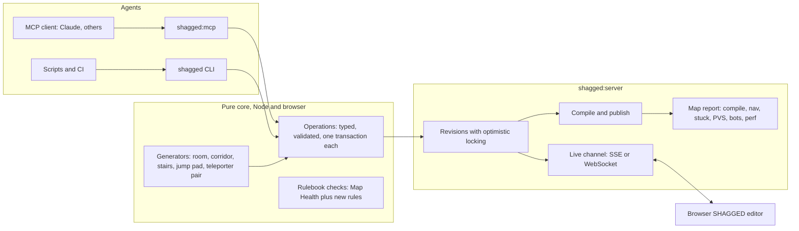

# SHAGGED API — letting AI agents build maps

**Status:** research, 2026-10-10. No code changed. Sources: the SHAGGED editor source in `src/engine/editor/`, [SHAGGED.md](SHAGGED.md), the bot and audit CLIs, and public descriptions of Blender's AI integrations (linked at the end).

## Summary

Give SHAGGED a programmatic API so an AI agent can author, compile and test a map the way a human does in the editor: through typed operations on the same map document, with automatic checks after each step. Blender's AI integrations expose the modelling program to agents; ours would expose a level editor *and* the game that plays the result.

This is more feasible than it sounds, because most of the hard parts already exist and are already headless:

- the editor's map document is pure TypeScript — validated, undoable transactions in Quake coordinates, with no DOM or Babylon dependency;
- `.map` export is deterministic, and a Node server already saves revisions, runs MakeBSP/MakeLight and publishes playable builds;
- the game can already judge a compiled map without a browser: BSP inspection, bot navigation graphs, stuck-geometry and PVS audits, bot matches, demo recording and timedemo benchmarks.

What is missing is a thin layer: a stable set of operations over the document, a CLI and an MCP server that expose them, a written rulebook for good Washoi maps, and a single "map report" that turns the existing checks into feedback an agent can act on. A first useful version — an agent builds a sealed multi-room map that compiles and whose spawns and items are reachable — is a small project.

The differentiator is not "AI makes a map". It is a **closed loop**: the agent can build, compile, walk with bots, measure performance and fix what it finds, without a human in the loop for every iteration, while a human can watch the same document live in the editor and take over at any point.

## What Blender's AI integrations teach us

The best-known example, blender-mcp, has two parts: an add-on inside Blender that opens a local socket, and an MCP server that the AI client talks to. Its tools fall into two styles:

- **Scene introspection first.** `get_scene_info` returns the scene as JSON. Agent guides tell the model to call it before changing anything.
- **An escape hatch.** `execute_blender_code` runs arbitrary Python with full `bpy` access. It is powerful and dangerous (it can delete the scene), and several alternative servers deliberately replace it with many small typed tools.

Two limitations matter for us. The add-on needs a running, interactive Blender: it does not start in background mode. And Blender has no notion of "is this model good": the agent has to look at renders.

SHAG can avoid all three problems:

| Blender pattern | SHAGGED equivalent |
| --- | --- |
| Live add-on socket into the GUI | Optional live bridge into the browser editor. The core API does not need the GUI at all. |
| `execute_blender_code` escape hatch | **No code execution.** Typed operations on a validated document. Every change passes `validateDocument`, so an agent cannot produce a document the exporter rejects. |
| Judge quality by renders only | Machine checks: compile/leak, Map Health, reachability, stuck spots, bot play, performance. Renders are an addition, not the only signal. |

## What already exists

Verified in source on 2026-10-10.

| Piece | Where | Why it matters for an API |
| --- | --- | --- |
| Map document | `EditorDocument.ts` | Plain JSON (`schemaVersion: 2`): box brushes with per-face materials, `patchDef2` patches, point entities, brush entities owning brushes by ID. `transact()` validates every change and keeps 100 undo steps. Stable IDs throughout. No DOM or Babylon imports. |
| Deterministic export | `MapWriter.ts` (`writeMap`) | The same document always produces the same `.map` bytes. Diffs and caching are reliable. |
| Shape helpers | `RoomTemplate.ts`, `EditorBoxTools.ts`, `PatchPresets.ts` (bevel, arch), `PatchGeometry.ts`, `FaceUv.ts` | Pure functions an API can wrap: a sealed lit room, box resizing, curved presets, natural texture alignment. |
| Catalogues | `EntityCatalog.ts` (56 point classes and 9 brush classes from `entities.def`, with documented keys and required-key markers), `TextureCatalog.ts` (search, folders, tags) | An agent can discover legal classnames, keys and textures instead of guessing. |
| Map Health | `MapHealth.ts` (`inspectMapHealth`) | Pure diagnostics with stable object IDs: missing spawns, missing required keys, broken target links, duplicate targetnames, unknown classes, unknown shaders, missing shader images. |
| Editor server | `server/ShaggedHttpServer.ts`, `MapStore.ts`, `CompileJobs.ts`, `PublishedBuild.ts`; `npm run shagged:server` | Loopback HTTP: list/load/save revisions with optimistic locking (`expectedRevision`, HTTP 409 on conflict), compile jobs (`fast`/`default`/`release`), logs, playable publication. Only fixed recipes, never caller-chosen executables or paths. |
| Compile CLI | `npm run shagged:compile -- <map>` | Headless compile of a saved revision through the same job runner. |
| BSP inspection | `npm run cli:bsp` (`info`, `entities`, `textures`, `effects`, `build`) | Confirms what MakeBSP actually produced. |
| Reachability | `src/bot/BotNavGraph.ts` | Builds a waypoint graph from the compiled BSP (spawns, items, floor sampling) with walk/jump/fall/jump-pad/teleporter edges and A* paths. It can answer "can every spawn reach every item?". |
| Geometry audits | `npm run audit:stuck`, `npm run audit:pvs` | Find places a player hull gets stuck, and how well the map's visibility data culls. |
| Play and measure | `npm run bot:server`, `demo:record`, `timedemo` | Bots can play the map. A recording can become a benchmark fixture (`benchmark:fixture -- --demo <file>`), and the timedemo reports frame time. |
| Live editor | `BrowserEditorHost.ts`, `EditorSession.ts`, `editor open/close/status/return` | Humans already edit in four views; Playtest launches the compiled map and returns to the editor. |

Gaps:

- **No operation layer.** Edits happen inside `EditorSession` (3,064 lines of UI and gesture code) or by direct `transact` callbacks. There is no named, typed list of operations an outside caller can invoke.
- **No CLI or agent entry point** for document edits; the CLIs start at "compile a saved map".
- **No live channel** between the server and an open editor. The browser saves through HTTP and polls compile jobs; it does not receive changes made elsewhere.
- **No mapping rulebook** an agent can read, and no combined report of the existing checks.
- **Geometry is axis-aligned boxes plus patches.** There are no arbitrary convex brushes or CSG yet ([SHAGGED.md](SHAGGED.md) feature matrix), so agent-built maps will look blocky until patches and the planned Block Builder kit are used.

## Proposed design

Three layers, one source of truth: the same `EditorDocumentData` the human editor uses.



### Layer 1: an operation library (pure core)

Extract a named operation set from what `EditorSession` does today, as pure functions over the document:

```ts
type Op =
  | { op: "box.create"; min: Vec3q; max: Vec3q; shader: string }
  | { op: "box.update"; id: string; min?: Vec3q; max?: Vec3q; shader?: string }
  | { op: "face.material"; id: string; faces: FaceKey[]; shader: string; align?: "natural" | Partial<FaceMaterial> }
  | { op: "entity.place"; classname: string; origin: Vec3q; keys?: Record<string, string> }
  | { op: "brushEntity.assign"; classname: string; brushIds: string[]; keys?: Record<string, string> }
  | { op: "patch.preset"; kind: "bevel" | "arch" | "flat"; /* sweep */ }
  | { op: "object.move" | "object.duplicate" | "object.delete"; ids: string[]; delta?: Vec3q }
  | { op: "gen.room" | "gen.corridor" | "gen.stairs" | "gen.jumppad" | "gen.teleporterPair"; /* parameters */ };

function apply(doc: EditorDocumentData, ops: Op[]): { doc: EditorDocumentData; created: string[]; issues: MapHealthIssue[] };
```

Design rules:

- **A batch is one transaction.** A list of operations either applies completely or not at all, through the existing `transact` and `validateDocument`. One undo step per batch, so a human can undo an agent's whole step.
- **Dry run and diff.** Every call can run with `dryRun: true` and return what would change (created/changed/deleted IDs, bounding boxes, new issues) without saving.
- **Optimistic locking.** Writes carry `expectedRevision`, as the server already requires. A human editing the same map in the browser and an agent can never silently overwrite each other.
- **Actionable errors.** Validation errors name the object, the field and the rule ("brush b12: x min 128 is not less than max 64"), never a stack trace.
- **Stable units.** Quake units, Z up, documented once in every tool description. Never Babylon coordinates.
- **Generators expand to ordinary objects.** A "room" becomes six brushes plus a light; a "teleporter pair" becomes a trigger brush entity, a `misc_teleporter_dest` and matching `target`/`targetname` keys. The document never contains hidden macro state, so a human can edit the result freely. (The [Block Builder](SHAGGED.md) proposal uses the same rule.)

### Layer 2: entry points

- **CLI** (`npm run shagged -- <command>`): `new`, `info`, `query`, `apply <ops.json>` (JSON or JSON Lines, with `--dry-run`), `health`, `compile`, `report`, `export`. Useful for scripts, tests and CI, and for agents that work through a shell.
- **MCP server** (`npm run shagged:mcp`, stdio): the same operations as typed tools, plus read-only resources — the rulebook, entity catalogue, texture catalogue and the current map summary. MCP is the protocol most AI clients already speak, and Blender's experience shows typed tools are safer than a code-eval tool. It talks to `shagged:server` over loopback, so the server stays the single writer of map files.
- **Live bridge** (later): `shagged:server` pushes document revisions to an open editor (Server-Sent Events are enough), so a human watches the agent build in four views, can undo its last batch, or keeps editing. The editor's existing revision check prevents lost updates.

### Layer 3: the map report (the feedback loop)

One command, `report`, runs the checks that already exist and returns a structured result an agent can act on:

| Check | Existing tool | Example finding |
| --- | --- | --- |
| Document rules | `validateDocument`, `inspectMapHealth`, new rulebook checks | "entity e7 trigger_teleport: target `arena2` has no destination" |
| Compiles, sealed | `CompileJobs` (MakeBSP `-leaktest`) | "leak: compile log points near (512, 128, 64)" |
| What was built | `cli:bsp info/entities` | brush and face counts, entities that survived compilation |
| Reachable | `BotNavGraph` | "item i3 (weapon_rocketlauncher) is unreachable from 2 of 4 spawns" |
| No traps | `audit:stuck` | "player hull stuck at (300, 40, 18)" |
| Visibility | `audit:pvs` | "PVS culls only 12%: the map is one open space" |
| Plays | `bot:server` + `demo:record` | bot deaths and pickups per minute, unused areas |
| Performance | `timedemo` on the recorded demo | median and p95 frame time against a budget |

Every finding carries coordinates or object IDs, so the agent can fix the exact object. Bot play and timedemo are slower (minutes, not seconds) and should be opt-in levels of the report.

## The mapping rulebook

An agent needs written rules, and the rules that can be checked should be checked. A first rulebook, from SHAG's own constants and SHAGGED's verified conventions:

**Units and the player** (from `src/shared/server/simulation/physics/constants.ts`):

- The player box is 30 × 30 units wide and 64 tall (32 crouched). Corridors at least 64 wide and 96 high leave comfortable room; 128 is a fight-able hallway.
- A step is at most 18 units; taller ledges need a jump. A standing jump rises about 45 units (jump velocity 270, gravity 800), so a 32-unit ledge is a hop and anything over about 44 needs stairs, a jump pad or a teleporter.
- Normal run speed is 320 units per second; at that pace a 1,024-unit room takes about three seconds to cross.

**Geometry and compile** (from [SHAGGED.md](SHAGGED.md)):

- Build on the grid (8 or 16 units); brushes must not overlap in volume.
- The playable space must be **sealed**: no gap from inside to the void, or MakeBSP's leak test fails.
- Caulk first: give hidden faces `common/caulk`, then texture visible faces.
- Shader names are written without the `textures/` prefix ("blx/blx_dark"); MakeBSP adds it.
- Triggers use `common/trigger`. Brush entities never set `origin` or `model`.

**Gameplay:**

- At least one `info_player_deathmatch`; for FFA, spread several apart with no direct line of sight between them.
- Every spawn should reach every weapon and every important item (checked by the nav graph).
- Teleporters and jump pads need a matching destination (`target` ↔ `targetname`).
- Give every room a light entity; an unlit compiled room is black.

**Performance** (from today's [WebGPU research](v0.9.27-webgpu.md)):

- Frame time is CPU-bound and grows with draw calls. Prefer fewer, larger brushes; avoid many small detail brushes in sight at once.
- Design so the PVS can cull: rooms joined by bends or doorways, not one big open field.

The rulebook should live in the repository as a document the MCP server serves as a resource, with each checkable rule mapped to a report code so the agent sees "rule R4 failed" together with the rule's text.

## Phased plan

| Phase | Deliverable | Acceptance |
| --- | --- | --- |
| **P0: core and CLI** | Operation library extracted from `EditorSession` behaviour; `shagged` CLI with `new`, `apply`, `info`, `health`, `compile`; three generators (room, corridor, teleporter pair). | A script builds two rooms joined by a corridor with spawns, a light per room and a weapon; it compiles with no leak; `cli:bsp` shows the entities; applying the same script twice gives identical `.map` bytes. |
| **P1: MCP and report** | `shagged:mcp` with typed tools and rulebook resources; `report` combining health, compile, BSP, nav reachability and stuck audit. | An AI client, given only a short brief ("small three-room FFA map"), produces a map that passes the report without human edits. Record the transcript and iterations. |
| **P2: live bridge** | Server pushes revisions to the open editor; editor shows agent changes and allows undoing a whole agent batch. | A human and an agent edit the same map; neither loses an edit; the human undoes an agent step from the editor. |
| **P3: play and polish** | Bot playtest and timedemo levels of the report; top-down plan images and editor screenshots for the agent to look at; more generators (stairs, arenas, Block Builder kit pieces). | An agent improves a map between iterations using bot and performance findings (for example, fixes an unreachable item, reduces p95 frame time). |

P0 is mostly moving existing logic behind names: the document, validation, writer, health check and compile path are done.

## Risks and open questions

- **Quality.** Agents are good at following rules and bad at taste. Expect valid but dull maps at first; the rulebook, generators and bot feedback have to carry the design quality. Human review stays essential.
- **Geometry limits.** Only axis-aligned boxes and patches exist. Interesting architecture needs patches, prefab kits, and eventually convex brushes/CSG, which is a separate, larger project.
- **Visual judgement.** Rendering editor screenshots needs a browser (headless Edge already works for renderer QA). A cheaper first step is a 2D top-down plan image drawn from the document in Node.
- **Compile toolchain.** MakeBSP/MakeLight binaries are local Windows files today; Linux builds were never run. CI or remote agents need them.
- **Safety.** Keep the current server rules: loopback only, configured origins, names validated as identifiers, no caller-chosen paths or executables, no code execution. Add per-batch limits (objects per batch, total brushes) so a runaway agent cannot fill the disk or lock the compiler.
- **Concurrency.** Optimistic locking already exists; the live bridge must surface conflicts clearly rather than merging silently.
- **Licensing of maps.** Decide who owns and how to credit agent-made maps before publishing any to the public map pool.

## Verdict

Feasible, and a genuine differentiator: few engines combine an in-engine level editor, a headless compiler pipeline and bots that can playtest the result. Start with P0: it proves the idea with mostly existing code, and every later phase builds on the same operation set.

## Sources

- [blender-mcp README mirror](https://www.remoteopenclaw.com/mcp/jagathgj/BlenderMCP): add-on plus MCP server architecture.
- [blender-mcp server source (fork)](https://glama.ai/mcp/servers/@Nanashi1526/blender-mcp/blob/efc833c7e9bad7515fc1f8a4f844949b9901f978/src/blender_mcp/server.py): `get_scene_info` over the add-on socket.
- [Another fork's server source](https://glama.ai/mcp/servers/@Aryeon0228/BlenderMCP/blob/9ef060bfec2038359e31903c9c83e3536c42c2b0/blender_mcp_server.py): `execute_blender_code` and its warning.
- [Hermes agent Blender skill](https://tessl.io/registry/skills/github/NousResearch/hermes-agent/blender-mcp): inspect the scene first; the add-on does not start in background mode.
- [A typed-tools Blender MCP server](https://glama.ai/mcp/servers/@ShirshovDIM/retopoflow_blender_mcp/blob/78358fedc1d6d47808d380d331e176370b479c59/src/tools/scene.py): typed tools instead of a code-execution catch-all.

These are third-party listings and forks of the original `ahujasid/blender-mcp` project; tool sets differ between forks.
