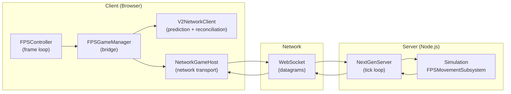
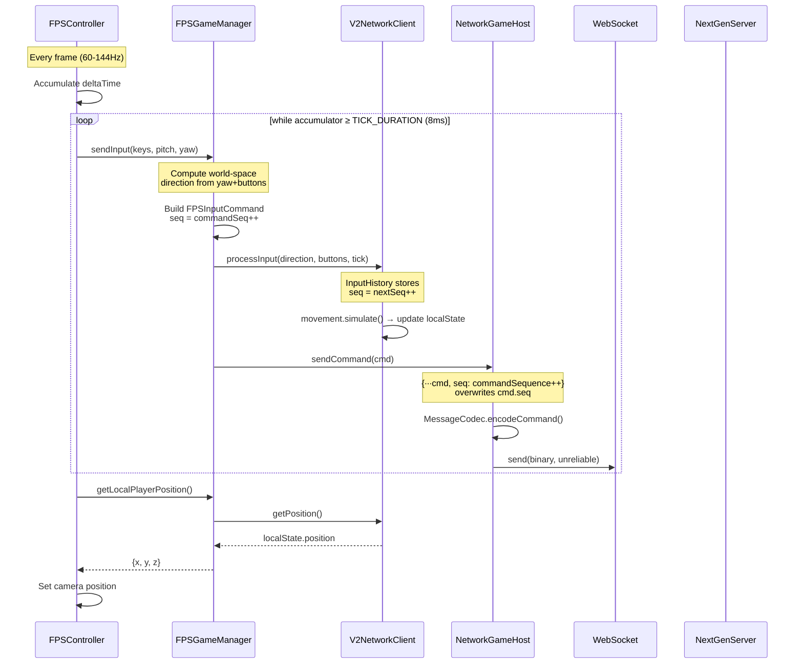
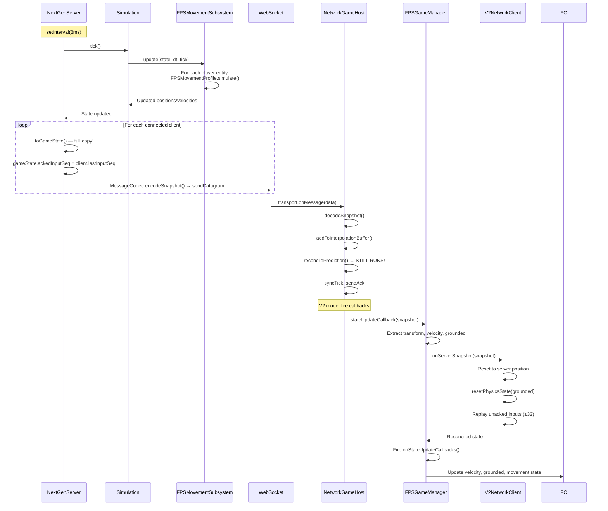
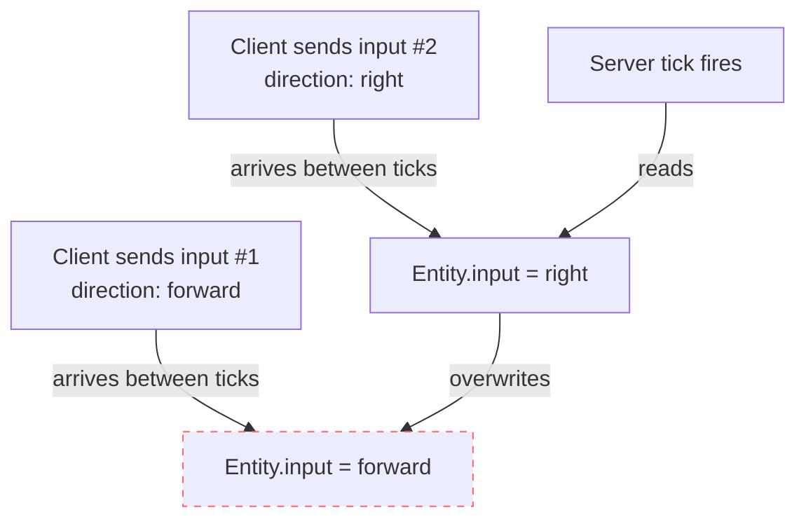
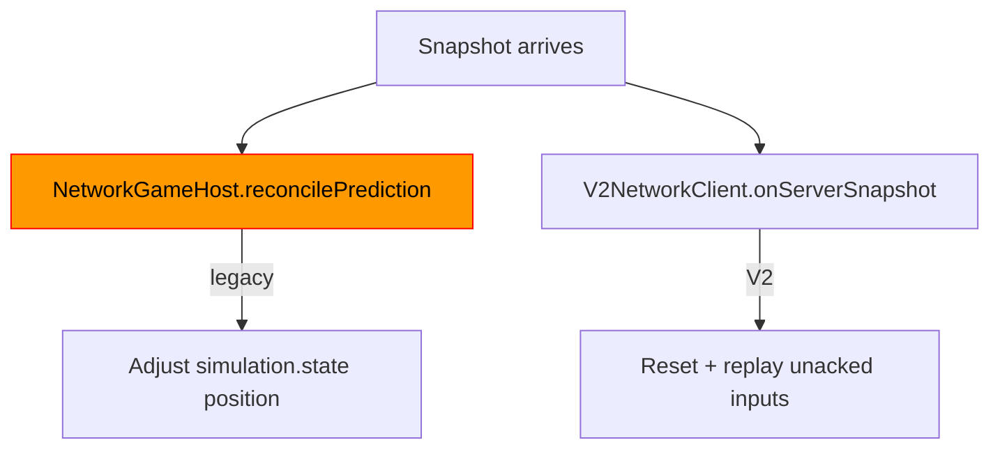
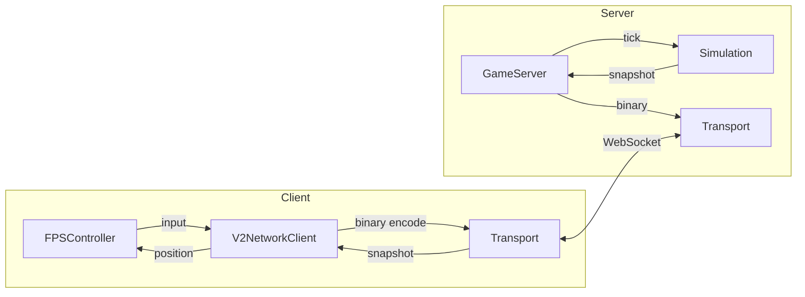

# V2.1 Networking Architecture — Deep Dive

Research document analyzing the current client-server networking pipeline, identifying issues, and proposing improvements.

---

## 1. System Overview



### Roles

| Component | Responsibility |
|-----------|---------------|
| **FPSController** | Input capture, camera, frame loop (requestAnimationFrame) |
| **FPSGameManager** | Bridge between controller and network layer, direction computation |
| **V2NetworkClient** | Client-side prediction, input history, reconciliation replay |
| **NetworkGameHost** | Network transport, message encode/decode, legacy prediction |
| **NextGenServer** | Server tick loop, input application, snapshot broadcast |
| **Simulation** | Subsystem orchestration, physics tick |
| **FPSMovementSubsystem** | Server physics via `FPSMovementProfile.simulate()` |

---

## 2. Client → Server Flow



### Execution Matrix — Client Input (per frame)

| # | Step | Rate | Component | Notes |
|---|------|------|-----------|-------|
| 1 | `requestAnimationFrame` fires | 60-144 Hz | FPSController | Variable framerate |
| 2 | `commandAccumulator += deltaTime` | — | FPSController | Fixed timestep accumulator |
| 3 | Cap accumulator at 100ms | — | FPSController | Prevents spiral, max ~12 inputs |
| 4 | **While** `accumulator ≥ 8ms`: | 125 Hz target | FPSController | Fixed tick loop within frame |
| 5 | Compute world-space direction | — | FPSGameManager | `cos(yaw)/sin(yaw)` + WASD buttons |
| 6 | Build `FPSInputCommand` with `commandSeq++` | — | FPSGameManager | Sequence for server |
| 7 | V2Client `processInput()` | — | V2NetworkClient | **LOCAL PREDICTION** |
| 7a | `InputHistory.add()` → `nextSeq++` | — | InputHistory | Independent seq counter! |
| 7b | `movement.simulate()` | — | FPSMovementProfile | Same physics as server |
| 7c | Update `localState` (position, velocity, grounded) | — | V2NetworkClient | Instant feedback |
| 8 | `gameHost.sendCommand(cmd)` | — | NetworkGameHost | **NETWORK SEND** |
| 8a | Overwrite `cmd.seq` with `commandSequence++` | — | NetworkGameHost | **Third** seq counter! |
| 8b | `MessageCodec.encodeCommand()` → binary | — | MessageCodec | JSON stringify + binary header |
| 8c | `transport.send(data, unreliable)` | — | WebSocket | UDP-like datagram |
| 9 | `accumulator -= TICK_DURATION` | — | FPSController | Consume one tick |
| 10 | Read V2Client position → set camera | Once/frame | FPSController | After tick loop |

> [!WARNING]
> **Three independent sequence counters exist** that must stay synchronized:
>
> 1. `FPSGameManager.commandSeq` — starts at **1**, incremented per `sendInput()`
> 2. `V2NetworkClient/InputHistory.nextSeq` — starts at **1**, incremented per `processInput()`
> 3. `NetworkGameHost.commandSequence` — starts at **0**, incremented per `sendCommand()`
>
> **The off-by-one** between #2 (starts at 1) and #3 (starts at 0) means the server always reports `ackedInputSeq` that is 1 less than the V2NetworkClient's internal seq. This causes **one extra input** to be replayed during every reconciliation.

---

## 3. Server → Client Flow



### Execution Matrix — Server Tick

| # | Step | Rate | Component | Notes |
|---|------|------|-----------|-------|
| 1 | `setInterval(8ms)` fires | ~125 Hz | NextGenServer | **Not drift-compensated** |
| 2 | `simulation.tick()` | — | Simulation | Increments tick, runs subsystems |
| 3 | `FPSMovementSubsystem.update()` | — | FPSMovementSubsystem | Priority 10, tickRate 125 |
| 3a | For each player: `getProfile(entityId)` | — | FPSMovementSubsystem | Per-entity movement profile |
| 3b | `adaptInput()` → `MovementInput` | — | FPSMovementSubsystem | Convert server entity input |
| 3c | `profile.simulate(pos, vel, input, dt, collision)` | — | FPSMovementProfile | **Shared physics code** |
| 3d | Apply result → entity transform/physics | — | FPSMovementSubsystem | Position, velocity, grounded |
| 4 | `broadcastSnapshot()` | — | NextGenServer | **Per-client snapshots** |
| 4a | `toGameState()` — **O(N) copies per tick** | — | NextGenServer | Creates full GameState per client |
| 4b | Set `ackedInputSeq = client.lastInputSeq` | — | NextGenServer | From last decoded input |
| 4c | `MessageCodec.encodeSnapshot()` → binary | — | MessageCodec | Binary protocol + JSON |
| 4d | `sendDatagram(bytes)` | — | WebSocket | Per-client send |

> [!IMPORTANT]
> **Input processing is NOT synchronized with tick()!** Inputs arrive asynchronously via `handleDatagram()` and are written directly to entity state. The tick loop then reads whatever input was last written. Multiple inputs arriving between ticks? **Only the last one is used.** Inputs arriving during a tick? **Race condition.**

---

## 4. Architectural Issues Found

### Issue 1: Input Overwrite — Last-Writer-Wins



**Problem**: The server doesn't queue inputs — it applies each input to the entity's `input` component directly. If two inputs arrive between server ticks, only the last one is simulated. But the **client predicted both inputs** so they diverge.

**Impact**: Mild jitter. At 125Hz server tick with typical 50ms RTT, usually only 1 input arrives per tick interval. But under burst conditions (client catches up after a frame drop), multiple inputs arrive and get lost.

**Fix**: Queue inputs per-entity and process all queued inputs during each tick.

---

### Issue 2: Dual Reconciliation



**Problem**: When V2 mode is active, `NetworkGameHost.reconcilePrediction()` still runs on every snapshot. It compares the legacy `simulation.state` (which is stale in V2 mode since `predictLocally()` is skipped) against server state. This means it's always finding a "prediction error" and applying corrections to a state nobody reads.

**Impact**: Wasted CPU, confusing debug logs, and potential for subtle state corruption if the legacy reconciliation modifies entities that V2NetworkClient also references.

**Fix**: Skip `reconcilePrediction()` entirely when `useExternalPrediction` is true.

---

### Issue 3: Snapshot-Driven State Updates (Not Frame-Synchronized) ⚠️

**This is likely the PRIMARY cause of visual jitter.**

```
Frame 1: [predict input #10] → camera position at P10
Frame 2: [predict input #11] → camera position at P11
Frame 3: [predict input #12] + [SNAPSHOT arrives, reconcile] 
          → camera position snaps to S8 + replay #9,#10,#11,#12 → P12'
Frame 4: [predict input #13] → camera position at P13'
```

The `onStateUpdate` callback fires **asynchronously** when a snapshot arrives from the server, during step `handleSnapshot()` inside `transport.onMessage()`. This means:

1. Reconciliation can happen **mid-frame** (between input processing and camera update)
2. Camera position jumps discontinuously when reconciliation produces a slightly different result  
3. The number of frames between snapshots is **variable** (depends on server tick rate vs client framerate vs network jitter)

**Impact**: Visual jitter on every snapshot. Even if the reconciled position matches perfectly, the **grounded state** and **velocity** snap to server values, then get replayed, potentially producing micro-differences that show as position hitches.

**Fix**: Decouple snapshot processing from rendering. Buffer snapshots and apply them at a deterministic point in the frame loop (before input processing, or after).

---

### Issue 4: Server `setInterval` Tick Drift

```javascript
const tickMs = 1000 / this.config.tickRate; // 8ms
this.tickInterval = setInterval(() => { this.tick(); }, tickMs);
```

`setInterval` does NOT compensate for execution time or scheduling jitter. Over time:

- Ticks drift from real time (Node.js `setInterval` resolution is ~1ms on average, can spike to 15ms)
- `dt` is always `tickSec` (fixed 0.008s) regardless of actual elapsed time
- Server "skips" ticks when under load but doesn't catch up

**Impact**: Server time drifts from client time, causing more snapshots to pile up or gaps to appear. Not a direct jitter cause but contributes to inconsistency.

**Fix**: Use `setImmediate` + high-resolution timer for compensated tick loop.

---

### Issue 5: Three Sequence Number Counters

| Counter | Start | Location |
|---------|-------|----------|
| `FPSGameManager.commandSeq` | 1 | Created but overwritten by NetworkGameHost |
| `InputHistory.nextSeq` | 1 | V2NetworkClient's internal tracking |
| `NetworkGameHost.commandSequence` | **0** | Actually sent to server |

The server receives `NetworkGameHost.commandSequence` (starts at 0), but V2NetworkClient's InputHistory starts at 1. This creates a permanent **off-by-one** that means:

- The very first input is always treated as "never acknowledged" until the second input arrives
- Every reconciliation replays **one extra input** unnecessarily

**Fix**: Unify to a single sequence counter, or align starting values.

---

### Issue 6: `toGameState()` Called Per-Client Per-Tick

```javascript
for (const client of this.clients.values()) {
    const gameState = this.toGameState(); // FULL COPY every time
    gameState.ackedInputSeq = client.lastInputSeq;
    const snapshotBytes = MessageCodec.encodeSnapshot(gameState);
    client.connection.sendDatagram(snapshotBytes);
}
```

Every tick, `toGameState()` iterates all entities, creates component objects, and builds a full `GameState` — once per connected client.

**Impact**: O(N×E) per tick where N=clients, E=entities. With 16 players, that's 16 full state copies per tick at 125Hz = 2000 copies/second.

**Fix**: Build `GameState` once per tick, clone or just set `ackedInputSeq` per client.

---

## 5. Feature / Execution Matrix

| Feature | Client | Server | Shared | Status | Notes |
|---------|--------|--------|--------|--------|-------|
| Physics simulation | `FPSMovementProfile.simulate()` | `FPSMovementProfile.simulate()` | ✅ `SharedCollisionWorld` | ✅ | Unified after refactor |
| Input capture | `FPSController.update()` | — | — | ⚠️ | 125Hz accumulator, 100ms cap |
| Direction computation | `FPSGameManager.sendInput()` | — | — | ⚠️ | Duplicates yaw→direction on both sides |
| Input transmission | `NetworkGameHost.sendCommand()` | `handleDatagram()` | `MessageCodec` | ⚠️ | No input queuing on server |
| Client prediction | `V2NetworkClient.processInput()` | — | — | ✅ | Same physics as server |
| Server reconciliation | `V2NetworkClient.onServerSnapshot()` | — | — | ⚠️ | Async, not frame-synchronized |
| Snapshot broadcast | — | `broadcastSnapshot()` | `MessageCodec` | ⚠️ | Per-client toGameState() |
| Interpolation buffer | `InterpolationBuffer` | — | — | 🔴 Not used | V2 mode bypasses interpolation |
| Smooth correction | `SmoothCorrection` | — | — | 🔴 Not used | V2 mode bypasses smoothing |
| Sequence tracking | 3 separate counters | `client.lastInputSeq` | — | ⚠️ | Off-by-one, over-complicated |
| Legacy reconciliation | `NetworkGameHost.reconcilePrediction()` | — | — | 🔴 Dead code | Still runs in V2 mode |

---

## 6. Proposed Architectural Improvements

### Priority 1: Fix Jitter (Quick Wins)

1. **Queue server inputs** — Store incoming inputs in a per-entity array, process all during tick
2. **Skip legacy reconciliation** in V2 mode — `if (useExternalPrediction) return` in `reconcilePrediction()`
3. **Fix sequence off-by-one** — Start `NetworkGameHost.commandSequence` at 1

### Priority 2: Clean Architecture

1. **Single snapshot per tick** — Build `GameState` once, set `ackedInputSeq` per-client before encoding
2. **Frame-synchronized reconciliation** — Buffer snapshots, process at deterministic point in frame loop
3. **Compensated server tick loop** — Replace `setInterval` with high-res timer

### Priority 3: Simplification

1. **Remove dual prediction paths** — V2NetworkClient should own ALL prediction; strip legacy prediction from NetworkGameHost
2. **Unify sequence counters** — Single counter passed through the entire pipeline
3. **Direct transport** — V2NetworkClient should handle its own encoding/transport instead of routing through NetworkGameHost

### Target Architecture



This removes:

- FPSGameManager as a middleman (fold into V2NetworkClient or make it purely UI-facing)
- NetworkGameHost entirely (V2NetworkClient handles transport)
- Dual reconciliation
- Triple sequence counters
- Per-client toGameState() copies

---

## 7. Files Reference

| File | Lines | Role |
|------|-------|------|
| [FPSController.ts](file:///c:/Users/sundf/Desktop/wash/shag/src/engine/camera/controllers/FPSController.ts) | 1227 | Input capture, camera, frame loop |
| [FPSGameManager.ts](file:///c:/Users/sundf/Desktop/wash/shag/src/games/fps/FPSGameManager.ts) | 668 | Bridge between controller and network |
| [V2NetworkClient.ts](file:///c:/Users/sundf/Desktop/wash/shag/src/games/fps/client/V2NetworkClient.ts) | 323 | Prediction + reconciliation |
| [InputHistory.ts](file:///c:/Users/sundf/Desktop/wash/shag/src/games/fps/client/InputHistory.ts) | 110 | Input storage for replay |
| [NetworkGameHost.ts](file:///c:/Users/sundf/Desktop/wash/shag/src/engine/network/client/hosts/NetworkGameHost.ts) | 815 | Transport + legacy prediction |
| [headless-netserver-v2.ts](file:///c:/Users/sundf/Desktop/wash/shag/src/cli/headless-netserver-v2.ts) | 808 | Server entry point + tick loop |
| [Simulation.ts](file:///c:/Users/sundf/Desktop/wash/shag/src/engine/server/core/Simulation.ts) | 200 | Server simulation orchestration |
| [FPSMovementSubsystem.ts](file:///c:/Users/sundf/Desktop/wash/shag/src/games/fps/server/systems/FPSMovementSubsystem.ts) | 145 | Server physics |
| [FPSSimulation.ts](file:///c:/Users/sundf/Desktop/wash/shag/src/games/fps/simulation/FPSSimulation.ts) | 213 | Client simulation (legacy) |
| [MovementSystem.ts](file:///c:/Users/sundf/Desktop/wash/shag/src/engine/network/systems/MovementSystem.ts) | 117 | Client physics system (legacy) |
| [MessageCodec.ts](file:///c:/Users/sundf/Desktop/wash/shag/src/engine/network/protocol/MessageCodec.ts) | 181 | Message encoding/decoding |
| [BinaryProtocol.ts](file:///c:/Users/sundf/Desktop/wash/shag/src/engine/network/protocol/BinaryProtocol.ts) | 601 | Binary wire format |
| [SharedCollisionWorld.ts](file:///c:/Users/sundf/Desktop/wash/shag/src/shared/collision/SharedCollisionWorld.ts) | ~140 | Unified collision (new) |
