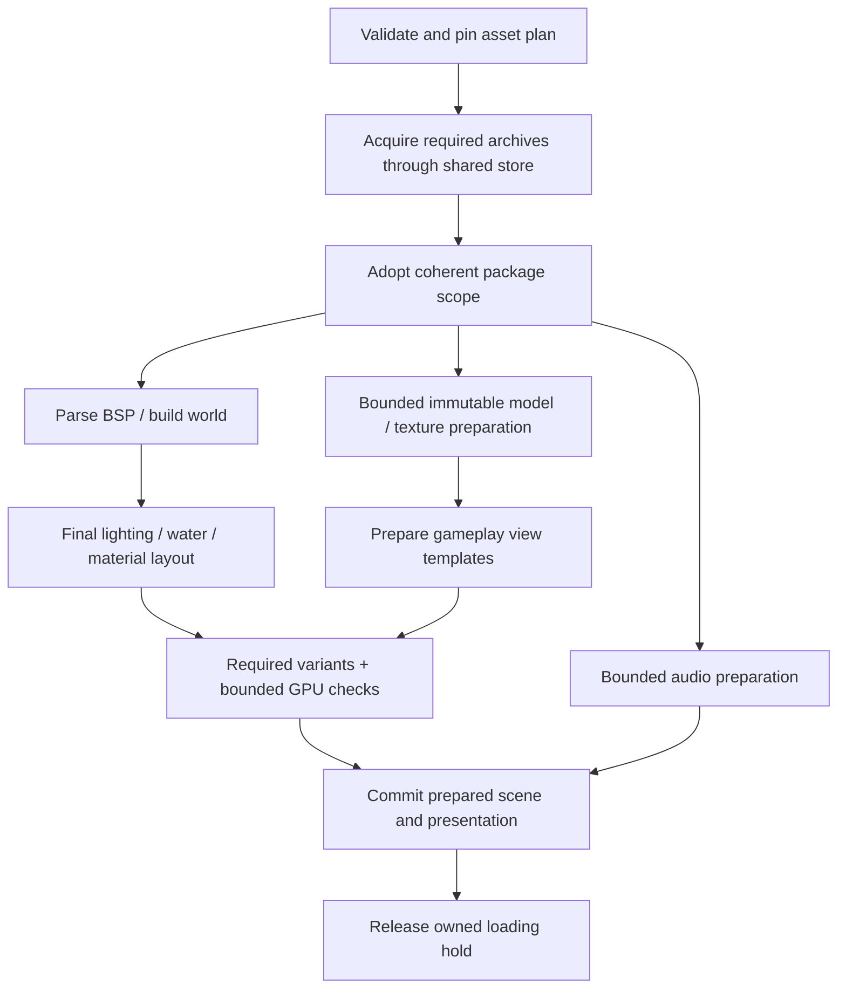

# Startup reliability and critical-path investigation — 2026-10-25

Implementation follow-up: [changes and validation](asset-loading-implementation-2026-10-25.md).

This is a second investigation route, following the
[full loading audit](asset-startup-review-2026-10-25.md). Its question is broader:
which work should startup do, which work should it avoid repeating, and which
independent work can safely overlap?

No runtime changes were made. Recommendations below are proposed repairs and
experiments, not implemented behavior or promised speedups.

## Additional observation

The user reported Opera GX hanging at **“Warming up effect shaders”** while
joining `washoi_dm11`. The screenshot shows package, geometry, texture,
lighting, collision and pickup-model stages preceding that label. It does not
show an error, a duration, browser build, selected renderer or GPU information.

MapLoader emits that label before calling `preloadEffectShaders`. It covers
fixture compiles, whole-scene material compiles, rendered-frame waits and light
retirement. Several are unbounded, as described in the first audit. Therefore
this is evidence of another affected browser/session, not proof of a particular
Opera bug or a particular stalled await. Do not infer that the screenshot used
WebGL2 merely from the browser name.

## Measurements: DM11 has a large CPU bottleneck too

An isolated headless Edge/WebGL2 probe loaded DM11 through `loadClientMap`, then
prepared the held weapons and projectiles through `preloadFPSWeapons`. It
repeated the same operation in the same page, disposing/rebuilding scene assets.
There was no lobby match or live server in this fixture, and FPS audio was not
part of the timed postload. The private Vite server had HMR/watch disabled.

| Work | First load | Repeated load |
| --- | ---: | ---: |
| Map load through ClientMapLoader | 16.92 s | 33.55 s |
| Map plus held-weapon/projectile preparation | 19.96 s | 37.04 s |
| BSP mesh build | 0.52 s | 0.55 s |
| Texture application | 2.77 s | 2.73 s |
| Pickup-model preloading | 0.88 s | 2.48 s |
| Effect-warmup progress interval | 1.04 s | 0.70 s |
| GPU-ready progress interval | 0.46 s | 15.06 s |
| Entity creation | 1.87 s | 2.90 s |
| Held-weapon preparation | 2.55 s | 2.98 s |
| Projectile preparation | 0.38 s | 0.36 s |
| Largest observed main-thread long task | 6.81 s | 7.55 s |

Rows are individual method durations or progress intervals, **not additive
components** of the totals. They include asynchronous waiting; they are not all
CPU time. The first/repeated labels do not establish cold HTTP versus persistent
cache behavior. Boot/lobby preparation can already have acquired common files.
These are diagnostic local dev-server runs, not production benchmarks or medians.

The repeated load logged the existing **15-second scene-readiness timeout** and
named `bsp_tex_6`, `bsp_tex_28` and `bsp_tex_56`. It proceeded after the timeout.
WebGL program-object warnings were also captured. The reason these meshes stayed
unready has not been isolated; it must be investigated, not hidden by reducing
the timeout. A cached archive does not make a rebuilt scene reliably faster.

A separate sampled CPU profile narrowed the large lighting interval:

```text
MapLoader.claimLiquidSurfaces             5.576 s elapsed
  LiquidSurfaceSystem.claim
    WaterSurfaceLighting.prepare         about 5.55 s inclusive CPU samples
      Ray.intersectsMesh
        triangle intersection / vector arithmetic
```

That profile's lightmap-application call took only about 14 ms. The broad
“Lighting” label conceals expensive water-light visibility preparation after
lightmap setup. The profile completed its map load without unready meshes at
the final diagnostic snapshot. Separate runs vary; this does not retract the
repeated-load failure above.

### Why water preparation is expensive

`src/engine/rendering/water/WaterSurfaceLighting.ts:93` computes static masks
synchronously. It supports up to four lit patches, 16×16 samples per mask and
four nearest lights: up to **4,096 candidate rays**, before containment, range
and facing tests reduce the actual count. Each visibility test searches blocker
meshes with `ray.intersectsMesh(mesh, true)`. Large texture-group meshes can
cover much of the map; broad mesh bounds alone do not make their triangle tests
cheap. An unoccluded ray can require substantial work.

This happens on every new water-system/map claim, on the browser's main thread.
Promises around it would not make that CPU work concurrent. It can freeze the
loading UI, delay socket callbacks and prevent timeout/visibility handlers from
running promptly.

Recommended experiments, in order:

1. Preserve the algorithm but process small batches with real event-loop yields,
   a cancellation check and a frame-time budget. This improves responsiveness,
   not necessarily total time. Microtask-only yields are insufficient.
2. Add spatial acceleration for static blocker triangles or a worker using a
   transferable immutable geometry snapshot. Build the acceleration once and
   share it across masks. Keep Babylon scene objects and GPU uploads on their
   owning thread.
3. Consider packaging precomputed masks with map media. Key them by geometry,
   authored light inputs, sampling/configuration and algorithm version; retain
   a runtime path for edited/custom maps. This moves repeated static work out of
   startup without changing the result.
4. Evaluate a cheaper mask resolution or quality tier only with visual comparison.
   Do not simply remove visibility and allow highlights through walls.

An existing BSP collision trace may be an acceleration option, but it is not a
drop-in equivalent to render-triangle visibility. Decorative geometry, alpha
surfaces and collision-only brushes differ. Verify occluder semantics first.

## Further reliability findings

### Hidden-tab recovery does not re-upload texture pixels

EffectPreloader calls `tex.updateSamplingMode(tex.samplingMode)` and describes
this as a forced upload. Installed Babylon 9.31.2 shows otherwise:

- `Materials/Textures/thinTexture.js` delegates to `updateTextureSamplingMode`.
- WebGL's `Engines/thinEngine.pure.js` changes min/mag filters, optional mipmaps,
  bindings and sampling metadata. It does not upload source pixels.
- WebGPU's implementation changes sampling metadata and optionally mipmaps.

A browser probe wrapped pixel-upload functions after creating a 1×1 raw texture;
calling the same sampler update caused **zero pixel-upload calls**. Thus the
recovery log/comment claims a stronger operation than it performs.

Proposal: treat visibility changes as scheduling changes first. Wait for
visibility and a bounded healthy frame/resource check. Treat actual context
loss/device loss as a separate lifecycle with the renderer's proper restoration
or controlled scene rebuild. Do not dirty every material or pretend to restore
pixels merely because the tab was hidden. Before removing recovery work, test
real context restoration and pending upload cases; the sampler result alone
does not prove every existing recovery step is unnecessary.

### A timeout around Babylon compilation does not cancel compilation

Installed `Material.forceCompilation` polls readiness using timers. Its promise
wrapper has no AbortSignal. Disposing the scene/material can leave an async
caller without a completion callback; racing a timeout does not stop that work.
Installed `Scene.whenReadyAsync` likewise registers an on-ready callback and
readiness polling; an outer timeout cleans up only the outer wait. A Babylon
readiness timeout/disposal clears callbacks without resolving that promise.

This reinforces the first audit's ownership requirement. Build cancellable
observation around actual resource/effect readiness where practical, retain
resources until their asynchronous users finish, and discard stale completions.
Do not launch unbounded compiles and then dispose all fixtures on the first
timeout/rejection. Do not clear Babylon's global observables to cancel one
operation: other consumers can own them.

### Parallel texture requests duplicate work today

PK3TextureLoader caches completed textures but has no per-key pending promise
for ordinary `loadTexture`. Two callers can pass the cache check together,
extract the same ZIP entry and construct two textures. TextureManager has a
similar completed-result pattern.

An isolated test issued two identical concurrent texture requests with controlled
extraction/creation. Both extracted and created independently and returned
different objects. Increasing material concurrency before fixing this can add
decompression, uploads and memory rather than shorten loading.

Proposal: a scene-owned pending cache keyed by resolved owner/content revision,
virtual path and reduction/format options. Remove failed entries for retry and
dispose stale results. Share immutable texture data carefully; retain independent
texture wrappers when a shader animates offsets, wrapping or other mutable state.

### Raw archive reuse still repeats entry extraction and model imports

`PK3Loader.getFile` invokes the ZIP entry's `async("arraybuffer")` on each read;
it does not retain a decoded entry buffer. The timed run read each of seven
pickup weapon GLBs again for held-weapon preparation; barrels also repeated.
Pickup caches and held-view ModelInstanceCache intentionally have different
scene/instance responsibilities. Do not merge live model hierarchies blindly.

Proposal: first share in-flight immutable entry extraction, then consider a
bounded byte cache keyed by package SHA/owner and path. Budget its uncompressed
bytes separately from compressed archive retention. A later scene-owned model
template cache can share parsing only where skeleton, animation, material and
attachment semantics match. The existing cache disposal guards are worth keeping.

## Where concurrency is safe, conditional, or unsafe

| Work | Recommendation | Required boundary |
| --- | --- | --- |
| Independent package acquisition | Queue required owners together through existing PackageStore | Keep its two-job limit initially; preserve SHA identity and foreground promotion. |
| Known map package + texture bank/common media | Start acquisition from a pinned plan before serial consumption | Acquisition may overlap; scope/override adoption must be stable before lookups. |
| Archive persistence | Best effort outside readiness | Bounded queue and retained bytes until write finishes; never block playing. |
| Audio preparation + map preparation | Candidate for overlap | Start after audio initialization/index availability and coherent package ownership; bound decode concurrency. |
| Independent diffuse/normal/gloss/emissive reads | Small bounded pool | Fix in-flight dedup and ownership first; keep candidate fallback order per asset. |
| BSP material jobs | Separate fetching/decoding from deterministic binding | Shader/plugin/lightmap/fog state must be complete before world becomes visible. |
| Pickup model imports | Already four at a time | Replace batch barriers with a bounded queue only after measurements; avoid upload bursts. |
| Held-weapon source loading | Can gain an independent preparation API | Do not parallelize calls to the current mutable `loadWeapon`. |
| Projectile source preparation + weapon source preparation | Candidate after stable scene/light/package setup | Existing prepare already parallelizes projectile models; enforce required outcomes. |
| Player animation clip imports | Candidate for bounded extraction/container imports | Preserve deterministic retargeting/commit and dispose partial containers. |
| Water mask/BSP preprocessing | Worker or time-sliced CPU work | Immutable snapshot, correct coordinate/occluder semantics and stale-result checks. |
| Shader warmup | Bounded scheduling for stable variants | Driver concurrency is not JS Promise concurrency; avoid temporary-light/define races. |
| Reflection capture | Keep GPU work scheduled and ordered | Needs final world lighting/materials; do not run captures against a partially built scene. |
| Map clear, ownership transfer, final commit | Keep one serialized owner | No old operation may clear or publish into the new scene. |

Existing concurrency matters: the archive store already allows two acquisitions;
pickup models use batches of four; FPS audio starts seven banks together and
each bank can decode paths together; projectile preparation already uses
Promise.all. Increasing all limits would multiply CPU/GPU/memory pressure.

The serial package loops in MapLoader do not fully use the existing store's
capacity. Start with bounded acquisition overlap, not a larger global limit.
Package mounting rebuilds filesystem lookup tables and increments revision;
shader loading observes that revision. Prefer gathering an acquisition result
set and then adopting a coherent mount/scope state before parsing/binding, rather
than repeatedly invalidating shader tables while consumers resolve assets.

Shader files are read/parsed sequentially and overwrite by deterministic order.
Extraction could overlap, but applying parse results must retain that order.
The measured shader-registry work was tens of milliseconds here, so it is a
lower priority than water, texture work and stalled readiness.

### Explicitly unsafe shortcut: Promise.all over loadWeapon

WeaponViewManager writes `_intendedWeaponId`, `currentWeaponDef`,
`currentWeapon` and `_loadGeneration`. Starting a newer load intentionally
supersedes an older one. `preloadWeapons` drives those same live-view operations
serially and compiles their resulting materials.

Refactor preparation into `source ready → instantiate/configure → compile →
commit view`. Only independent source preparation should overlap. Preserve the
generation checks for actual weapon switches. Similar reasoning applies to
global model loaders with mutable scene state.

## Proposed loading contract

Use one operation with identity, cancellation, cleanup and a typed terminal
result. The engine owns these generic mechanics; FPS supplies required media
and presentation policy. This should not reintroduce SHAG imports of game code.



The graph is a target design, not today's exact call order. Scene mutation still
needs scheduling. In particular, move readiness after the objects it promises
to cover: current final entities are created after the map's GPU gate, and demo
runtime effects/view models are wired after map completion. Either include their
required preparation before the barrier or require a game-owned postload barrier
in every entry path. Do not start gameplay entities' simulation/events early
merely to compile their models.

Define completion deliberately:

- **Required:** coherent world geometry/materials, gameplay collision/controller,
  current POV/held weapon, core player representation, essential combat effects
  and their resource readiness. Missing required media produces a clear retry or
  disconnect outcome, not success with holes or invisible weapons.
- **Optional:** explicitly classified decoration, extra presentation variants
  or enhancement captures may finish later using a valid fallback. Any deferred
  work has a budget, owner and cancellation path. Keep first-person ADS/LG and
  the currently displayed weapon out of this category.
- **Hidden:** transfer and safe CPU preparation may continue; GPU/final
  presentation work waits or polls within an explicit visibility-aware policy.
  A hidden pause must remain cancellable. Separate active-stage time from wall
  time, and retain a generous transfer total limit so slow downloads can finish.
- **Failed/cancelled/superseded:** releases only its own overlay and mute leases;
  no late scene mutation, controller switch, retry or progress from it may win.

Do not use “scene ready” as the only asset contract. It is global, includes
unrelated resources, and does not express which gameplay effect or model is
missing. Also do not shorten every timeout and proceed anyway; that exchanges a
stuck loader for missing gameplay presentation.

## Instrumentation before optimization

The Opera observation demonstrates why the current broad labels are inadequate.
Add operation-scoped substage timing and a compact diagnostic snapshot:

- elapsed stage/active-visible time, last progress and render heartbeat;
- pending archive cache/network/hash/ZIP tasks, owner, priority and consumer;
- pending extracted files, image/decode/import jobs and byte/memory estimates;
- named material/mesh variant, unmet textures, compilation error and backend;
- context/device state, tab visibility transitions and cancellation reason;
- required/optional outcome and the remaining readiness dependency.

Use developer logs/diagnostic export for detail. The player sees useful progress
or a clear recoverable failure; raw internal dependency lists need not dominate
the loading UI. Progress should come from completed work, not timers extending a
hold forever. Avoid global monkeypatches or hot-path GL queries in production.

## Implementation order and acceptance checks

| Order | Small change | Evidence needed before moving on |
| --- | --- | --- |
| 1 | Owned, bounded warmup/recovery and correct material/light cleanup | Never-resolving compile/frame, visibility changes, disposal, context loss and cancel all reach a safe terminal or explicit suspended state. |
| 2 | Fix optional storage blocking and cached SHA adoption | Hung/rejected cache operations do not prevent validated network load; warm reuse works. |
| 3 | Index-first texture resolution plus pending extraction/texture dedup | Indexed unmounted owner succeeds without loose probes; concurrent same-key requests share work; failure retries. |
| 4 | Remove the water-mask main-thread stall | Equivalent masks/visuals, measured long-task reduction, cancellation and repeated-map checks. |
| 5 | Unified live/demo required-media barrier and continuous POV reconstruction | Fresh/cached Watch and FFA show held weapons, ADS and beams; pause/seek/POV changes behave consistently. |
| 6 | Overlap acquisition, audio and independent source preparation | Repeated runs improve median/tail startup without more failures, memory growth or UI freezes. |
| 7 | Optional build-time preprocessing and wider worker use | Worthwhile measured benefit on slower machines; custom-map fallback and stale-data validation. |

The first audit's depth-capture binding defect also needs its separate small
renderer fix and regression run. It should not be obscured by a loading rewrite.

Collect stage distributions on DM2, DM5 and DM11; test cold profile, same-page
reload, new-page persistent cache, slow transfer, corrupt/missing data, storage
denial, CPU throttling, hidden/resumed tabs, actual context loss, cancel/retry,
rapid map replacement and demo cuts. Include Opera GX with its actual settings,
ordinary Chromium, Firefox and supported GPU backends. A single localhost timing
cannot set release performance claims or concurrency limits.

A proposed responsiveness target is sub-50-ms owned CPU batches, with smaller
budgets where needed to keep rendering/input healthy. This is an acceptance goal,
not a measured property of the current loader. Set overall startup targets only
after baselines on representative network/hardware are collected.

## Validation and limitations

Second-pass baseline after concurrent changes landed: outer `e8920ec8`, FPS
`8fd1a95`. The earlier report retains its original baseline. No runtime source
was edited, branch switched, production changed or assets regenerated.

Exact validation commands run this pass:

```powershell
npx.cmd vitest run src/engine/weapon/__tests__/EffectPreloader.test.ts src/engine/loader/pk3/__tests__/PackageStore.test.ts src/games/fps/client/__tests__/FPSWeaponPreloader.test.ts
npx.cmd vitest run --config .cache/startup-concurrency-review.vitest.config.ts
node .cache/startup-critical-path-probe.mjs
node .cache/startup-cpu-profile.mjs
node .cache/analyze-startup-profile.mjs
npm.cmd run docs:build
```

Results: **3 files / 19 existing tests passed**, **one duplicate-texture fault
reproduction passed**, two instrumented map/postload runs and one sampled CPU
profile completed, and **documentation build passed**. The fault test asserts
the defect, not a fix. Initial Vite/docs launches hit sandbox `spawn EPERM`;
authorized retries outside that process restriction succeeded.

Local ignored evidence: `.cache/startup-critical-path.json`,
`.cache/startup-cpu-profile.json`, `.cache/startup-dm11.cpuprofile`, and the
scripts/config/test named above. Probes used source-method wrappers; attempts
to wrap Babylon compilation through separately imported dependency modules did
not capture those calls, so no compile-count or unique-variant speed claim is
made. Resource transfer counters were not reliable in this fixture and were
not used for a cold-download conclusion. CPU sampling and wrappers add overhead.

The probes recorded no HTTP 4xx/5xx responses. Successful loading here does not
reproduce or rule out Opera GX's hang. That browser's exact stalled operation,
the repeated-load unready meshes, and persistent missing ADS/LG in the user's
production demo session remain unresolved. Full renderer/network release gates
were not run because this pass changes research documentation only.
