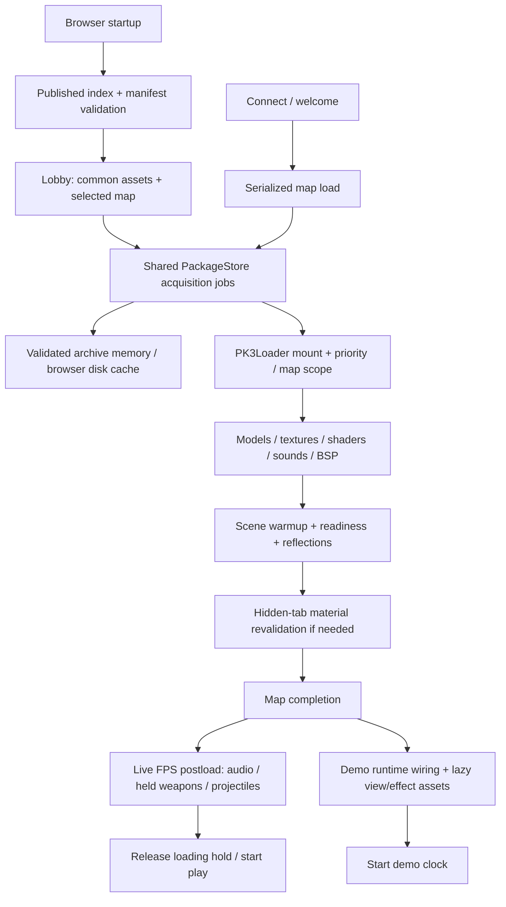

# Asset loading and startup review — 2026-10-25

Implementation follow-up: [changes and validation](asset-loading-implementation-2026-10-25.md).

Follow-up: [reliability and critical-path investigation](asset-startup-reliability-performance-2026-10-25.md)
adds the Opera GX warmup observation, measured DM11 timings, the water-lighting
CPU bottleneck and a proposed concurrency/ownership design.

## Outcome and scope

The startup pipeline has several independent reliability defects. The most urgent
are unbounded GPU recovery waits, optional browser storage blocking required
downloads, and a texture resolver that can bypass the published PK3 index. A
WebGL framebuffer feedback error was also reproduced and narrowed to depth-capture
binding state with a test-only correction and an unchanged control run.

This is a review, not a claim that those defects have been fixed. No runtime
source was changed for this audit. Fault-injection tests and browser probes live
under ignored `.cache/`. Production was inspected read-only for the recording;
no deployment or asset modification was performed.

Baseline: outer `0cdfc6dc`, FPS `c37b670`, both on `main`, version alpha.4.
Concurrent changes appeared during the audit in audio, loading UI, networking,
DemoService and lobby UI. They were left untouched; conclusions describe the
reviewed baseline, not a validation of those concurrent edits.

The review traced boot, metadata publication, archive acquisition and mounting,
lobby preparation, live connections, map loading, model/texture/audio consumers,
GPU warmup, hidden-tab recovery, overlay ownership, demo playback and teardown.
It is a cross-system source review with targeted reproduction, not an exhaustive
test of every asset, shader, browser or deployment configuration.

## Data and ownership flow



| Layer | Owns | Important boundary |
| --- | --- | --- |
| PK3Index | File-to-package lookup, published package identities | An indexed file is not necessarily mounted yet. |
| PackageStore | Shared archive downloads, SHA validation, raw ZIP caches | A lobby consumer leaving must not cancel a body needed by connection. |
| PK3Loader | Mounted ZIPs, priority, filesystem revision | Mounting and acquiring bytes are separate operations. |
| MapLoader | Serialized map operations, supersession signal, scene cleanup | Its queue does not own all surrounding client or FPS work. |
| Scene model/texture caches | Parsed objects and GPU resources | Raw ZIP cache readiness does not imply model or GPU readiness. |
| Loading overlay | Progress, holds, loading SFX mute lease | Hiding/cancelling presentation does not itself cancel all work. |
| DemoService | Recording ownership, playback, followed POV | Demo runtime preparation differs from live-match postload. |

### Boot and connection

FPS `client/main.ts` and `BrowserRuntime` establish the renderer, index,
commands/services, scene and camera/physics, then lobby and the render loop.
Boot failures have a failure presentation. An exception rethrown from the render
callback can prevent Babylon from scheduling its next frame; frame-dependent
startup work therefore needs a terminal failure path too.

The live flow is socket connection → welcome → map load → collision/triggers and
camera setup → FPS audio/held-weapon/projectile preparation → join/chase and
release of `fps:postload`. Network watchdogs account for hidden or blocked-tab
gaps. A terminal session-end callback cancels the match loader, shuts down and
unloads; cancellation is not wholly absent, but several awaited operations do
not observe it.

### Metadata and downloads

The published manifest/index pair is validated for schema, package identities
and integrity before adoption. PackageStore deduplicates by source and SHA,
limits concurrency to two jobs with at most one background job, and promotes
queued work needed by a foreground consumer. Active archive bodies can survive
lobby-to-connect transitions. Validated raw archives use bounded-size memory
and disk caches. Archive acquisition has header, idle and total network bounds,
retry and origin fallback.

Lobby preparation selects common weapon/player/sound/effect/UI media and the
selected map's owner and dependencies. Its ready indicator describes downloaded
files, not parsed models, decoded audio or compiled shaders. That distinction
is correct and must remain explicit.

The legacy metadata fallback may scan whole archives directly. The generator
writes index and manifest through separate renames, so readers can encounter a
temporarily mismatched pair. Validation prevents adopting that pair, but the
fallback can turn it into unnecessary large transfers rather than a short retry.

### File-resolution inventory

| Asset | Reviewed path | Remaining issue / exception |
| --- | --- | --- |
| BSP, shaders, map dependencies | Index, package acquisition, mount, virtual filesystem | Preserve indexed map resolution in headless tools too. |
| Packaged GLB weapons and previews | ModelAsset resolver acquires indexed owner and reads package bytes | Recent loose-GLB fixes are already in the baseline. |
| Other model formats / custom player roots | Some paths retain direct URL loading | Resolver coverage is not universal; classify custom URLs separately. |
| Textures | PK3TextureLoader, optional KTX2 sidecar, loose fallback | Unmounted indexed owner can be skipped; see F3. |
| Weapon tags | Indexed package lookup; custom unindexed directory fallback | Missing indexed optional tags already avoid loose 404 probes. |
| SFX | Indexed owner acquisition and decoded buffer cache | Decode/preload stages lack overall cancellation/deadline. |
| Music | Package/index resolution, blob playback, request ownership | Separate from loading-screen SFX mute; preserve music behavior. |
| Demo recording | Stream download with cancellation and transfer bounds, then reader | Download readiness is separate from playback asset readiness. |
| JS chunks, WASM, fonts, index/manifest | Direct bootstrap HTTP | These are intentionally outside ordinary PK3 asset lookup. |
| Benchmark outline proxy | Explicit loose GLB/JSON | Optional benchmark path, not normal player-model loading. |

Explicit external/blob/data URLs are intentional direct sources. Generated KTX2
sidecars are an optimization distinct from source assets. Their freshness and
per-texture decode completion still need stronger ownership and validation.

## Findings with reproduced evidence

### F1 — High: hidden-tab recovery can wait forever

`src/engine/weapon/EffectPreloader.ts:342` (`revalidateMaterials`) awaits shader
compilation, two raw after-render notifications and `scene.whenReadyAsync()`
without a deadline or map AbortSignal. MapLoader awaits this directly. Its
ordinary scene-ready gates use the bounded `MapLoadWait` helper; recovery does
not. An aborted load can consequently keep the map queue from draining.

Fault injection resolved shader and scene readiness immediately but withheld
render frames. Recovery remained pending after 60 seconds and retained the
observer. This proves a hang path consistent with the reported “Revalidating
textures” screen. It does not identify which particular wait stalled in the
user's browser.

Fix direction: bounded, abortable stage operations with observer cleanup and
scene/load ownership. A timeout race alone is insufficient if late work can
still modify a newer scene.

### F2 — High: optional disk cache can block a required archive

`src/engine/loader/pk3/PackageStore.ts:168` awaits `caches.open`; `read` also
awaits cache lookup/body validation. After successful network acquisition it
awaits the serialized persistence queue before resolving the job. Rejected
storage operations are handled, but never-settling ones have no deadline.

Fault injection left `caches.open` pending. After 60 seconds the archive job was
still pending and no network request had started. A hung persistence operation
can also hold later writes by source inspection; that variant was not separately
fault-injected.

Fix direction: bound optional cache reads, return validated acquired bytes
independently of best-effort persistence, and prevent a stuck write from poisoning
the queue. Keep integrity validation mandatory.

### F3 — High: indexed textures can fall through to loose HTTP

`src/engine/loader/pk3/PK3TextureLoader.ts` checks mounted packages in
`loadTexture` / `resolveAndLoadTexture`; it does not first acquire the owner
named by PK3Index. Missing mounted bytes can therefore trigger loose probes or
return null despite a valid indexed source.

The reproduction indexed a real ZIP containing `textures/review.tga`, left that
package unmounted, and requested the texture. It attempted loose HTTP, returned
null and never called package acquisition.

Fix direction: resolve indexed ownership and mount/acquire it before fallback,
as ModelAsset already does. Direct files remain fallback for genuinely unindexed
assets. Do not add ad-hoc directory guesses.

### F4 — High: depth capture leaves inconsistent framebuffer binding state

`src/engine/rendering/SceneDepthCapture.ts:177` mixes raw GL framebuffer binds
with Babylon's cached engine state. `prepare` allocates targets and changes raw
binding state; the capture path can return when its effect is not ready before
the later engine rebind.

Instrumented Edge/WebGL2 playback reproduced GL error 1282: framebuffer feedback
at `PostProcessManager._finalizeFrame`, `imageProcessing` on `fpsCamera`.
A test-only wrapper rebinding the source through `engine.bindFramebuffer`
immediately after successful `prepare` removed the draw error in the same
fixture. An unchanged control run then reproduced it again. Both runs had zero
failed HTTP requests.

This strongly isolates binding-state handling; it is not yet a reviewed source
fix. Restore engine/GL state on every exit, including error/early-return paths,
then run renderer regressions and broader GPU fixtures. Avoid adding expensive
per-frame GL queries as the permanent solution.

### F5 — Medium: material freeze state is lost on recovery failure

`revalidateMaterials` unfreezes saved StandardMaterials and refreezes them only
at normal completion. A compilation rejection skips restoration. A frozen
material with an injected compile failure remained unfrozen after rejection.

Fix direction: restore owned material state in `finally`, respecting disposal
and supersession. Do not infer a PBR hang from this StandardMaterial reproduction.

### F6 — Medium: caller abort stops following a fetch after headers

`src/engine/loader/pk3/AssetRequest.ts` removes the caller-signal relay when
`fetchAsset` returns Response headers. The separate body reader has idle/total
bounds but no caller signal. Aborting after headers did not abort the request's
controller in the streaming reproduction.

Fix direction: define cancellation through body completion. Distinguish an
acquisition owner's cancellation from a consumer detaching from a shared
download; leaving the lobby must not abort a connection's shared transfer.

### F7 — Medium: cached-index fallback omits content-hash registration

`src/engine/loader/pk3/PK3Index.ts:765` registers package SHA identities for a
valid published snapshot. Loading the stored index followed by the matching
legacy-checksum early return does not perform the same registration.

Fault injection used a cached SHA-bearing index, unavailable published metadata
and matching checksum. No PackageStore snapshot registration occurred, leaving
source identities without their hashes. Hash-based persistent reuse is then
unavailable for that page's acquisitions. This is a specific fallback defect,
not proof that all successful connections always redownload assets.

Fix direction: adopt validated snapshot identity consistently across published
and cached paths. Avoid discarding known-good cache identities during transient
metadata failure.

### F8 — Medium: paused POV cuts reset ADS to neutral

`src/games/fps/client/DemoPovState.ts` resets first-person effects at a
discontinuity and advances with zero demo delta when paused. An aimed player
selected on a paused cut produced neutral FOV multiplier 1 in the reproduction.
Held-weapon animation uses a different update clock, so camera and weapon can
settle differently.

Separately, `voltaic_beam` is classified as a one-shot demo event; target/seek
presentation deliberately suppresses one-shots and seek clears world effects.
Continuous beam state is not reconstructed on the landing frame. That latter
behavior is source-verified, not a reproduction of permanent missing beams.

Fix direction: reconstruct continuous ADS/beam presentation at a cut without
replaying shot sounds, explosions or other historical one-shots.

## Additional source-level risks and readiness gaps

These deserve fixes/tests but were not all reproduced as user-visible failures.

- **Warmup is only partially bounded.** EffectPreloader's fixture compiles and
  raw frame waits remain unbounded even though world-material compilation has
  a cap and a bounded frame helper already exists. WeaponViewManager weapon
  preparation and ProjectileManager material preparation also lack overall
  cancellation/deadlines. MatchMapLoader renews its postload hold every five
  seconds, so the overlay's hold timeout is not an overall startup deadline.
- **Live and demo readiness differ.** Normal demo startup loads the map, then
  wires its renderer, effects and weapon view and starts playback. It does not
  await the same held-weapon/projectile preparation as live FPS postload.
  Hitscan prewarm starts in the background. This can expose lazy assets during
  initial playback; it is not established as the user's persistent ADS/LG cause.
- **Some “ready” stages tolerate missing required media.** Projectile model
  preload returns booleans which preparation does not reject when false.
  Pickup preloading catches individual failures. Separate optional decoration
  failures from missing gameplay presentation and surface the distinction.
- **Cancellation ownership stops at subsystem boundaries.** Client scene clear
  occurs outside MapLoader's serialized operation. Delayed camera/spawn work,
  connection-overlay delays, and some postload work lack a shared generation.
  Cancelling a match loader during a stalled awaited preload cannot interrupt
  that preload. Add overlap/supersession tests before changing this flow.
- **Global progress/complete events lack operation correlation.** Start has an
  identity, but progress/completion and global hold cancellation do not fully
  isolate old/new operations. Late work can affect current presentation unless
  every producer owns and checks its operation.
- **Some resource promises rely solely on browser callbacks.** KTX2 worker
  startup is bounded, but per-texture completion is not. Loose tags and several
  legacy texture/prefab paths use plain fetch. Audio decode/preload needs stage
  ownership too. Standard-texture blob cleanup should include failure paths.
- **Cache identity is uneven above raw ZIPs.** Texture caches key by path and
  texture detail, not filesystem revision. Normal map clear does reset them;
  refresh within a scene needs explicit coverage. Model loaders with mutable
  scene state across awaits need late-completion tests, alongside the existing
  good ModelInstanceCache disposal guards.
- **Metadata adoption lacks a single in-flight owner.** Concurrent ensureIndex
  calls and publication during startup need controlled mismatch/retry tests.
  Full archive scanning should be a deliberate recovery path, not an accidental
  result of one temporarily mismatched metadata pair.
- **Failure contracts vary.** Some callers inspect strings while others use
  typed/boolean results. A load that logs and continues needs a deliberate
  optional/required classification; a connected but unready scene must not be
  presented as success.

The recurring glTF “Failed to find common root” warnings remain open. They were
observed during successful playback as well as startup and are not evidence by
themselves that a model failed to load. The WebTransport URL-scheme warning is
separate from asset acquisition; retain the future transport implementation.

## Exact production demo investigation

Read-only copy of EU's latest DM5 FFA at investigation time:
`washoi_dm5_ffa_20261025_103937.shagdemo` (version 6, 12,003 frames,
192,032 ms, 125 Hz simulation / 63 Hz snapshots).

The recording contains ADS inputs and beam events. Input IDs correctly map to
the player-state keys; no recording-format change is indicated by this evidence.
The human player never fired Voltaic in this file; bot beam events are present.

Normal continuous local Edge playback of the exact recording showed held
riotgun ADS approaching 1 and camera zoom about 0.85 during the recorded aimed
interval. Remote beams rendered. Switching POV away and back during playback
also recovered ADS and continued showing beam instances. A paused known beam
frame rendered visibly in the probe.

Therefore **persistent missing ADS/LG in the reported production Watch session
is still unresolved**. Paused-cut behavior and startup readiness gaps are real
follow-ups, but neither should be presented as the proven cause of that report.
The probe used current local source and Edge/WebGL2, not the exact production
bundle/browser/session state.

## Validation receipt

Headless tests preceded browser probes. Exact commands:

```powershell
npx.cmd vitest run src/games/fps/client/__tests__/FollowedViewWeapon.test.ts src/games/fps/client/__tests__/DemoViewer.test.ts src/games/fps/client/__tests__/DemoPovState.test.ts src/games/fps/client/__tests__/WeaponViewManagerBeamRouting.test.ts

npx.cmd vitest run src/engine/loader/pk3/__tests__ src/engine/loader/map/__tests__ src/engine/weapon/__tests__/EffectPreloader.test.ts src/engine/ui/__tests__/MapLoadingOverlayHold.test.ts src/engine/ui/__tests__/MapLoadingOverlayHidden.test.ts src/games/fps/client/__tests__/MatchMapLoader.test.ts src/games/fps/client/__tests__/LobbyAssetPreparation.test.ts src/games/fps/client/__tests__/FPSWeaponPreloader.test.ts src/games/fps/client/__tests__/DemoServiceStarts.test.ts src/games/fps/client/__tests__/DemoServiceLifecycle.test.ts src/games/fps/client/__tests__/DemoLoadOwnership.test.ts src/games/fps/client/__tests__/DemoDownload.test.ts

npx.cmd vitest run --config .cache/startup-review.vitest.config.ts
```

Results: **4 files / 62 tests**, **23 files / 138 tests**, and **7 isolated
fault reproductions** passed. The seven fault tests assert current defective
behavior; their passing does not mean the defects are fixed. They cover F1,
F2, F3, F5, F6, F7 and F8. Fake time was used for stalled-operation cases.

Additional evidence generated by ignored scripts:

- `.cache/inspect-demo-effects.ts` and `.cache/demo-input-spans.ts`: actual
  DemoReader inspection of the EU recording and local recordings.
- `.cache/demo-eu-effects-probe.mjs`, `.cache/demo-eu-continuous.mjs`,
  `.cache/demo-eu-switch-probe.mjs`: real-GPU playback and POV checks.
- `.cache/alpha4-errors-probe.mjs`: unchanged framebuffer-error control.
- `.cache/startup-depth-binding-probe.mjs`: test-only binding correction.
- Corresponding JSON and PNG files preserve observations locally. These ignored
  artifacts are not durable repository fixtures; the confirmed cases need
  tracked regression tests when their fixes land.

No new runtime implementation was made, so full release gates and the complete
renderer/network simulation regression set were not rerun for this report.
This is not release approval. Firefox, WebGPU, real context loss, the user's
exact production browser state, all map/media banks, and deployment-time
metadata races remain unverified.

## Recommended repair sequence

1. Give warmup/recovery a bounded, cancellable operation lifetime, with observer
   and material-state cleanup. Verify hidden→visible, stopped render loop,
   compile rejection, scene disposal and superseding map load.
2. Make optional CacheStorage unable to block acquisition; register cached SHA
   identities consistently. Test cold, warm, offline, quota rejection, hung
   reads/writes and shared lobby→connect promotion.
3. Close indexed texture/model resolution gaps. Test an indexed but unmounted
   owner, missing optional sidecars, corrupt/missing packages, mirror failure
   and unindexed custom fallback. Assert indexed success makes no loose probes.
4. Correct depth-capture binding restoration in a small renderer patch. Run the
   unchanged GPU fixture plus renderer/network regressions before broadening it.
5. Give live/demo startup the same explicit required-media readiness contract
   and reconstruct continuous POV state on cuts. Keep acquisition shared while
   scene/GPU state remains scene-owned.
6. Add operation IDs and a failure/cancel/retry matrix across overlays, client
   map setup and postload. Exercise rapid connect/disconnect, map replacement,
   slow models, tab backgrounding and repeated Watch/POV/seek transitions.

Each repair should land with a failing-before/passing-after regression and a
small reviewable diff. Preserve `public/data` and the existing shared-download
handoff throughout; no repository or asset migration is needed to fix these.
