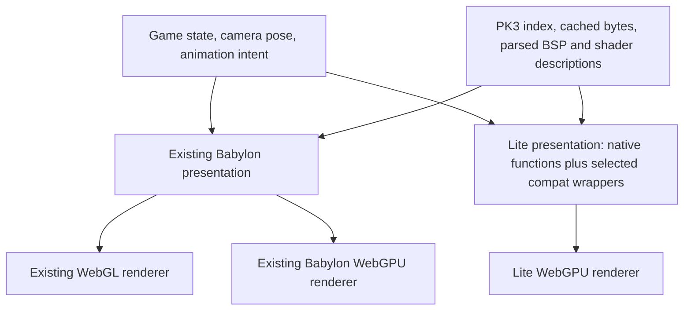

# Babylon Lite as a SHAG renderer

Opened: October 25, 2026 (Europe/Helsinki). Status: initial source investigation;
discussion document, not an implementation commitment.

Follow-up: [proposed file structure and owner-by-owner migration map](babylon-lite-migration-map-2026-10-25.md).
The owner confirmed that this is future/post-1.0 research and that the working
renderers should be preserved with existing code touched as little as possible.
The follow-up makes that the default architecture constraint and identifies
additional native material and effect-batching proof tasks.

The [source-boundary study and ranked groundwork shortlist](babylon-lite-code-boundaries-2026-10-25.md)
follow actual import paths and lifecycle calls. Read that before choosing which
existing classes to refactor: several candidates are already reusable unchanged.

## Working conclusion

**Worth prototyping; not a replacement we can make inside the existing engine
factory alone.** Babylon Lite has native WebGPU rendering, custom WGSL materials,
glTF animation and explicit render tasks. Its new compatibility package makes an
incremental experiment more plausible than a complete rewrite from the outset.
However, SHAG uses several Babylon features that the compatibility package
explicitly rejects, and its readiness semantics differ from ours.

The recommended first step is an isolated Lite map viewer using our real PK3
index, BSP parser and map textures. Run a small compatibility experiment beside
it. Compare those results before choosing how much of SHAG to adapt. Keep both
existing renderers available throughout the investigation.

No SHAG runtime code, dependencies, renderer preferences, production assets or
deployments were changed for this investigation.

## Evidence and version boundaries

SHAG baseline: engine `9bedff2da11cb83345d9612b2f89dca5ca8371c6`, FPS
`0759316308429c2ad36aa1e3bda1b111b22016e7` (alpha5.1). Installed-package
declarations in the engine use Babylon core/loaders `^9.31.2`.

Upstream source inspected: Babylon-Lite master at
[`1a2728c6d44383ef3a79cfc680e2e761b4f1e986`](https://github.com/BabylonJS/Babylon-Lite/tree/1a2728c6d44383ef3a79cfc680e2e761b4f1e986).
GitHub reports that commit at October 25, 2026, 20:19:10 UTC. A copy is under
ignored `.cache/babylon-lite-research/`; it is evidence, not a project dependency.

Registry metadata checked separately:

| Package | Registry `latest` observed | Meaning for an experiment |
| --- | --- | --- |
| `@babylonjs/lite` | `1.36.0`, published October 20 | Actual published engine package |
| `@babylonjs/lite-compat` | `1.36.0-preview`, published October 20 | Explicit preview; peer dependency on `@babylonjs/lite` |
| `babylon-lite` | HTTP 404 | Workspace name used in upstream source/examples, not the installation name verified here |

The published Lite package reports git head
`5241e29f5a88ff23534a11d3114ac8ea983c5961`. **The October 25 source inspection does
not establish that every inspected API ships in the October 20 npm packages.**
Choose and pin a matching package pair or a source revision before a prototype;
verify its actual exports and behavior rather than following `latest` silently.
Registry sources: [Lite metadata](https://registry.npmjs.org/@babylonjs%2flite),
[compat metadata](https://registry.npmjs.org/@babylonjs%2flite-compat).

Entry points supplied by the owner:
[overview](https://www.babylonjs.com/lite/),
[documentation](https://doc.babylonjs.com/lite),
[repository](https://github.com/BabylonJS/Babylon-Lite).
The documentation website did not expose useful text to the research browser;
the repository's Markdown and TypeScript were inspected directly. The searchable
feature comparison and even the checked-out comparison table lag some source
features. An empty cell in that table is not sufficient evidence of absence.

## What would actually change?

Here, native WebGPU means building directly around that graphics API. It does
not mean a desktop executable, nor the separate Babylon Native project.

SHAG's two existing choices share the same Babylon scene API:

```text
Babylon Scene / Mesh / Material / Camera / Animation
                       |
             RenderingEngineFactory
                  /           \
           Babylon Engine   Babylon WebGPUEngine
                |                    |
              WebGL                WebGPU
```

Lite introduces another scene/rendering implementation. It does not implement
the existing `@babylonjs/core` engine underneath an unchanged Babylon scene.
Its native API uses data objects and functions; `@babylonjs/lite-compat` supplies
some familiar classes over those objects. See the
[porting guide](https://github.com/BabylonJS/Babylon-Lite/blob/1a2728c6d44383ef3a79cfc680e2e761b4f1e986/docs/lite/03-porting-guide.md)
and [compatibility package](https://github.com/BabylonJS/Babylon-Lite/blob/1a2728c6d44383ef3a79cfc680e2e761b4f1e986/packages/babylon-lite-compat/README.md).

A possible destination, not an existing SHAG interface:



The sharing boundary should be **asset data and game intent**, not live
`Mesh`, `Material`, `Scene`, GPU texture or skeleton objects from one engine
passed into the other. The diagram omits engine-specific physics and cosmetic
systems; those also need deliberate ownership.

## Findings in SHAG

| Boundary | Verified source | Consequence |
| --- | --- | --- |
| Startup | `src/engine/rendering/RenderingEngineFactory.ts`, `src/engine/runtime/BrowserRuntime.ts` | Factory returns Babylon `AbstractEngine`; runtime constructs Babylon `Scene`. Lite requires an additional runtime path, not one more constructor in this factory. |
| Renderer selection | `BrowserRuntime.ts` | Default is WebGL; WebGPU is a URL opt-in. Preserve this baseline while experimenting. |
| Map decoding | `src/engine/loader/bsp/BspLoader.ts` | IBSP v46 / FBSP v1 parsing does not import Babylon. Good candidate for direct reuse. |
| Geometry construction | `BspMeshBuilder.ts`, `bsp/mesh/faceBuilders.ts`, `vertices.ts`, `coordinates.ts`, `types.ts` | Face geometry is mostly arrays, but mesh results and a coordinate helper depend on Babylon types/runtime math. Reuse algorithms; separate the data boundary carefully. |
| Packages and cache | `loader/pk3/PK3Index.ts`, `PK3Loader.ts`, `PackageStore.ts` | Indexed asset acquisition is separable from GPU objects. Keep the same package ownership, persistent cache and shared in-flight downloads. |
| Textures | `PK3TextureLoader.ts`, `texture/KTX1Loader.ts`, `KTX2SidecarLoader.ts` | Acquisition, decoding and Babylon texture upload are combined in places. Lite needs its own upload/cache lifetime while preserving indexed sources and compressed-format fallback. |
| Map shaders | `Q3ShaderParser.ts`, `Q3ShaderTypes.ts`, `Q3ShaderMaterialFactory.ts`, `Q3NodeMaterialBuilder.ts` | Parsing and material intent can be reused. Material construction and shader generation require an adapter or new implementation. |
| Baked lighting and fog | `BspBakedLightingPlugin.ts`, `AtmosphericFogPlugin.ts`, `Q3StageColorPlugin.ts` | Uses define preparation, custom uniforms/samplers and binding hooks that exceed Lite compat's fixed-slot plugin support. |
| Models | `model/ModelAsset.ts`, `ModelLoader.ts`, `ModelSourceCache.ts`, `AssetPreloader.ts` | Indexed GLB bytes are reusable; Babylon model instances, animations, skeletons, attachment points and cache ownership need migration checks. |
| Visibility | `PVSCuller.ts`, `FrozenWorldMaterials.ts`, `WeaponCameraCandidates.ts` | Preserve SHAG's visibility decisions. PVS currently toggles Babylon mesh visibility; a Lite sink needs equivalent semantics and bundle invalidation. |
| Held weapon | `src/engine/weapon/WeaponViewManager.ts` | Uses world and weapon cameras, separate masks/FOV and ordering. One camera rendering a model is insufficient parity. |
| Secondary passes | `SkyPortal.ts`, `SceneDepthCapture.ts`, `SurfaceCubemaps.ts`, `rendering/water/*`, `effects/PostProcessingManager.ts` | These need explicit Lite tasks/material views or another documented implementation. Existing Babylon RTT/pipeline objects do not transfer. |
| Effects | `effects/RainEffect.ts`, `DebrisEffect.ts`, `weapon/ProjectileManager.ts`, FPS `client/RagdollSystem.ts` | Classic/GPU particle systems and Babylon trail lifetimes are real dependencies, not just optional library imports. |
| Physics and queries | `physics/PhysicsSystem.ts`, `BabylonPhysicsBackend.ts`, FPS `simulation/MovementProfile.ts` | Deterministic movement can stay. Browser Havok bodies and scene picking still bind to Babylon meshes/scenes and need independent review. |
| Loading readiness | `loader/map/GpuPreparation.ts`, `MapLoader.ts` | The current transaction checks real material/mesh readiness, cancellation, visibility and context loss. Lite needs equivalent actual readiness guarantees. |

A coarse import scan found 271 TypeScript files importing `@babylonjs/*` under
engine/FPS after excluding `__tests__`, FPS scripts and nested `node_modules`:
221 engine and 50 FPS. This includes math/types and is **not** a rewrite estimate
or an exhaustive production dependency graph. It demonstrates why a global import
alias should not be mistaken for a verified integration.

## Compatibility layer: useful, but not transparent

Upstream ships a [Vite plugin and import redirect table](https://github.com/BabylonJS/Babylon-Lite/blob/1a2728c6d44383ef3a79cfc680e2e761b4f1e986/packages/babylon-lite-compat/src/bundler-resolve.ts).
Core/loaders deep imports, including side-effect imports, redirect to the compat
barrel. This could save migration work on transforms, ordinary meshes, common
materials, glTF, math and some animation/physics APIs.

There are verified blockers for simply applying that plugin to SHAG:

- [Compat `ShaderMaterial`](https://github.com/BabylonJS/Babylon-Lite/blob/1a2728c6d44383ef3a79cfc680e2e761b4f1e986/packages/babylon-lite-compat/src/unsupported/unsupported-apis.ts)
  throws. Native Lite custom WGSL materials exist, but Babylon's shader-store and
  preprocessing dialect is a different contract. Even existing SHAG WGSL plugin
  snippets are not automatically standalone Lite shaders.
- [Compat material plugins](https://github.com/BabylonJS/Babylon-Lite/blob/1a2728c6d44383ef3a79cfc680e2e761b4f1e986/packages/babylon-lite-compat/src/materials/material-plugin.ts)
  reject overridden binding, uniform, sampler and several define hooks that
  SHAG's baked-lighting/fog plugins implement.
- `RenderTargetTexture`, `ReflectionProbe`, `GlowLayer`,
  `DefaultRenderingPipeline`, `SSAO2RenderingPipeline`, classic particles and
  `GPUParticleSystem` have explicit unsupported implementations. Native task
  alternatives cover some purposes; they do not preserve the class APIs.
- [`Scene.render()`](https://github.com/BabylonJS/Babylon-Lite/blob/1a2728c6d44383ef3a79cfc680e2e761b4f1e986/packages/babylon-lite-compat/src/scene/scene.ts)
  does no rendering, `whenReadyAsync()` resolves immediately and `isReady()`
  returns true. Lite's engine drives registered scenes. A script reaching these
  methods successfully is not proof that a map has rendered or is GPU-ready.
- The import plugin is a build-level substitution. Enabling it globally would
  also redirect code intended for SHAG's existing WebGL/Babylon WebGPU paths.
  Use an isolated entry/build configuration for a compatibility spike. Keeping
  classic and compat copies in the same graph also needs class-identity and
  side-effect audits; do not mix their `instanceof` tests or resource objects.

An exported symbol is therefore not evidence of implemented behavior. A useful
first compatibility result is an inventory of actual call/property blockers,
including cases that compile but change readiness, ordering or lifetime behavior.

## Native Lite capabilities that make this interesting

The checked source contains substantive mechanisms relevant to SHAG:

| Mechanism | Opportunity | Limit to establish |
| --- | --- | --- |
| Native WGSL materials | Implement Q3 stages and baked lighting without shipping our GLSL conversion path in the Lite entry | Port shader semantics, layouts, gamma, blend/depth behavior and material cache keys |
| Explicit frame tasks and material views | World, weapon, sky, depth and water passes can have clear inputs, order and ownership | The documented frame graph is an ordered task list, not automatic dependency scheduling; the application still owns correct order and feedback prevention |
| Shader pipeline sharing and hidden-packet update opt-ins | Reduce duplicate pipeline work and CPU updates for PVS-hidden map surfaces | Workload-specific opt-ins; measure rebuild/bundle invalidation cost and restored visibility correctness |
| Async ShaderMaterial pipeline preparation | Move custom pipeline compilation before first use | Covers ShaderMaterial, not every Standard/PBR/postprocess pipeline; it does not remove GPU compile latency or replace cancellation/timeouts |
| GPU error/device-loss subscriptions and opt-in recovery | Better failure reports and a controlled recovery path | Recovery needs retained sources, registration for every context kind, and has unsupported storage-resource cases; not guaranteed automatic recovery of SHAG |
| `loadGltf(engine, ArrayBuffer or Blob)` | Consume our indexed self-contained GLBs without direct loose-file primary requests | External glTF references and auxiliary decoder/BRDF downloads require an explicit URL/content policy; no `AbortSignal` appears in the inspected load function signature |
| Thin instances, hierarchy pools, GPU culling, clustered point/spot lights | Candidate improvements for repeated props and dense effects | Porting is required; SHAG's existing `InstancedMesh` interface is not Lite's thin-instance interface |
| OffscreenCanvas support | Possible later move of rendering work off the main thread | Input, state transfer, asset ownership, DOM-dependent effects and synchronization become a separate project |

Sources: [native exports](https://github.com/BabylonJS/Babylon-Lite/blob/1a2728c6d44383ef3a79cfc680e2e761b4f1e986/packages/babylon-lite/src/index.ts),
[frame graph](https://github.com/BabylonJS/Babylon-Lite/blob/1a2728c6d44383ef3a79cfc680e2e761b4f1e986/docs/lite/architecture/28-frame-graph.md),
[custom shader materials](https://github.com/BabylonJS/Babylon-Lite/blob/1a2728c6d44383ef3a79cfc680e2e761b4f1e986/docs/lite/architecture/24-shader-material.md),
[async compilation](https://github.com/BabylonJS/Babylon-Lite/blob/1a2728c6d44383ef3a79cfc680e2e761b4f1e986/docs/lite/architecture/53-async-shader-pipeline-compilation.md),
[device recovery](https://github.com/BabylonJS/Babylon-Lite/blob/1a2728c6d44383ef3a79cfc680e2e761b4f1e986/docs/lite/architecture/50-device-lost-recovery.md),
[glTF loader](https://github.com/BabylonJS/Babylon-Lite/blob/1a2728c6d44383ef3a79cfc680e2e761b4f1e986/packages/babylon-lite/src/loader-gltf/load-gltf.ts).

The repository also contains a Quake demo. Its
[BSP parser](https://github.com/BabylonJS/Babylon-Lite/blob/1a2728c6d44383ef3a79cfc680e2e761b4f1e986/lab/lite/src/demos/quake/bsp/parse-bsp.ts)
targets **Quake 1 BSP v29**, not our IBSP/FBSP formats. Its
[world material](https://github.com/BabylonJS/Babylon-Lite/blob/1a2728c6d44383ef3a79cfc680e2e761b4f1e986/lab/lite/src/demos/quake/render/quake-material.ts)
illustrates base texture plus grayscale lightmap and reverse-depth bias. This
is useful implementation evidence, not proof of Warsow shader, deluxe-lighting
or SHAG weapon-camera compatibility. Its viewmodel is camera-locked in world
space, which also differs from SHAG's separate weapon pass.

Two tempting detours should stay separate:

- Lite's MeshLoD path rejects UV2/lightmaps and material plugins in the inspected
  implementation. It is not an immediate replacement for lightmapped BSP/PVS
  rendering. See [MeshLoD constraints](https://github.com/BabylonJS/Babylon-Lite/blob/1a2728c6d44383ef3a79cfc680e2e761b4f1e986/docs/lite/architecture/mesh-lod.md).
- The source tree has `@babylonjs/lite-gl`, despite the main site's WebGPU-only
  description. Its README describes a WebGL2 micro-engine for effects/sprites,
  not a replacement for SHAG's full classic 3D renderer. It was not evaluated
  as a fallback.

## Performance hypotheses, not promised gains

The official overview reports large savings on its own parity scenes. Those
numbers do not predict SHAG's complete application, assets or frame time. We
would still download the same map/model/audio media, and a compat-based port
could keep meaningful wrapper overhead and retained modules.

SHAG's [alpha3 measurements](v1.0.0-alpha3-performance.md) found substantial CPU
time in draw submission and visible-mesh selection. That makes Lite worth
investigating. Those measurements predate further optimizations and cannot serve
as the comparison baseline for alpha5.1.

Use the same recorded camera/actor sequence, assets, resolution, AA, lighting and
visible features. Compare classic WebGL, Babylon WebGPU (including its existing
`?ncm=1` render-bundle experiment), and Lite. Record:

- cold and warm time to first complete playable frame, split into download,
  decode, GPU upload, shader preparation and scene construction;
- CPU render time and GPU frame time separately; median/p95/p99 plus first-use
  spikes, not just average FPS;
- draw calls, visible objects/triangles, pipeline creation and texture memory;
- compressed JS/WASM actually requested by the selected path, separate from
  shared media bytes; whether importing the Lite entry accidentally pulls in
  classic renderer implementations;
- correctness screenshots and repeated unload/reload resource counts.

A reduced-feature Lite prototype is useful for development, but its FPS is not
a fair speed comparison against the complete game.

## Integration options

| Option | Scope | Assessment |
| --- | --- | --- |
| Replace `WebGPUEngine` in the factory | Keep every caller unchanged | Incompatible contracts; reject as an implementation plan |
| Global compat import rewrite | Redirect existing application to compat | Useful isolated audit tool; blocked as a transparent production port |
| Compat-assisted Lite presentation | Keep compatible classes, replace shaders/passes/effects with native Lite adapters | Plausible migration route if the actual API audit is favorable; measure wrapper and dual-API complexity |
| Native Lite presentation | New rendering implementation consuming common asset/game data | Clearest long-term boundary and optimization control; largest initial effort |
| Separate Lite map viewer | Real maps and assets, limited rendering feature set | Recommended first deliverable: measurable and easy to discard |

If we eventually expose a third renderer, selection should happen **before scene
creation**, probably with a reload and an isolated entry/chunk graph. The exact
query name is undecided; `renderer=lite` is only a proposal. Existing
`renderer=webgpu` must continue to identify the existing Babylon backend.

Replacing the existing Babylon WebGPU option later could reduce the supported
combinations, but only after Lite has equivalent supported gameplay features and
reliability. Keeping WebGL through classic Babylon remains a separate choice.
Fallback must recreate the appropriate scene and, after a context is acquired,
may need a fresh canvas. Switching just an engine reference cannot preserve
another renderer's scene/GPU objects.

## Proposed investigation sequence

1. **Freeze the experiment inputs.** Pick a source/package pair; record its
   version, adapter, browser and device. Use an isolated checkout or entry so
   experiments cannot alter production startup or shared build aliases.
2. **Inventory actual compatibility.** Resolve our imported runtime symbols,
   then inspect methods/properties and unsupported hooks for a representative
   startup/map/model flow. Verify the chosen version's exports. Distinguish
   wrappers, throwing stubs and semantic mismatches.
3. **Render real static geometry.** Read `washoi_dm2` through the existing PK3
   index and cache; reuse BSP parsing and coordinate conversion rules. Build
   positions/normals/UV/UV2/indices in Lite. First display diffuse plus baked
   lightmap, then verify vertex colors, winding, gamma and lightmap orientation.
   Unsupported surface classes must be counted and identified, not silently
   replaced and declared compatible.
4. **Prove the hard material cases.** Port representative deluxe/lightmap-array
   surfaces, normal/gloss stages, animated additive/filter/alpha stages,
   autosprites and height/pass-aware fog. Check another map such as
   `washoi_dm11`; one attractive room is insufficient coverage.
5. **Add one animated actor and one held weapon.** Load our real indexed GLB
   bytes. Check cloned skeleton/texture ownership, attachment sockets, ADS,
   weapon FOV/depth/order, followed-player changes and animation seeking.
   A deterministic replay fixture could exercise these without a live match;
   using the full current DemoService unchanged is not assumed possible.
6. **Decide architecture with evidence.** Choose compat-assisted or native
   adapters, or stop if savings do not justify migration. Introduce only the
   presentation/data seams demonstrated necessary by the prototype.
7. **Reach gameplay and lifecycle parity.** Effects, water/sky/depth passes,
   decals/outlines/color correction, cosmetic physics, menu backgrounds,
   network interpolation and demo behavior all need explicit coverage before
   it becomes a supported game renderer. Editor migration can be decided
   separately; retaining the existing editor renderer is reasonable.

These are proposed stages, not completed tests or a calendar estimate.

## Reliability requirements for any prototype that becomes playable

The new renderer must preserve the loading work we have just stabilized:

- A load has one owner, a cancellation signal and generation; a cancelled
  decoder/upload result must be disposed rather than attached to a later map.
  Shared package downloads can continue for other consumers.
- Download complete, decoded, uploaded, pipeline prepared and first correct
  rendered frame are different milestones. In particular, compat readiness
  must not dismiss the loading screen early.
- Shader/device failures must end in a reported failure or a controlled
  fallback, not a permanent warming-up screen. Hidden-tab suspension must not
  be mistaken for completed GPU work or a timeout consuming visible-load budget.
- Device loss, resize, pipeline compilation and render-task replacement need
  explicit failure/cleanup paths. Retaining CPU copies for recovery has a memory
  cost that belongs in measurements.
- Rejoining, map transitions and cancellation at every load stage must leave
  one render loop, correct camera/pass ownership and no old-resource updates.
- Preserve primary asset lookup via PK3 index and persistent cache. Lite must
  not reintroduce loose-file requests, independent duplicate downloads or CDN
  dependencies absent from our deployment/content policy.

Required later coverage includes cold/warm starts, failed package/decode/shader
loads, unavailable WebGPU, context/device loss, background/resume, repeated map
changes, weapon switching, spectate-target changes, demo seek, gameplay effects,
and both rendering and resource cleanup on actual supported browsers/hardware.

## Open discussion

- Is the desired win CPU frame time, startup size, fewer shader workarounds,
  or a cleaner presentation architecture? Measure all, but choose a primary
  success criterion before expanding the port.
- Is a limited experimental map viewer a useful first outcome? Recommendation:
  yes; it can answer the material/performance questions without binding us to
  a full game migration.
- Would we accept the maintenance of three choices for an evaluation period,
  then retire Babylon WebGPU only if Lite wins? Recommendation: yes, rather
  than deciding which implementation to delete before comparing them.
- How much upstream compat extension would be reusable versus recreating
  Babylon internals locally? Prefer a small verified boundary over a growing
  private compatibility engine. Upstream issue requests can be considered later;
  none were posted during this investigation.

## Work performed and limits

Read SHAG's runtime/factory, loaders, custom materials, effects, visibility,
physics and relevant manuals/research. Inspected pinned upstream Markdown and
TypeScript plus public registry metadata. Used source searches and read-only
Git status/revision checks. No third-party code was installed or executed.

No Lite scene was built or GPU benchmark run. Visual parity, browser stability,
full API coverage, wrapper overhead, final bundle size and performance benefit
are **unverified**. No release/production change is implied by this document.

Documentation validation: `npm.cmd run docs:build` passed. The first sandboxed
attempt could not spawn esbuild (`EPERM`); the same command succeeded with the
required process permissions. This builds the engine manual; the research file
is outside that site's page tree and its proposed integration is not executable
validation. No gameplay tests were needed for this documentation-only change.
