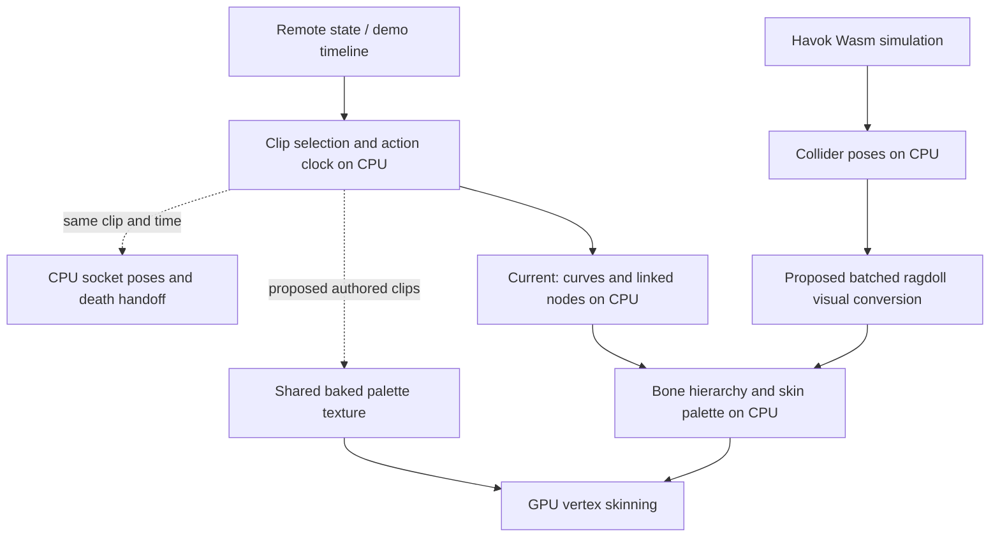

# Animation and physics CPU: choosing the implementation

Date: October 27, 2026. Installed Babylon 9.31.2. The cache-animation step below
has its first implementation; no WebAssembly kernel, worker or compute shader
is implemented. See the linked investigation for implementation validation.
Builds on the [measured investigation](cpu-animation-physics-investigation-2026-10-27.md)
and [CPU study](cpu-optimization-study-2026-10-27.md).

## Recommendation and decision matrix

Remove unnecessary animation work first, batch ragdoll pose conversion second,
and make pose throttling cover skin-matrix preparation if measurements justify it.
These changes benefit both renderers and preserve the physics engine. For a larger
animation redesign, investigate baked bone textures before WebGPU compute.

| Target | Preferred approach | WebGL2 | WebGPU | Wasm/worker/compute decision |
| --- | --- | --- | --- | --- |
| Disabled pickup templates evaluating constant curves | Settle the intended source pose and stop source-owned groups | Yes | Yes | Eliminate the work; no alternate execution backend needed |
| Repeated ragdoll hierarchy rebuilds | Cached rig layout, parent-first numeric conversion, local bone writes, one final preparation | Yes | Yes | First use TypeScript; benchmark Wasm only after removing repeated rebuilds |
| Stepped actors preparing unchanged skin matrices | Attribute actual uploads, then gate by pose revision with explicit invalidation | Yes | Yes | Scheduling/ownership problem first; faster math would still repeat work |
| Hidden one-shots | Separate action-clock completion from visual curve evaluation | Yes | Yes | Keep timing on CPU; low priority until quantified |
| Many remote actors playing authored clips | Shared baked bone-matrix atlas plus CPU socket sampling | Yes, capability checked | Yes | Most promising larger GPU experiment; validate costs and visual parity |
| Large procedural/blended pose batches after the above | Packed CPU reference kernel, then compare alternate executors | Yes, CPU path | Yes, CPU or compute | Wasm can accelerate numeric work; compute needs GPU-resident output |
| Havok world simulation | Retain existing solver and behavior; profile integration separately | Yes | Yes | Havok is already Wasm with SIMD; a GPU solver would be a different physics implementation |

"Yes" identifies a compatible design route, not a measured speedup. Existing
renderer-specific lighting, depth and draw-call work belongs to the other work
stream. Avoid changing those files while implementing these CPU candidates.

## Where the work actually goes

The standard Babylon bone shaders already apply weighted skinning on the GPU.
The CPU still evaluates curves, updates the hierarchy and prepares bone matrices.
Installed `Shaders/ShadersInclude/bonesVertex.js` and its WGSL counterpart show
the palette lookup and vertex deformation. Moving curve or palette generation
to the GPU is an additional change, not simply enabling GPU skinning.

Havok's solver is already WebAssembly. Babylon's JavaScript plugin transfers
transforms and invokes `HP_World_Step`; our ragdoll synchronization then updates
the visible skeleton. Wasm alone does not move these integration stages to another
thread. [Babylon Havok integration](https://doc.babylonjs.com/features/featuresDeepDive/physics/havokPlugin/)
describes the solver/plugin split and the SIMD requirement.



Player movement/prediction is a separate deterministic simulation. None of these
proposals changes its 125 Hz rules, network format or demo format.

## Small changes with the strongest evidence

### Stop source-owned animations at the cache boundary

Change [AssetPreloader](../../src/engine/loader/AssetPreloader.ts), not the global
GLB importer. Capture the source's required pose and animation intent, settle it
once, and stop its cache-owned groups. Ensure pickup clones retain the intended
skinning and attachment pose. A custom animated pickup needs an explicit clone
playback policy; the six observed constant assets do not establish that policy
for every possible model.

[ModelInstanceCache](../../src/engine/loader/model/ModelInstanceCache.ts) already
records autoplay state and stops hidden sources before starting clone groups.
Reuse that ownership principle. Do not stop visible viewmodel/barrel animation
or dispose groups still needed by a clone. This is the first implementation
candidate because the reversible A/B established actual removable work.

Constant-track pruning is a separate possible asset optimization: applying a
constant value once on clip entry can avoid evaluating its keys repeatedly. It
must still reset the value on every relevant transition; dropping the channel
can leave the previous clip's value behind. The player clips have not been
audited for constant-track savings, so this is not a measured recommendation.

### Batch ragdoll conversion before changing its execution language

[RagdollSystem](../../src/games/fps/client/RagdollSystem.ts) caps active ragdolls
at four. Vanguard has 65 bones and 15 controlled colliders. Rebuilding the whole
hierarchy between world-space bone setters is avoidable work regardless of
whether the quaternion arithmetic runs in JavaScript or Wasm.

Cache parent order, collider mappings, bind corrections and scratch storage when
the ragdoll is created. Read collider poses once, resolve parents including
uncontrolled ancestors, convert into local transforms, then prepare once. The
synthetic proof establishes this mechanism, not real-rig equivalence.

A first adapter can live at proposed
`src/games/fps/client/ragdoll/BatchedPoseSync.ts`. Babylon's public `pauseSync`
can transfer visual-sync ownership; match the existing observer stage and clean
up the adapter with the body. Keep the native path until real-rig parity passes.
Do not vendor-patch or monkey-patch Babylon based on the diagnostic wrappers.

Do not disable collider pre-step as part of this change. The retained Havok test
found different trajectories. Also do not infer that an entire corpse is idle
from the hips alone: the game's rest heuristic is not a solver-wide sleep test.
Skipping a repeated visual pose would require all relevant input poses to be
unchanged and correct invalidation on wake/teleport/scale changes.

### Give pose throttling an explicit owner

[PlayerModelManager](../../src/engine/animation/PlayerModelManager.ts) already
throttles some locomotion curve evaluations. Installed `Skeleton.prepare()` copies
linked TransformNode values into bones before its dirty check, so unchanged
inputs can still dirty skin matrices. Measure real actors' builds/uploads between
pose samples before introducing another gate.

Two routes merit a small isolated prototype:

| Route | Advantage | Constraint |
| --- | --- | --- |
| Pose revision gate around linked-node synchronization/preparation | Preserves the imported rig and animation target model | No verified public drop-in freeze API; use a supported extension or propose an upstream equality/dirty fix, not private flags |
| Retarget into an owned numeric/local-bone pose pipeline | Makes change tracking and executor substitution explicit | Larger migration: existing channels and socket consumers expect linked TransformNodes |

The second route cannot be implemented by simply unlinking the rig.
`extractAnimChannels()` retargets to TransformNodes and filters position tracks;
`RemotePlayerRenderer.getBoneTransform()` returns `bone.getTransformNode()`.
Root-motion correction and hand attachments must follow the same resulting pose.
Global dirty-flag suppression would conceal real changes and is unsuitable.

A linked-value equality check still scans the rig, but could avoid matrix builds
and texture uploads when nothing changed. An instance revision gate can skip more
work, but only if every pose writer participates. Compare both against ordinary
preparation rather than assuming the more elaborate gate wins. Keep separate
revisions for local pose, mesh/bind-space inputs and render-context resources;
a world-space actor move need not imply a different local skin palette, while
socket world transforms must still follow it.

Hidden one-shots need similar ownership. `playOnce()` stops locomotion, runs a
separate group and resumes locomotion on completion. Pausing that group can also
pause its completion callback. Preserve the logical action end independently,
then sample the correct pose on visibility return; never resume a stale attack.

## WebAssembly: suitable for a packed numeric kernel, not object traversal

Wasm is a plausible later executor for parent-first pose composition, quaternion
conversion or a large curve-sampling batch. First implement a pure numeric
TypeScript reference with persistent typed arrays. Then compare the same workload
in Wasm, including packing, calls, copies and applying results to Babylon.

Use one coarse call for the batch, not calls back into JavaScript per bone.
`WebAssembly.Memory` exposes linear memory that JavaScript can view through
typed arrays; it does not make Babylon object graphs directly shareable.
[Memory reference](https://developer.mozilla.org/en-US/docs/WebAssembly/Reference/JavaScript_interface/Memory).

Illustrative upper-bound active ragdoll payloads, excluding headers/alignment:

| Representation for four Vanguard ragdolls | Raw float32 bytes |
| --- | ---: |
| 60 collider poses, XYZ + quaternion | 1,680 |
| 260 local bone quaternions + four root XYZs | 4,208 |
| 260 full 4x4 matrices, without identity palette slots | 16,640 |

These are small batches; no timing break-even is established. A faster quaternion
kernel may save little if object writes and palette preparation dominate. Havok
owns its own Wasm module/memory; no stable cross-module zero-copy pose interface
has been verified. Budget transfers unless an actual supported interface proves
otherwise. Compare scalar and SIMD variants only with capability checks and a
working reference fallback. Account for module startup, build tooling and memory
growth invalidating cached JavaScript views.

Wasm is not automatically multithreaded. Moving work off the main thread requires
a worker architecture as well. Keep authoritative movement out of this experiment.

## Workers: responsiveness is a separate benefit from less CPU work

A worker could own an independent pose batch; the main thread still owns Babylon
scene objects and applies results. Do not send scene graphs or synchronously wait
for each bone. Transferring an ArrayBuffer moves ownership and detaches the sender's
buffer, so use a bounded pool and explicit return messages.
[Transferable objects](https://developer.mozilla.org/en-US/docs/Web/API/Web_Workers_API/Transferable_objects).

An asynchronous result needs map generation, entity life/generation, pose time,
request sequence and discontinuity identity. Reject results from a previous map,
death, seek or target. Apply the latest complete result without blocking rendering;
bound queue length and measure the added pose latency. A watched POV may need the
synchronous reference path. Moving a tiny batch can add scheduling delay while
leaving the same total work, or more, across processes.

SharedArrayBuffer can avoid ownership transfers but needs a correct publication
protocol and deployment isolation. Browser availability of shared memory requires
the relevant security/isolation conditions; production headers and third-party
resource compatibility have not been audited for this task.
[SharedArrayBuffer requirements](https://developer.mozilla.org/en-US/docs/Web/JavaScript/Reference/Global_Objects/SharedArrayBuffer).
Start an experiment with transfer buffers rather than changing deployment headers.

## Baked bone textures: the stronger GPU candidate for authored animation

Babylon's baked animation path stores sampled bone matrices in a texture and
selects them in the vertex shader. It trades CPU pose work for asset/GPU storage.
Default playback does not interpolate frames or blend clips. That is a visual
constraint to evaluate, not a reason to claim a drop-in replacement.
[Baked animation documentation](https://doc.babylonjs.com/features/featuresDeepDive/animation/baked_texture_animations/).

Installed 9.31.2 includes `BakedVertexAnimationManager`, `VertexAnimationBaker`,
and both GLSL and WGSL baked-animation includes. Despite the API's "vertex" name,
this inspected implementation stores bone matrices rather than one animated
position per vertex. A shared clip atlas can serve many actors with independent
clip/time settings.

### Asset budget checked against our pack

The [metadata evidence](cpu-evidence/2026-10-27-animation-budget.json) records the
pack hash, first-skin joint count, configured clips and source durations. The
[read-only generator](cpu-evidence/animation-asset-budget.mjs) reproduces it.

At an illustrative 30 samples/second, using `ceil(duration * 30) + 1` per clip:

| Quantity | Estimate |
| --- | ---: |
| Bones / palette slots including identity | 65 / 66 |
| Present core clips / optional dance clips present | 17 / 0 |
| Total sampled core frames | 839 |
| Float32 bytes per palette frame | 4,224 |
| Raw float32 atlas | 3,543,936 bytes, about 3.38 MiB |
| Raw float16 atlas | 1,771,968 bytes, about 1.69 MiB |

This is not an actual bake or compressed download size. It excludes padding,
socket tables, CPU copies, loader overhead and a final clip boundary policy.
Half precision needs capability and pose-error validation. Texture limits and
vertex texture support must be checked; retain the ordinary CPU path when needed.

### Integration problems that must be solved

1. **Bake the pose we actually use.** The built-in synchronous baker advances
   skeleton animation and renders the scene per sample. Our clips are retargeted
   AnimationGroups on TransformNodes with filtered root motion. Build a controlled
   offline bake adapter around that policy; blindly passing skeleton ranges would
   not prove the right animation was sampled. Do not bake hundreds of frames on
   the loading path. Version the result against source media, rig mapping and bake
   policy, and publish/load it through the existing PK3 index/cache path.
2. **Keep a single logical clip clock.** Locomotion, one-shots, speed changes,
   demo pause/seek and visibility return must resolve from the same timeline as
   CPU playback. Current `playOnce()` stops locomotion despite its overlay naming;
   do not invent simultaneous blending requirements for that implementation.
   Smooth transition blending, if desired later, needs its own shader/data design.
3. **Preserve CPU sockets.** Weapons attach to RightHand; bomb placement reads
   Spine1 through [RemotePlayerRenderer](../../src/games/fps/client/RemotePlayerRenderer.ts)
   and [BombRenderer](../../src/games/fps/client/BombRenderer.ts). Store/sample
   model-space socket transforms from the same bake, or evaluate their ancestor
   chains on CPU. Skin matrices include bind-pose correction and are not directly
   attachment transforms. Shader/CPU frame selection must agree.
4. **Preserve all rendering passes.** Installed standard outline/depth renderers
   contain BVA support, but our [PlayerOutlineProxy](../../src/engine/rendering/PlayerOutlineProxy.ts)
   explicitly rejects baked managers and uses its fallback. Either adapt that
   path or retain the fallback intentionally and measure it. Verify forward,
   depth, shadows, reflections, outlines, bounds, warmup and context recovery.
5. **Handle death without GPU readback.** Ragdolls cannot be pre-baked from a clip.
   Evaluate one full CPU pose at handoff, from the same clip/time, to initialize
   colliders; continue with Havok and the dynamic pose path. Test a death between
   sample boundaries and immediately after a seek or target change.

Start with medium/far remote actors. Keep near/watched actors and held weapons
on their verified path while matching sockets and sample quality. This is an
internal presentation policy, not a proposed player setting. Baked data is useful
future renderer groundwork, but does not establish Babylon Lite API compatibility.

## Compute shaders: viable only with a different end-to-end data flow

Babylon compute shaders are WebGPU-only; query
`engine.getCaps().supportComputeShaders`. They use WGSL and can consume/produce
storage buffers. [Compute shader API](https://doc.babylonjs.com/features/featuresDeepDive/materials/shaders/computeShader/).

A credible experiment batches actors, keeps rig/clip data resident, uploads small
state inputs and produces a palette consumed directly by every relevant draw
pass. Hierarchy dependencies require a deliberate algorithm, such as parent-first
work within a rig or staged hierarchy levels; independent invocations per bone
cannot assume parents have finished.

Computing matrices and reading all of them back to call Babylon bone setters
would retain object integration while adding synchronization/copies. GPU buffer
mapping is asynchronous and mapped buffers cannot be used by GPU commands.
[GPUBuffer.mapAsync](https://developer.mozilla.org/en-US/docs/Web/API/GPUBuffer/mapAsync).
The resulting performance risk is an inference from that data flow, not a measured
penalty in SHAG. Keep a small CPU socket path and avoid routine pose readback.

This becomes interesting for a substantial procedural/blended animation workload
that baked clips cannot represent, or a future GPU-native renderer. Four capped
ragdolls do not yet justify it. Their collider inputs still come from CPU Havok;
moving the solver itself to compute would require new collision/constraint
behavior and gameplay validation. Keep the WebGL2 reference route independently
functional; no compute work is required for the first three optimization phases.

## Proposed file boundaries and acceptance sequence

These paths describe a possible implementation, not files already created:

| Phase | Files / ownership | Required decision before progressing |
| --- | --- | --- |
| A: cache animation ownership, implemented | Existing engine `AssetPreloader.ts`; tests beside loader tests | Constant transform clips settle once; meaningful/uncertain source animations retained. Validation recorded in the focused investigation |
| B: batched ragdoll pose, implemented | Game `client/ragdoll/BatchedPoseSync.ts`, wired by `RagdollSystem.ts` | Real Vanguard matrices and sockets match native; physics unchanged. Validation recorded in the focused investigation |
| C: skin preparation and hidden actions | Existing engine `PlayerModelManager.ts`, game animation LOD/timeline; supported Babylon extension if necessary | Per-actor upload counts justify change; no private dirty suppression; every invalidation tested |
| D: shared numeric pose representation | Engine `animation/pose/` only if consumers need it; game owns clip/LOD policy | Typed-array JS reference passes parity and removes allocations; no new backend yet |
| E: offline BVA experiment | Media/bake tool plus engine animation adapter; game supplies rig/clip policy | One baked clip and CPU sockets match; then all clips/passes on both renderers |
| F: alternate numeric executor | Wasm or worker behind the same pose boundary, not duplicate gameplay logic | End-to-end benefit survives copies, object application and scheduling |
| G: GPU-resident procedural poses | Separate WebGPU animation adapter; existing CPU reference retained | Measured workload warrants it, all passes and CPU sockets work without routine readback |

For phase D, a minimal proposed contract carries a cached parent/index/bind layout,
local TRS arrays, a pose revision and a generation/timeline token. Numeric code
must not import Babylon. The Babylon adapter alone applies the pose. Introduce
this when there is a concrete consumer; the cache fix needs no general pose
framework. Game policy remains in FPS and engine code must not import it.

Accept changes using complete valid replay runs and live deaths with stable source,
fixed population, backend and frame cap. Separate inclusive diagnostic timings
from clean comparisons. Measure animation calls, hierarchy visits, palette builds
and actual uploads, main-thread busy time, allocations/GC and p95/p99 delivery.
For workers add result age/queue depth; for GPU paths add GPU time, upload volume,
memory and compilation/readiness. Reduced CPU work can increase GPU cost, especially
on weaker hardware. Do not use a lower CPU percentage at a lower frame rate as
proof of improvement. No fixed percentage/FPS gain is promised.

Keep the existing tests for clip groups, pose stepping, disposal and demo animation
timeline, and add real-rig/socket parity cases before browser testing. Renderer
runtime changes require the repository's full gates and renderer/network regression
set. Test map reload, death/respawn, spectate target changes, pause/seek, slow motion,
background/restore and repeated joins on both renderers.

## Validation of the solutions research and open questions

The research round reviewed installed source and official APIs, verified the actual media
metadata, and added the repeatable budget generator. It did not run new browser
benchmarks, compile Wasm, dispatch compute or change runtime/manual-site files.
Earlier measured/synthetic results and commands remain in the linked investigation.

Run from the assembled root:

```powershell
node --check docs/research/cpu-evidence/animation-asset-budget.mjs
node docs/research/cpu-evidence/animation-asset-budget.mjs
```

The generated report was compared structurally with the stored JSON, including
the current pack SHA-256. Research links, code fences and whitespace were checked.
No manual-site build or full runtime suite was needed for this research-only round.

Unverified: real-rig batched equivalence; actual savings from per-actor upload
gating; constant player-track savings; baked quality/socket/bounds parity; weak-GPU
cost; worker latency/break-even; Wasm SIMD benefit; compute break-even; and production
cross-origin isolation. Each remains an experiment, not a shipping guarantee.
