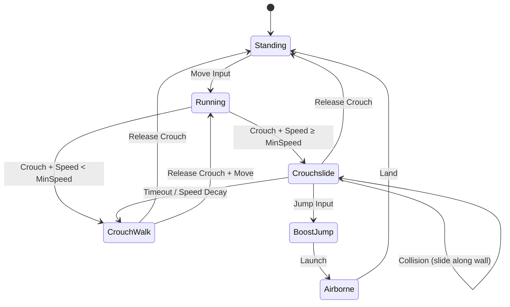

# Crouchslide Movement Mechanic - Research & Design

## Overview
Crouchslide is a modern FPS movement technique popularized by **Apex Legends** and **Call of Duty: Warzone**. It combines crouch with forward momentum to create a fast, fluid, and tactical movement option.

---

## Core Concept

| State | Input | Speed | Behavior |
|-------|-------|-------|----------|
| **Crouch Walk** | Crouch + Low Speed (< strafe) | ~50% movement | Stealthy, quiet movement |
| **Crouchslide** | Crouch + High Speed (≥ strafe) | 120-150% initial | Momentum-preserving slide |

### Entry Conditions
- Player must be **grounded** and **moving fast enough** (≥ `sv_movementSpeed`).
- Player presses **Crouch** while running.
- Slide direction is locked to velocity at entry (no steering during slide).

### Exit Conditions
- **Timeout**: Slide expires after `sv_slideDuration` (default: 1000ms).
- **Jump Cancel**: Player can jump during slide for a **boost jump** (Apex-style).
- **Stop**: Player releases movement keys (friction kills slide).
- **Collision**: Hitting a wall ends the slide.

---

## Proposed Variables

| Variable | Default | Description |
|----------|---------|-------------|
| `sv_slideDuration` | 1000 | Max slide time in milliseconds |
| `sv_slideSpeedMultiplier` | 1.2 | Initial slide speed relative to entry speed |
| `sv_slideDecay` | 0.5 | Speed decay per second (linear fade) |
| `sv_slideJumpBoost` | 1.3 | Boost multiplier when cancelling slide with jump |
| `sv_slideMinSpeed` | 180 | Minimum speed required to initiate slide |
| `sv_slideFriction` | 0.1 | Friction during slide (much lower than ground) |

---

## State Machine

---

## Related Mechanics Integration

### 1. Stealth Crouch (Mechanic #6)
- When `speed < sv_strafeSpeed`, player is in **Crouch Walk** (quiet footsteps).
- When `speed ≥ sv_strafeSpeed`, player transitions to **Crouchslide** (loud, but fast).

### 2. Launch at Preserved Momentum (Mechanic #3)
- **Boost Jump**: Jumping during a slide preserves and amplifies momentum.
- Formula: `jumpVelocity = slideVelocity * sv_slideJumpBoost + normalJumpHeight`
- This creates a "super jump" effect when chaining slide → jump.

### 3. Wall Interaction
- Sliding into a wall clips velocity (standard collision).
- Potential: Slide → Wall → Wallrun chain (future feature).

---

## Implementation Plan

### Phase 1: Core Slide
1. Add slide state to `FPSController` (isSliding, slideStartTime, slideVelocity).
2. Implement entry/exit conditions.
3. Apply constant friction during slide (no air control).
4. Add `sv_slide*` variables to `MovementVars`.

### Phase 2: Boost Jump
1. Detect jump during slide state.
2. Apply `sv_slideJumpBoost` to horizontal velocity.
3. Play boost jump animation/sound.

### Phase 3: Crouch Walk Fallback
1. When slide ends (timeout/speed loss), transition to crouch walk.
2. Crouch walk has reduced speed and quiet footsteps.

### Phase 4: Polish
1. Camera tilt during slide (optional, cosmetic).
2. Third-person slide animation (for spectators).
3. Sound effects (slide friction sound).
4. Particle effects (dust trail).

---

## Reference Games

| Game | Slide Duration | Boost Jump | Notes |
|------|---------------|------------|-------|
| **Apex Legends** | ~1.5s | Yes | Aggressive, chain-able |
| **Call of Duty: Warzone** | ~1s | Limited | Tactical, slower recovery |
| **Titanfall 2** | Infinite (on slopes) | Yes | Physics-based, best-in-class |
| **Mirror's Edge** | ~0.8s | Yes | First-person focused, iconic |

---

## Approved Features ✅

| Feature | Status | Notes |
|---------|--------|-------|
| **Slide Cooldown** | ✅ Approved | Prevents spam-sliding |
| **Slope Acceleration** | ✅ Approved | Uses `sv_gravity` for downhill boost |
| **Camera Tilt** | ✅ Approved | Immersive visual feedback |
| **Boost Jump** | ✅ Approved | Hold Space = boost, Tap Space = stand up |
| **ADS Disabled** | ✅ Approved | Cannot aim down sights while sliding |

### Boost Jump Behavior (CoD/Walljump Style)
- **Hold Space** during slide → Boost jump (1.3x momentum)
- **Tap Space** during slide → Quick stand, continue running
- Same input pattern as existing walljump mechanic

### Keybinds (Placeholder)
- **Ctrl** or **C** → Crouch/Slide toggle
- (Binds TBD in future keybind system)

---

## Updated Variables

| Variable | Default | Description |
|----------|---------|-------------|
| `sv_slideDuration` | 1000 | Max slide time (ms) |
| `sv_slideSpeedMultiplier` | 1.2 | Initial speed boost |
| `sv_slideDecay` | 0.5 | Speed decay per second |
| `sv_slideJumpBoost` | 1.3 | Boost when jump-cancelling |
| `sv_slideMinSpeed` | 180 | Minimum entry speed |
| `sv_slideFriction` | 0.1 | Low friction during slide |
| `sv_slideCooldown` | 500 | Cooldown before next slide (ms) |
| `sv_slideSlopeBoost` | 1.0 | Slope acceleration multiplier (scales with gravity) |
| `sv_slideCameraTilt` | 5.0 | Camera roll angle during slide (degrees) |

---

## Files to Modify

- `src/engine/camera/controllers/FPSController.ts` - Main logic
- `src/engine/core/MovementVars.ts` - New slide variables
- `src/engine/game/Player.ts` - State machine integration
- `src/audio/SoundManager.ts` - Slide sound effects

---

## Next Steps

1. [ ] User approval of design
2. [ ] Add slide variables to `MovementVars`
3. [ ] Implement slide state in `FPSController`
4. [ ] Test and tune timing/speed values
5. [ ] Add boost jump integration
