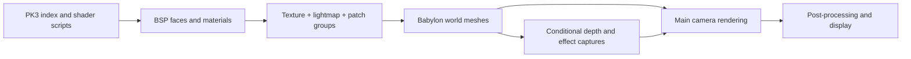

# v0.9.23 rendering investigation

**Started:** 2026-09-11. **Last progress update:** 2026-09-12.

**Status:** PVS now enables automatically on completed playable BSP map loads on `feature/v0.9.23-gfx-investigation`. The user reports roughly 35 FPS rising to 120 FPS with PVS. Default activation passed 138 focused tests and the required renderer regressions. Optional spatial batching remains default off, with large-map `wbomb6` comparisons recorded below; systematic browser correctness/performance capture remains pending.

**Source snapshot:** `2e4886d5`, SHAG `0.9.23`, installed Babylon core `9.17.0`.

**Scope:** Five performance candidates and five graphics candidates for the existing FPS renderer.

## Implementation progress

This matrix is the current progress tracker. Update it whenever implementation, validation, or an investigation result changes; partial work stays visible here.

| Work item | Status | Evidence / next step |
| --- | --- | --- |
| Renderer inventory; five optimization and five graphics candidates | Investigated | Source inspection and Babylon references below; benefits still need measurement. |
| Feature branch | Done | `feature/v0.9.23-gfx-investigation`, based on `2e4886d5`. |
| PVS: compiled face/leaf membership | Implemented; headless-validated | World batches carry the union of their faces' clusters; unassigned surfaces remain visible. IBSP and FBSP maps exercised. |
| PVS: cached frame updates and small boundary crossings | Implemented; headless-validated | Tests verify zero mesh-visibility reads on stationary/same-cluster frames and correct sub-unit boundary crossings. |
| PVS: active camera and lifecycle cleanup | Implemented; headless-validated | Camera swaps, parent transforms, normal world + weapon camera pair, map replacement and disposal covered. Multiple world views conservatively show all. |
| PVS: focused and water regression tests | Passed for default activation | 138/138 tests in eleven files, including 28 PVS/spatial/load-path tests. New coverage verifies default-on sequencing, off/reload behavior, delayed cameras, missing/malformed data and background loads. |
| Required renderer regression commands | Passed for default activation; existing warnings remain | Simulation, physics, tick, fuzz and indexed `wdm2` load all exited 0. Explicit forwarding also verified 1,000 fuzz ticks, seed 923, zero errors and matching checksum. Physics/lightgrid baseline warnings persist. |
| PVS: installed-map headless exercise | Passed | Six authored `wdm2` spawn origins: 38-79 of 197 meshes hidden (19.3-40.1%). `acidwdm2`: 106 registered; map replacement and clear reset the culler. Counts are not GPU savings; results below. |
| TypeScript and formatting | Passed for default activation | `npm run typecheck`; Biome checked all eleven changed TypeScript files. |
| Documentation, final diff and links | Passed for default activation | Matrix and current validation ledger updated; no whitespace diagnostics on tracked/new files, and all 60 relative file links resolve. User's roughly 35 to 120 FPS observation recorded with its limits. |
| PVS: automatic gameplay activation | Implemented; headless-validated | Completed playable loads now enable PVS after entity spawning. Camera argument is optional; missing/invalid PVS leaves the world visible. `pvs off` applies to the current map, and the next playable load enables it again. Background maps remain separate; spatial batching remains default off. |
| PVS: batch span and triangle-weight measurement | Implemented; three maps compared | Reusable `audit-pvs.ts` reports heavy batches, per-spawn counts, averages and geometry hashes. `wdm2`, `acidwdm2` and `wbomb6` each audited at four cell sizes. |
| PVS: large-map validation (`wbomb6`) | Headless comparison passed | 286,736 triangles; 21 authored spawn origins. At 1024 units, mean retained triangles fell from 118,576 to 92,237 (22.2%) while mean visible meshes rose from 183.5 to 195.3 (6.4%). All four geometry hashes matched. Browser FPS/visual validation remains pending. |
| PVS: spatial batch splitting | Implemented; headless-validated; default off | Only original material/lightmap/patch batches with at least 1,024 triangles split. `r_bsp_cellsize 1024` applies at next map build. Larger `wbomb6` gives the strongest result so far; browser acceptance remains pending. |
| Spatial experiment validation | Passed | Geometry hashes matched across all three maps; 133 tests and required regressions passed after the final console update fix. `wbomb6` console rebuilds verified 864 meshes at 1024 and 743 at 0; PVS toggles/re-registration worked. |
| Static transform/bounds freezing in playable load path | Implemented; headless-validated | `MapLoader` now calls `freezeStaticWorld()` after the material freeze, gated by `r_bsp_freeze`. Eligibility moved from "not an autosprite" to the `bspPvsClusters` annotation, so gameplay movers parented under the world root are excluded by annotation rather than by load order. `wdm2` render path freezes 136 (root + 135 batches, 62 autosprites skipped) — unchanged by the tighter filter. The playable call site itself is browser-only: headless registers no gameplay map launcher. Measure separately from PVS. |
| Browser visuals and CPU/GPU performance capture | User FPS improvement reported; systematic checks pending | User reports roughly 35 to 120 FPS from another spawn with PVS. Exact map, cell size, hardware, route and timing capture were not specified in that report; treat this as a user observation, not a controlled benchmark. |
| Water cost, optional passes, WebGPU and graphics experiments | Candidates documented | No implementation or measured improvement claimed. |

### 2026-09-11: PVS foundation started (historical checkpoint)

- Created `feature/v0.9.23-gfx-investigation` from `2e4886d5` and retained this research document.
- Confirmed that sampled bounds are not reliable face membership, sub-10-unit camera motion can miss a cluster transition, and PVS teardown drops observer references without removing the observer.
- Confirmed gameplay movers can be parented under the world root. Static PVS must identify authored world surfaces explicitly rather than register every descendant indiscriminately.
- Work started: compiled face/leaf membership, cached visibility updates, active-camera tracking, lifecycle cleanup, and regression tests. Validation was pending at this checkpoint; the next entry records the results.

### 2026-09-12: PVS foundation implemented and headless-validated

**Behavior now implemented:** BSP leaf-face references define membership for each rendered world face; a material batch receives the union of its faces' clusters. Unassigned/invalid membership remains visible. Registration only accepts annotated world surfaces, keeping independently moving brush entities and other untagged descendants outside static PVS. Existing batching and material semantics are unchanged.

Stationary frames return cached counts without BSP lookup or mesh scans. Movement within a cluster checks the source leaf but does not scan meshes. Any cluster transition, including less than one unit of motion, updates visibility. Registration, toggles and explicit `invalidate()` force reevaluation. An explicit `getStats()` still scans for diagnostics; `pvs status` reports visibility without changing it. Update time is the last full visibility update, not a per-frame cost measurement.

The manager follows the live world camera and uses its world position. Source review caught the normal `[eye, weapon]` camera pair: the weapon-only layer must be excluded from world-view selection. Missing/invalid source positions and multiple actual world cameras conservatively show registered surfaces. The manager removes its frame observer on disable and retains disposal hooks until the map/world/scene is released; re-enabling does not duplicate observers. Disabling and teardown restore each mesh's visibility recorded at registration, including intentionally hidden surfaces.

**Visibility ownership:** the culler owns `isVisible` for registered static surfaces. Temporary capture overrides must restore it afterward; use `invalidate()` to reapply PVS after an external override. An enduring change to the intended baseline requires restoring/unregistering the culler and registering again. `WaterProbeCache` and `WaterActorReflection` already temporarily include PVS-hidden world geometry and restore the flags; their tests pass. This does not establish correctness for every shader, shadow pass or other auxiliary view.

**Installed-map results:** the CLI initialized its shader registry and constructed actual meshes with `BspMeshBuilder` through `bsp render` under Babylon `NullEngine`. `wdm2` (FBSP) produced 135 material batches plus 62 autosprites; `acidwdm2` (IBSP) produced 106 batches. Samples below use authored spawn **origins**, converted to Babylon `(x, z, y)`, without adding gameplay eye height. Each `pvs on` performs an immediate update; a headless batch does not run the normal render loop.

| Map / Babylon position | Source cluster | Visible clusters | Visible / registered meshes | Hidden meshes |
| --- | ---: | ---: | ---: | ---: |
| `wdm2`: `(-184, 168, 288)` | 553 | 440 / 1,192 | 158 / 197 | 39 (19.8%) |
| `wdm2`: `(-790, 232, -854)` | 1141 | 279 / 1,192 | 118 / 197 | 79 (40.1%) |
| `wdm2`: `(824, 424, -232)` | 99 | 386 / 1,192 | 145 / 197 | 52 (26.4%) |
| `wdm2`: `(-798, 424, -368)` | 1058 | 370 / 1,192 | 139 / 197 | 58 (29.4%) |
| `wdm2`: `(-344, 424, 184)` | 545 | 402 / 1,192 | 154 / 197 | 43 (21.8%) |
| `wdm2`: `(254, 24, -270)` | 314 | 453 / 1,192 | 159 / 197 | 38 (19.3%) |
| `acidwdm2`: `(254, 24, -270)` (retained camera, not a spawn sample) | 452 | 370 / 850 | 65 / 106 | 41 (38.7%) |

Turning PVS off restored all 197 `wdm2` meshes. Loading `acidwdm2` created a fresh registration; `bsp clear` returned PVS status to available but not initialized. The earlier default-camera exercise also observed `acidwdm2` cluster 227 with 54/106 meshes visible, but did not record that camera's coordinates.

**Interpretation:** compiled PVS is eliminating whole batches in this headless inspection path. At the second `wdm2` spawn, only 279/1,192 clusters are in the PVS, yet 118/197 meshes remain visible. Broad material batches and conservative membership are still a constraint worth investigating. This is not a comparison against the previous sampling algorithm, a triangle/draw reduction measurement, or an FPS benchmark. Frustum culling may already reject some of these meshes; batch sizes vary greatly, and additional render passes have separate costs.

**Follow-up from this checkpoint:** the next entries record batch/triangle measurement, the optional spatial experiment and subsequent default PVS activation. Browser comparisons remain pending. Static transform freezing is still a separate optimization.

### 2026-09-12: Optional spatial batching and large-map comparison

**Implemented:** `r_bsp_cellsize` defaults to **0 (off)**. Positive values use 128-4096 map-unit cells, applied on the next map build through both `MapLoader` and `BspManager.render`. A face's source-bounds centre selects its cell in BSP coordinates. Whole faces are assigned once; no clipping, triangle duplication, retessellation or UV rewriting is performed. A face may extend outside its cell, so cell size is a grouping parameter, not a hard mesh-bounds limit.

Only opaque, non-animated groups with valid compiled membership are eligible. Transparent/blended surfaces, polygon-offset decals, liquids, parsed vertex-deformed shaders, autosprites and textures associated with fog/effects keep their existing grouping. Original texture/lightmap/patch groups below **1,024 tessellated triangles** are kept merged. The existing mesh names and texture/lightmap metadata remain compatible with material application and area-light texture lookup.

**Why restrict small batches:** the initial uniform 512-unit experiment increased mean visible `wdm2` meshes from 145.5 to 489 for a 26.7% reduction in retained triangles. That is a poor CPU-submission tradeoff to adopt without a benchmark. The refined threshold reduces fragmentation. It is an initial policy, not a proven optimal threshold.

**Related load-time fix:** texture-load entries are now deduplicated by texture index. Applying one texture already visits all matching meshes, including separate lightmaps and spatial chunks; duplicate entries repeated that work. Entries fell from 139 to 102 on `wdm2` and from 106 to 30 on `acidwdm2`; no loading-time speedup was benchmarked. A test verifies that the base texture resolves once and reaches every matching chunk while lightmap and PVS metadata survive.

The console exercise also caught this map-build-only cvar scheduling a live material update. It now uses the existing deferred-update guard, avoiding an unnecessary scene update and headless `requestAnimationFrame` failure.

**Audit method:** [audit-pvs.ts](../../src/cli/audit-pvs.ts) loads PK3s through `NodePk3`/`PK3Index`, loads the shader registry, and builds real geometry with `NullEngine`. It compares sizes 0/512/1024/2048 at every authored `info_player_deathmatch` origin: six positions on `wdm2`, eleven on `acidwdm2`, and twenty-one on the user-requested `wbomb6`. All source clusters were valid; `wbomb6` positions cover twenty distinct clusters of 2,796. This samples spawn origins without an eye-height offset, not an entire map route or all PVS rows.

The audit hashes an order-independent list of triangles while preserving winding, position, normal, UV, UV2, vertex colour, texture/lightmap identity and initial backface-culling state. It fails if a variant changes that hash or retains more triangles than the baseline at a sampled position. All twelve final map/size combinations passed, with unchanged total vertices and triangles. The hash is not a rendered-material or shader-output comparison.

| Map | Cell size | Total meshes | Mean PVS-visible meshes | Mean PVS-retained triangles | Triangle reduction vs size 0 |
| --- | ---: | ---: | ---: | ---: | ---: |
| `wdm2` | 0 | 197 | 145.5 | 42667.7 | 0.0% |
| `wdm2` | 512 | 362 | 242.2 | 34054.2 | 20.2% |
| `wdm2` | 1024 | 222 | 164.7 | 39779.8 | 6.8% |
| `wdm2` | 2048 | 219 | 164.7 | 40062.8 | 6.1% |
| `acidwdm2` | 0 | 106 | 55.9 | 14786.2 | 0.0% |
| `acidwdm2` | 512 | 106 | 55.9 | 14786.2 | 0.0% |
| `acidwdm2` | 1024 | 106 | 55.9 | 14786.2 | 0.0% |
| `acidwdm2` | 2048 | 106 | 55.9 | 14786.2 | 0.0% |
| `wbomb6` | 0 | 743 | 183.5 | 118575.8 | 0.0% |
| `wbomb6` | 512 | 959 | 204.3 | 90677.9 | 23.5% |
| `wbomb6` | 1024 | 864 | 195.3 | 92237.2 | 22.2% |
| `wbomb6` | 2048 | 804 | 189.9 | 97885.0 | 17.4% |

Means weight each authored spawn equally. “PVS-retained triangles” sums indices on visible world meshes **before frustum culling**, without counting additional rendering passes. Neither the mesh counts nor the triangle reductions are measured GPU draw calls, CPU submission times or FPS gains.

**Large-map result:** `wbomb6` builds 253,913 vertices and 286,736 triangles from its 21,584 BSP faces, with 24 lightmaps and 350 autosprites. At cell size 1024, retained triangles drop **22.2%** while mean visible meshes rise **6.4%**. At 2048, the tradeoff is **17.4%** fewer retained triangles and **3.5%** more visible meshes. At 512 it is **23.5%** fewer triangles and **11.3%** more visible meshes. These make 1024 and 2048 useful browser comparison candidates; they do not justify a default change yet.

**Smaller-map limit:** `wdm2` at 1024 removes 6.8% of baseline-retained triangles with 13.2% more mean visible meshes. The refined policy leaves `acidwdm2` unchanged: its largest 6,775-triangle ink batch is a special surface and the eligible batches fall below the threshold. Uniform splitting would reduce more triangles there but add many meshes. Preserving this limit is preferable to claiming a universal improvement.

**Console integration:** at `wbomb6` position `(112, 24, 272)`, cluster 1539, the actual cvar/rebuild command path produced 252 visible of 864 registered meshes at 1024 and 235 visible of 743 at 0. Switching PVS off and rebuilding reset registration correctly. The final run had no live-update callback error.

**Browser A/B procedure (pending; updated for default PVS):** run commands individually. Begin with `r_bsp_cellsize 0`, load `wbomb6`, verify `pvs status`, then capture a repeatable route with `perf capture 10`. Repeat at 1024 and optionally 2048, reloading the map; PVS enables automatically. Keep resolution, camera/FOV, quality settings, PVS state and warmed assets fixed. Use the same existing gametype; the headless audit itself assumes no gametype. Check doors, tunnels, outdoor sightlines, fog, water, sprites, lightmaps and camera changes. More mesh/material objects may increase loading, collision setup, auxiliary-pass and CPU submission costs.

```text
developer 1
r_bsp_cellsize 1024
map wbomb6
pvs status
perf capture 10
```

Set `r_bsp_cellsize 0` and reload to restore original grouping. `pvs off` only disables visibility culling; it does not merge an already partitioned map. No automatic PVS activation, new graphics effect or gameplay/networking change was added in this checkpoint.

### 2026-09-12: PVS enabled by default

The user reported roughly **35 to 120 FPS** with PVS from another spawn and explicitly requested default activation. This is a user observation; the report did not specify the exact map, cell size, hardware, route or timing capture. It supports the user's default-on decision without establishing a repeatable benchmark or attributing the gain to spatial splitting.

`MapLoader.loadBspMap()` now awaits `BspManager.enablePVS(scene)` after material/light setup, shader readiness, tab recovery and final entity spawning. Registration captures the completed world's intended visibility. Every playable load, reload and map change enables PVS; `pvs off` disables it for the current map, and `pvs on` restores it immediately. A missing camera initially shows the registered surfaces, then the next frame uses the current world camera. Missing/malformed PVS data leaves the world visible and allows loading to succeed.

Menu background loads do not register or enable gameplay PVS. The lower-level `bsp render` inspection flow still uses explicit `pvs on`. `r_bsp_cellsize` remains **0 by default**. No cvar, saved config, gameplay simulation or networking behavior changed in this activation step.

Five added cases run the real `MapLoader.loadMap` sequence and mesh/culling/cleanup code with synthetic two-room BSP data, while stubbing asset I/O, GPU readiness, lighting and gameplay services. They verify activation after setup/entity handling, off/reload behavior, delayed camera assignment, missing/malformed data and background-map exclusion. All **138 tests in eleven files** and the required renderer regressions passed. Complete installed-map browser loading and auxiliary-view visuals remain unverified by automation; see the current validation ledger below.

The strongest starting points are **missing load-path optimization wiring, PVS correctness, spatial BSP batching, and water capture costs**. For graphics, **directed particle effects** offer the smallest useful experiment; volume lighting is the more ambitious atmospheric option. These are hypotheses ranked from code inspection, not measured FPS improvements.

Assumptions: preserve Quake/Warsow material semantics and competitive visibility; support the existing single-player and multiplayer client; keep WebGL2 as the default; offer expensive effects through explicit quality settings. Use `wdm2` for an initial indoor baseline and `acidwdm2` for a water comparison if installed. No gametype, win condition, server protocol, or simulation changes are proposed.

## What the renderer already does

The playable path is `MapLoader`/`BspManager`/`BspMeshBuilder`. `MapRenderer.ts` also contains rendering functionality, including static clustered lights, but its raw-map path should not be mistaken for the normal indexed BSP loading path.



This is a dependency sketch, not the exact order of all Babylon render passes.

| Area | Verified current behavior | Implication |
| --- | --- | --- |
| Backend | `RenderingEngineFactory` defaults to WebGL2. `?renderer=webgpu` and `r_webgpu` select an experimental backend with initialization fallback. | Switching backend is already possible; it is not itself a new optimization. |
| BSP geometry | Default grouping remains texture index, lightmap index and patch status. This branch adds optional spatial grouping for eligible large batches. Lightmaps remain separate `RawTexture`s. | `r_bsp_cellsize` permits an A/B test; room-spanning groups remain the default until browser measurements justify a change. |
| Visibility | `PVSCuller` exists. The only `enablePVS()` caller found under `src` is `PvsCommand`; no automatic activation was found in map loading. | PVS data being loaded does not establish that gameplay is using it. User configs may still enable it. |
| Static work | `r_bsp_freeze` defaults to 1, but its transform/bounds helper is called only in `BspManager.render()`. `MapLoader` builds meshes directly and freezes selected materials instead. | The helper exists and has tests, but the normal playable path does not call it. Material freezing is a different operation. |
| Materials/assets | PBR/deluxe and KTX2 preferences default on. Q3 compatibility includes multiple material paths and animated stages. | Preserve fallbacks, UV conventions, lightmaps, and shader animation when optimizing. |
| Lighting | World effect lights use `DynamicLightCluster` on WebGL. Textured area lights and opt-in emissive-surface placement already exist. | Neither clustered lights nor textured panels belong on a list of missing features. |
| Post-processing | HDR default pipeline with bloom; optional SSAO, SSR, glow, cel outlines, and classic source-mesh god rays. SSR forces the geometry-buffer path. | Count actual enabled passes before adding or merging effects. |
| Water | Cached room probes; quality 2 adds depth, quality 3 adds half-resolution world color. Nearby actor reflections can add a separate reflected view. | Lower target resolution reduces pixel work, but still requires geometry submission. |
| Particles | Rain already has a GPU backend/fallback. Other effects include CPU particles and specialized pooled geometry. | “Move all particles to the GPU” is too broad and partly redundant. |
| Measurement | `perf capture [seconds]` reports p50/p95 frame/CPU/GPU timings, draw calls, active meshes, triangles, and shader/bundle counters. | Reuse existing instrumentation; add pass-specific evidence only where needed. |

Source entry points: [map loading](../../src/engine/loader/map/MapLoader.ts), [client map setup](../../src/engine/loader/map/ClientMapLoader.ts), [mesh builder](../../src/engine/loader/bsp/BspMeshBuilder.ts), [PVS](../../src/engine/loader/bsp/PVSCuller.ts), [render defaults](../../src/engine/rendering/RenderVars.ts), [post-processing](../../src/engine/effects/PostProcessingManager.ts), [area lights](../../src/engine/lighting/AreaLightManager.ts), [rain](../../src/engine/effects/RainEffect.ts).

Earlier investigations remain useful context: [Babylon 9 upgrade](BabylonJS-9-upgrade.md), [area/volumetric lighting](BABYLON9_AREA_VOLUMETRIC_LIGHTS.md), [SSR](BABYLON9_SSR.md), [water](WATER.md), and [rendering pipeline](RENDERING_PIPELINE.md). Current source takes precedence over older claims: for example, `buildLightmapTextures()` currently creates individual textures, despite the older pipeline diagram mentioning an atlas.

## Five optimization candidates

| ID | Candidate | Expected opportunity, not a measured result | Effort / priority |
| --- | --- | --- | --- |
| O1 | Connect existing static/PVS optimizations to gameplay; remove redundant scans | Transform/bounds CPU work and geometry hidden behind rooms | Small initial cleanup, medium activation work / first |
| O2 | Partition BSP batches spatially; investigate lightmap packing | Better culling and local lighting, balanced against draw calls | Medium-large / second |
| O3 | Reduce recurring water capture work | Extra world submissions, reflected-view CPU work, GPU bandwidth | Medium / first on water maps |
| O4 | Budget optional passes; evaluate shared resources and Frame Graph | Fullscreen shading, repeated depth work, target memory | Small tuning experiments, large graph migration / staged |
| O5 | Revisit WebGPU compatibility, then measure render-bundle reuse | CPU submission and shader startup work | Large / later |

### O1. Finish the static-world and PVS integration

**Pre-change evidence (`2e4886d5`).** In [PVSCuller](../../src/engine/loader/bsp/PVSCuller.ts), `update()` returned `getStats()` below a 10-unit movement threshold, scanning every managed mesh. Moving sufficiently within the same cluster also walked all assignments. [BspManager.enablePVS](../../src/engine/loader/bsp/BspManager.ts) captured the camera passed at activation. **Implemented on this branch:** cached frame updates, exact movement/cluster checks, current world-camera selection and lifecycle cleanup; see the progress matrix and tests.

A separate call-site gap is directly visible in [MapLoader](../../src/engine/loader/map/MapLoader.ts): `loadBspMap()` calls `BspMeshBuilder.build()` and later `setMeshResult()`, bypassing the `freezeStaticWorld()` call in `BspManager.render()`. Its `mat.freeze()` loop does not freeze mesh transforms or bounds. Reuse the existing helper on eligible world geometry in the playable path, gated by `r_bsp_freeze`, and validate build order around water/sprites and moving brush entities. Measure this independently from PVS changes.

**Implemented integration.** Completed playable map loads enable PVS using the live world camera, with `pvs off` retained for comparison. Headless load-sequence tests pass. Browser verification must still exercise camera changes and small doorway crossings.

**Remaining correctness checks.** The original registration sampled 15 bounding-box points, which could not establish all face membership. This branch replaces those samples with compiled leaf-face references and explicit world-surface metadata. Default activation is now implemented at the user's request. Rendered gameplay still needs systematic validation of camera swaps, doors/lifts, transparent overlays and auxiliary reflection cameras. Main-camera visibility cannot hide geometry needed by another view.

**Measure/accept.** Compare PVS time, active-mesh evaluation, draws, and frame p95 for stationary views and a repeatable route crossing doorways. Require no disappearing surfaces, stale camera state, or visibility errors in water reflections. This can improve CPU work without a major mesh rebuild; O2 addresses the spatial limit separately.

### O2. Make BSP batches spatially useful

**Evidence.** The [mesh-builder](../../src/engine/loader/bsp/BspMeshBuilder.ts) retains texture/lightmap/patch grouping by default. This branch optionally adds a cell key to eligible large groups. [PVS registration](../../src/engine/loader/bsp/BspManager.ts) uses compiled face membership and culls entire resulting batches. [AreaLightManager](../../src/engine/lighting/AreaLightManager.ts) also explains why map-spanning batches undermine local light scoping.

**Implemented experiment.** The optional grid grouping and triangle threshold are described in the progress log. It preserves complete faces and their compiled memberships. Next measure actual frame times; room/cluster-aware grouping remains a possible alternative if grid boundaries prove inefficient. No lightmap packing has been implemented.

As a separate second step, test lightmap atlases within compatible chunks to recover draws split only by lightmap index. Rewrite UV2 with padding and preserve filtering, FBSP lightstyle/deluxe assumptions, material state, and unmapped/fullbright surfaces. Packing is not automatically beneficial: `wdm2` has only four lightmaps, and texture/material identity can still prevent merges.

**Integration risks.** Movers stay independently transformable; autosprites and transparent stages need their existing semantics. Audit consumers of `bsp_tex_*` names and metadata, including area-light texture lookup, water-region extraction, and material application. Do not blindly merge the whole map or freeze the active-mesh list.

**Measure/accept.** Report total batches, visible batches, submitted triangles, draws across all passes, and CPU/GPU p95. Accept extra total meshes only if the tested routes actually get cheaper without cracks, lightmap seams, or lost faces. If successful, spatial chunks can also help light/occluder selection.

### O3. Spend less on water captures when their contribution is small

**Evidence.** [LiquidSurfaceSystem](../../src/engine/rendering/water/LiquidSurfaceSystem.ts) already suspends depth/refraction when liquids leave view. [WaterProbeCache](../../src/engine/rendering/water/WaterProbeCache.ts) caches room captures rather than updating them every frame. The remaining recurring work includes [WaterRefraction](../../src/engine/rendering/water/WaterRefraction.ts) and [WaterActorReflection](../../src/engine/rendering/water/WaterActorReflection.ts): the latter scans actors, selects occluders, checks readiness, and schedules a reflected view while eligible. Its target is quarter resolution, capped at 320 pixels on the longest side, but occluders still submit.

**Experiment.** Cache stable actor/occluder membership and reusable arrays, then add projected-water-area thresholds and hysteresis. Test actor-reflection cadence independently from refraction. Camera movement changes the projected image even when scenery is static, so refresh on meaningful camera/actor/pool changes; begin with reduced cadence only for near-stationary views. Keep waves and player ripples responsive.

Do not drop occluders to meet a budget: suppress/fade the reflected actor layer instead. The current code already follows that rule. Retain its reflected-camera frustum checks and special reflection-only local body handling.

**Measure/accept.** Compare quality 2, quality 3 without actors, and quality 3 with actors at the same camera position, followed by pool traversal. Record CPU/GPU p95 and capture draws. Look for reflection judder, actor admission popping, bank/refraction smearing, and hidden actors becoming visible. Potential benefit is map/view dependent; dry maps will not gain from this work.

### O4. Budget the post-processing stack before migrating it

**Evidence.** [SSR](../../src/engine/effects/SSREffect.ts) uses 500/1,000 maximum ray steps by tier and automatic thickness computation. [SunGodRays](../../src/engine/lighting/SunGodRays.ts) constructs its classic effect at ratio 1.0. [GlowEffect](../../src/engine/effects/GlowEffect.ts) and default bloom serve different purposes, but enabling both adds work. They are not interchangeable effects.

**Small experiments.** Reduce god-ray occlusion resolution separately from the final composite; test bounded SSR ray budgets/resolution and thickness settings; compare bloom/glow combinations at matched appearance. Babylon's classic god-ray API exposes separate `postProcessRatio` and `passRatio`. These are existing capabilities, not Babylon 9 inventions. [Official VLS documentation](https://raw.githubusercontent.com/BabylonJS/Documentation/master/content/features/featuresDeepDive/lights/volumetricLightScattering.md)

**Larger experiment.** Inventory target dimensions/formats, depth conventions, mesh exclusions, cameras, and lifetimes. [WaterDepth](../../src/engine/rendering/water/WaterDepth.ts) deliberately owns its renderer because water needs camera-space Z while cel outlines use a different depth metric, and Babylon's per-camera depth cache preserves the first caller's settings. Any sharing requires explicit conversion/ownership and matching inclusion rules. SSR's geometry-buffer choice also avoids a known StandardMaterial prepass problem in this code; do not undo it casually.

Frame Graph reached v1.0 with Babylon 9 and can make resource lifetimes and compatible texture reuse explicit. Prototype a small graph only after measuring the existing stack; graph conversion does not by itself eliminate passes or improve FPS. [Official Frame Graph announcement](https://forum.babylonjs.com/t/frame-graph-v1-0-is-now-live/62163), [architecture documentation](https://raw.githubusercontent.com/BabylonJS/Documentation/master/content/features/featuresDeepDive/frameGraph.md)

**Measure/accept.** Attribute GPU time and target memory to enabled effects, then compare image quality and p95. Preserve silhouettes, transparency, camera switching, depth interpretation, and disposal. This work supplies prerequisites for G3, rather than making volume lighting a quick toggle.

### O5. Earn a WebGPU performance comparison through visual parity

**Evidence.** [RenderingEngineFactory](../../src/engine/rendering/RenderingEngineFactory.ts) already supports an opt-in WebGPU path and packaged GLSL translation tools. [DynamicLightCluster](../../src/engine/lighting/DynamicLightCluster.ts) explicitly disables clusters on WebGPU because of binding failures. [DynamicLightSafety](../../src/engine/lighting/DynamicLightSafety.ts) uses smaller WebGPU forward-light caps. There are no application assignments to `compatibilityMode` or `snapshotRendering` in the source scan.

**Experiment.** Reproduce the existing lighting/material compatibility failures against the installed version, then evaluate a pinned Babylon update if justified. Bring representative BSP, weapon, water, and skinned-player shaders to equivalent output. Native WGSL is worth testing for custom shaders, especially startup/translation costs; it is not a guaranteed steady-state speedup.

Only after parity, compare Babylon's non-compatibility rendering mode and bundle reuse on stable draws. The installed engine exposes `compatibilityMode`, and [RendererPerformanceCapture](../../src/engine/rendering/RendererPerformanceCapture.ts) already records bundle creation/reuse. Full-scene snapshot rendering needs special care around changing PVS, moving actors, animated textures, and extra cameras; it is not an appropriate blanket switch. [Babylon 9.17 WebGPU engine source](https://raw.githubusercontent.com/BabylonJS/Babylon.js/9.17.0/packages/dev/core/src/Engines/webgpuEngine.pure.ts)

**Measure/accept.** Same resolution, visible lights, materials, effects, route, and warmed assets on both backends. Separate load/compile time from frame CPU/GPU p95. A faster image caused by missing lights does not establish a backend performance gain. Keep the existing initialization fallback and user opt-in until the comparison passes.

## Five graphics candidates

“Available in Babylon 9” does not necessarily mean “introduced in 9.0.” The release highlights include features that landed earlier. The table distinguishes new SHAG work from existing capabilities. [Official Babylon 9 overview](https://www.babylonjs.com/)

| ID | Idea and engine fit | Version / existing state | Cost and first target |
| --- | --- | --- | --- |
| G1 | Directed particles for teleporters, energy pickups, and impact sparks | Node Particle Editor is a 9.0 highlight; flow maps existed in 8.6. SHAG has no node-particle/flow-map/attractor integration in the inspected source. | Low-medium, bounded cosmetic effect / first |
| G2 | Temporal antialiasing for calmer fine detail and cleaner captures | TAA is available in installed 9.17, not claimed as a new 9.0 feature; SHAG does not use it. | Medium; stationary demo/showcase first, gameplay experimental |
| G3 | Light volumes through windows/grates and hazy industrial spaces | The new Frame Graph volumetric task is a 9.0 addition; current SHAG god rays use the classic source-mesh effect. | High; one directional light and one room |
| G4 | Physical sky and aerial perspective for outdoor arenas | Atmosphere is a 9.0 highlight; `@babylonjs/addons` is not installed here. | Medium-high; one opted-in outdoor map |
| G5 | Environment shadowing for selected PBR presentation scenes | IBL shadows predate 9; 9 highlights dynamic environment lighting. No SHAG integration found. | High; small static showcase, low priority for live arenas |

### G1. Give energy effects authored direction and structure

**Look.** Sparks drawn into a teleporter, a short outward impulse on a powerup pickup, or a vortex around a charging energy source. These suit the arena vocabulary and can be readable at small particle counts.

**Verified building blocks.** Installed core includes `Particles/Node/nodeParticleSystemSet`, `Particles/flowMap`, and `Particles/attractor`. The editor provides graph-based authoring; `Attractor` exposes world position and signed strength. Flow maps are screen-aligned, so camera motion matters. They support CPU and GPU particle systems, but node authoring is not proof that every chosen graph runs on the GPU. [Node Particle Editor docs](https://raw.githubusercontent.com/BabylonJS/Documentation/master/content/toolsAndResources/npe.md), [Babylon maintainer's flow-map announcement, including its 8.6 origin](https://forum.babylonjs.com/t/using-flow-maps-with-particle-system/58263)

**First experiment.** Add one locally packaged effect to the existing FPS event/effect path, using a world-space attractor for a persistent map feature. Use screen-space flow only where view-relative behavior is intended. Compare with [ExplosionEffect](../../src/engine/weapon/ExplosionEffect.ts) and [RainEffect](../../src/engine/effects/RainEffect.ts) lifecycle/budget patterns. Cap particles, lifetime, and concurrent emitters; release observers/resources on map changes. Do not turn cosmetic particle state into replicated gameplay.

**Accept if:** the effect reads better at the same scene readability, with a known CPU/GPU budget and no growth after repeated triggers. Check camera rotation and overlapping effects, not just a still image.

### G2. Explore temporal stability without sacrificing fast aiming

**Look.** Reduce shimmer in distant metallic detail, railings, and water highlights; improve paused demos and showcase captures.

**Verified API, installed package.** `@babylonjs/core/PostProcesses/RenderPipeline/Pipelines/taaRenderingPipeline.pure.d.ts` exposes `TAARenderingPipeline`, `samples`, `factor`, `disableOnCameraMove`, `reprojectHistory`, and `clampHistory`. Its own description emphasizes still pictures, warns about ghosting, and requires TAA before other camera post-processes. The default disables accumulation on camera movement. This is an API-verified experiment, not a promise of robust FPS temporal reconstruction.

**First experiment.** Use a stationary demo/showcase camera, then separately test reprojection while strafing and turning rapidly. Route setup through [PostProcessingManager](../../src/engine/effects/PostProcessingManager.ts), which already owns fragile pipeline ordering. Check motion-vector coverage for animated players/custom materials, history reset at teleports/camera changes, and projection alignment with water captures. Shader-only water waves need special attention because geometry motion vectors do not describe all shading motion.

**Accept if:** fine detail stabilizes without visible trails on opponents, muzzle flashes, outlines, or the weapon. Keep gameplay opt-in until fast-motion comparisons pass. Reprojection/velocity targets and history buffers have a cost; TAA is neither free AA nor an upscaler.

### G3. Add volume lighting as a contained high-quality experiment

**Look.** Shafts shaped by a window/grate and visible while looking across a hazy room, beyond the current radial source-mesh treatment.

**Verified API.** Installed `FrameGraphVolumetricLightingTask` accepts a directional light, volume mesh, matching color/depth targets, `phaseG`, and optional extinction. `FrameGraphLightingVolumeTask` can generate the light volume from a shadow task. The official documentation describes extruded light volumes, not a general-purpose local fog/fluid simulator. WebGPU can update the volume using compute; WebGL reads back a shadow map and updates the mesh on the CPU. [Official implementation guide](https://raw.githubusercontent.com/BabylonJS/Documentation/master/content/features/featuresDeepDive/lights/volumetricLightScattering.md)

**First experiment.** One opted-in industrial room, one directional source, reduced volume tessellation/update cadence, with existing `SunGodRays` as fallback. Run the actual `IsSupported(engine, enableExtinction)` check: in installed 9.17, extinction requires `dualSourceBlending`; it is not enough to check “WebGPU available.” Integrating Frame Graph remains a prerequisite even for the WebGL variant.

**Accept if:** volume shape and occlusion improve materially for an agreed frame-time budget, without hiding opponents or flashing when the camera crosses a doorway. Treat moving shadow casters and CPU readback as explicit test cases. Do not advertise arbitrary point/spot volumetric support from this directional-light API.

### G4. Make outdoor sky, sun, and haze agree

**Look.** A coherent sunset over an outdoor arena, directional haze in the distance, or an authored alien sky. Best on maps with substantial sky exposure; an enclosed arena gains little.

**Verified upstream capability.** `Atmosphere` is imported from `@babylonjs/addons/atmosphere`, provides sky/aerial perspective, and integrates with directional lights and PBR materials. Documentation specifies WebGL2 or WebGPU with `Atmosphere.IsSupported(engine)`. The addon is absent from this project's dependencies, so compatible package/version and asset requirements still need checking before a prototype. [Official Atmosphere documentation](https://github.com/BabylonJS/Documentation/blob/master/content/addons/atmosphere.md)

**First experiment.** Connect a single map's atmosphere to [SkyLightSystem](../../src/engine/lighting/SkyLightSystem.ts) sun/time state and the existing HDR pipeline. Calibrate the atmosphere scale to Quake world units. Validate linear/gamma composition, current fog, and water reflections together. Cached water probes will not automatically follow a changing sky or day/night cycle; choose an update policy or a static presentation time for the first trial.

**Accept if:** sky, sun, and reflections look coherent at a bounded cost. Preserve authored Q3 skyboxes as the default for existing content. Physical sky lighting must not silently imply rebaking the map's static lightmaps.

### G5. Investigate IBL shadows for a small presentation scene

**Look.** Ground a weapon or player showcase in its environment lighting, with broad soft shadowing and less visually floating geometry.

**Important distinction.** The 9.0 overview describes dynamic environment shadows responding to lighting changes. The detailed documentation still limits practical use to static shadow casters because moving casters require costly voxelization. Therefore, this investigation does **not** propose real-time voxel shadows from every animated player. [Release description](https://www.babylonjs.com/?WT.mc_id=13556-DEV-codeproject-article33), [detailed IBL limitations](https://raw.githubusercontent.com/BabylonJS/Documentation/master/content/features/featuresDeepDive/postProcesses/IBLShadowsRenderingPipeline.md)

**Verified API.** Installed `Rendering/IBLShadows/iblShadowsRenderPipeline.pure.d.ts` exposes `addShadowCastingMesh`, `addShadowReceivingMaterial`, `updateSceneBounds`, `updateVoxelization`, and resolution/sample controls. The documented pipeline uses an environment texture, voxelization, geometry buffers, and temporal filtering, with Standard/PBR receivers. Custom ShaderMaterial/NodeMaterial compatibility is not established by that support statement.

**First experiment.** A small static diorama associated with [PostGameShowcase](../../src/games/fps/client/PostGameShowcase.ts), using only intentionally selected casters/materials. Establish a suitable environment texture; a skybox reflection or baked BSP lightmap is not automatically the required lighting setup. Exclude the sky from voxel bounds and avoid darkening existing baked shadows a second time.

**Accept if:** environment contact improves without excessive darkening or temporal lag. Measure voxel build cost separately from steady-state frames. Full live-arena use remains deferred pending a verified dynamic-caster solution and a convincing cost comparison against existing shadows/SSAO.

## Suggested next investigations

1. **PVS follow-up:** compare `wbomb6` at cell sizes 0/1024/2048 with PVS enabled along the same browser route. Verify images and CPU/GPU p95 before changing defaults. The compiled-membership, caching and optional spatial grouping checkpoints are headless-validated.
2. **Water baseline:** reproduce one pool view and actor approach; attribute the quality-2/3 and actor-reflection deltas. Prototype scheduling only if the pass costs justify it.
3. **Small visual prototype:** choose G1 for an energy/teleporter effect with fixed particle and emitter budgets. G3 is the next larger rendering experiment after the pass inventory.

Do not prioritize more bloom, adding SSAO/SSR from scratch, another GPU rain implementation, or a second static-freeze helper: those capabilities already exist. O1 is about connecting the existing helper correctly. Gaussian splats, geospatial rendering, and a wholesale material-model migration have weaker immediate fit than the shortlist for these BSP arenas.

## Measurement protocol for implementation follow-ups

Run the required headless checks first. Then, in the browser console, use the existing commands below **individually**; `perf capture` collects the following interval, so close the console promptly and repeat the same view/route:

```text
developer 1
map wdm2 duel
render export
pvs status
perf capture 10
pvs on
perf capture 10
pvs off
```

Use a fixed viewport, resolution, browser/GPU/driver, camera/FOV, effects configuration, and warmed asset state. Prefer a repeatable demo/camera route; include stationary, fast doorway traversal, effect-heavy combat, and water views. Repeat comparable captures at least three times and examine p50/p95 rather than uncapped FPS alone. Separate loading/compilation stalls from steady-state results. Avoid comparing captures with different console visibility or saved cvars.

[RendererPerformanceCapture](../../src/engine/rendering/RendererPerformanceCapture.ts) is aggregate instrumentation: active-index-derived triangles are not a complete per-pass triangle census, GPU timings can be unavailable, and these counters do not establish input latency. Use a browser/GPU capture for pass attribution and record target memory separately. Headless `NullEngine` output does not benchmark GPU rendering.

For subsequent renderer implementations, repository policy additionally requires:

```sh
npm run test:simulation
npm run test:physics
npm run server:tick
npm run server:fuzz -- --ticks 1000
npm run cli:game -- -- --exec "bsp load wdm2; bsp info; quit"
```

## Default PVS validation (2026-09-12; latest checkpoint)

Exact files changed in this step:

| File | Change |
| --- | --- |
| [MapLoader.ts](../../src/engine/loader/map/MapLoader.ts) | Automatically enables PVS after completed gameplay setup and entity spawning. |
| [BspManager.ts](../../src/engine/loader/bsp/BspManager.ts) | Optional camera argument for activation before a camera exists; explanatory fallback status for missing/invalid data. |
| [PVSCuller.test.ts](../../src/engine/loader/bsp/__tests__/PVSCuller.test.ts) | Five load-path cases, bringing this file to 28 tests. |
| [BSP manual](../manual/guides/bsp-system.md) | Default activation, current-map override, conservative fallback and updated spatial comparison commands. |
| `docs/research/v0.9.23-rendering-research.md` | Live matrix, user FPS observation, implementation behavior and validation results. |

Assumptions: default activation applies to the existing playable FPS BSP load path for both single-player and client-side multiplayer; no particular gametype is required. Background-only maps and explicit lower-level inspection are separate paths. `config/maps.json` has an unrelated user change and was left untouched.

Final focused command, **138/138 passed in eleven files**:

```sh
npm run test:run -- src/engine/loader/bsp/__tests__/PVSCuller.test.ts src/engine/loader/bsp/__tests__/BspMeshBuilderFreeze.test.ts src/engine/__tests__/BspMeshBuilder.test.ts src/engine/__tests__/LiftRendering.test.ts src/engine/__tests__/WaterActorReflection.test.ts src/engine/__tests__/WaterProbeCache.test.ts src/engine/__tests__/WaterDepth.test.ts src/engine/__tests__/WaterRefraction.test.ts src/engine/__tests__/WeaponViewManagerLifecycle.test.ts src/engine/__tests__/LiquidSurfaceSystem.test.ts src/engine/__tests__/RenderVars.test.ts
```

The initial focused command used only `src/engine/loader/bsp/__tests__/PVSCuller.test.ts`: a sandbox esbuild `spawn EPERM` was resolved by an approved retry (28 tests passed). Strengthening the setup-order assertion then exposed a test-fixture mistake: `MapLoader` does not invoke the post-render hook. The final test observes an actual awaited entity handler and verifies its recorded state after loading. The final expanded suite above passes. Existing simulated water failures and the intentionally throwing render-variable listener remain expected test diagnostics.

| Exact command | Result after activation changes |
| --- | --- |
| `npm run test:simulation` | Exit 0; player creation and ten ticks. Existing uninitialized/null-collision diagnostic remains. |
| `npm run test:physics` | Exit 0; `wdm7` movement/jump/collision exercise. Existing lightgrid 31,020/30,997 mismatch and StepSlideMove Y 432/422 warning remain. |
| `npm run server:tick` | Exit 0; 125 ticks, matching determinism checksum `2768943778`. |
| `npm run server:fuzz -- --ticks 1000` | Exit 0; npm omitted the flag and ran 10,000 ticks, seed `1789197272123`, zero errors, matching checksum `3006463166`. |
| `npm run server:fuzz -- -- --ticks 1000 --seed 923` | Exit 0; confirmed 1,000 ticks, zero errors, matching checksum `740789751`. |
| `npm run cli:game -- -- --exec "bsp load wdm2; bsp info; quit"` | Exit 0; indexed FBSP load, 1,192 clusters; existing lightgrid 10,880/10,841 mismatch remains. This is a parsing regression, not a default-activation exercise. |
| `npm run typecheck` | Passed after final test edits. |

Formatting passed on all eleven changed TypeScript files:

```sh
npx biome check src/cli/audit-pvs.ts src/engine/__tests__/RenderVars.test.ts src/engine/loader/bsp/BspMeshBuilder.ts src/engine/loader/bsp/PVSCuller.ts src/engine/loader/bsp/mesh/pvs.ts src/engine/loader/bsp/mesh/spatialBatching.ts src/engine/loader/bsp/mesh/types.ts src/engine/loader/bsp/__tests__/PVSCuller.test.ts src/engine/loader/map/MapLoader.ts src/engine/loader/bsp/BspManager.ts src/engine/rendering/RenderVars.ts
```

Final `git diff --check` and the four `git diff --no-index --check -- NUL <file>` commands listed in the spatial ledger below emitted no whitespace diagnostics (new-file differences return 1). A filesystem check through `node --input-type=commonjs` resolved all 60 relative file links across the two changed Markdown files.

Unverified: actual browser default activation on installed maps, complete gameplay/material rendering, all auxiliary views and controlled CPU/GPU/FPS measurements. The earlier `wbomb6` geometry audit remains valid because this step changes activation timing, not geometry. Work remains local and uncommitted on `feature/v0.9.23-gfx-investigation`.

## Spatial experiment validation (2026-09-12; before default activation)

This checkpoint changed these exact files, including the preceding PVS foundation (later default-activation changes are recorded above):

| File | Current change |
| --- | --- |
| [PVSCuller.ts](../../src/engine/loader/bsp/PVSCuller.ts) | Compiled membership, cached frame updates, conservative fallback and visibility restoration from the foundation. |
| [mesh/pvs.ts](../../src/engine/loader/bsp/mesh/pvs.ts) | Compiled face-cluster membership from the foundation. |
| [BspManager.ts](../../src/engine/loader/bsp/BspManager.ts) | Foundation camera/lifecycle fixes plus passing the spatial option into inspection builds. |
| [BspMeshBuilder.ts](../../src/engine/loader/bsp/BspMeshBuilder.ts) | Face membership metadata, optional spatial grouping, minimum batch threshold and unique texture-load entries. |
| [mesh/spatialBatching.ts](../../src/engine/loader/bsp/mesh/spatialBatching.ts) | Cell-size normalization, face-centre cell selection and the minimum triangle threshold. |
| [mesh/types.ts](../../src/engine/loader/bsp/mesh/types.ts) | Optional `spatialCellSize` build setting. |
| [MapLoader.ts](../../src/engine/loader/map/MapLoader.ts) | Passes the same option into the playable build path. |
| [RenderVars.ts](../../src/engine/rendering/RenderVars.ts) | Persistent `r_bsp_cellsize`, default off, deferred until map build. |
| [PVSCuller.test.ts](../../src/engine/loader/bsp/__tests__/PVSCuller.test.ts) | 23 tests covering foundation behavior and the spatial/material experiment. |
| [RenderVars.test.ts](../../src/engine/__tests__/RenderVars.test.ts) | New console-setting test verifies deferred updates and reset behavior. |
| [audit-pvs.ts](../../src/cli/audit-pvs.ts) | Reproducible indexed-map audit with geometry hashes and spawn-sample reports. |
| [BSP manual](../manual/guides/bsp-system.md) | PVS and spatial-setting usage, reload requirements and audit command. |
| `docs/research/v0.9.23-rendering-research.md` | Current progress matrix, results, limitations and validation ledger. |

Assumptions: existing FPS renderer and world/weapon camera convention; installed `wdm2`, `acidwdm2`, `wbomb6`; default WebGL2 remains unchanged. Headless geometry audits load shader definitions and initial materials but do not run full texture uploads, gameplay, Havok simulation, frustum culling or GPU passes. The user smoke check preceded spatial batching and did not specify PVS state, map or route.

The final focused command passed **133 tests in eleven files**:

```sh
npm run test:run -- src/engine/loader/bsp/__tests__/PVSCuller.test.ts src/engine/loader/bsp/__tests__/BspMeshBuilderFreeze.test.ts src/engine/__tests__/BspMeshBuilder.test.ts src/engine/__tests__/LiftRendering.test.ts src/engine/__tests__/WaterActorReflection.test.ts src/engine/__tests__/WaterProbeCache.test.ts src/engine/__tests__/WaterDepth.test.ts src/engine/__tests__/WaterRefraction.test.ts src/engine/__tests__/WeaponViewManagerLifecycle.test.ts src/engine/__tests__/LiquidSurfaceSystem.test.ts src/engine/__tests__/RenderVars.test.ts
```

The preceding run used the first ten paths and passed 96 tests before the deferred-update fix. A test launch was temporarily rejected by automatic approval review due to an account usage limit. A later normal sandbox attempt hit esbuild `spawn EPERM`; the approved retry and final expanded run passed. Simulated capture failures, unavailable float-depth targets and a deliberately throwing RenderVars listener are expected passing-test diagnostics.

Required regressions were rerun after the final source edit:

| Exact command | Final result |
| --- | --- |
| `npm run test:simulation` | Exit 0; initialization, player creation and ten ticks; existing null-collision diagnostic remains. |
| `npm run test:physics` | Exit 0; `wdm7` movement/jump/collision exercise. Existing lightgrid 31,020/30,997 mismatch and StepSlideMove Y 432/422 warning remain. |
| `npm run server:tick` | Exit 0; 125 ticks and matching determinism checksum `2768943778`. |
| `npm run server:fuzz -- --ticks 1000` | Exit 0; npm omitted the flag, so the final run used 10,000 ticks, seed `1789195029661`; zero errors and matching checksum `961652364`. |
| `npm run server:fuzz -- -- --ticks 1000 --seed 923` | Exit 0; confirmed 1,000 ticks, four players, zero errors and matching checksum `740789751`. |
| `npm run cli:game -- -- --exec "bsp load wdm2; bsp info; quit"` | Exit 0; indexed FBSP load, 1,192 clusters; existing lightgrid 10,880/10,841 mismatch remains. |

Map/size audits and console integration:

```sh
npx vite-node src/cli/audit-pvs.ts -- wdm2 acidwdm2
npx vite-node src/cli/audit-pvs.ts -- wbomb6
npm run cli:game -- -- --exec "developer 1; r_bsp_cellsize 1024; bsp load wbomb6; bsp render; teleport 112 24 272; pvs on; pvs status; pvs off; r_bsp_cellsize 0; bsp render; pvs on; pvs status; quit"
```

All final runs exited 0. The first audit prototype printed its baseline but retained Node handles; it was interrupted, then the one-shot CLI was updated to flush its report and exit with `runCli`'s success/failure code. Later baseline/refined comparisons exited normally. The first console exercise exposed the `requestAnimationFrame` callback error described above; the final retry confirmed that error is gone. Headless localStorage warnings, missing shader templates and the debug `Collision: q3 (0 planes)` diagnostic remain. `wbomb6` additionally reports a lightgrid mismatch of 50,820/45,735; `acidwdm2` reports 9,472/8,640. These were not repaired as part of this rendering experiment.

Current geometry SHA-256 values (identical across all four sizes per map):

| Map | Hash |
| --- | --- |
| `wdm2` | `b25bc051198bb55e672ed13d7c336a86b36b3648f4454adb992339eb69a65e12` |
| `acidwdm2` | `50032a2a0c1feb46f12af866cc05a3124908e581d0d99796b782cd5fb844baf4` |
| `wbomb6` | `9c585b1fbc6dbe9d88a291b2cb41f2ed934e2e0d1294487b6a47fb5377dac0fb` |

Final `npm run typecheck` passed. Formatting passed with:

```sh
npx biome check src/cli/audit-pvs.ts src/engine/__tests__/RenderVars.test.ts src/engine/loader/bsp/BspMeshBuilder.ts src/engine/loader/bsp/PVSCuller.ts src/engine/loader/bsp/mesh/pvs.ts src/engine/loader/bsp/mesh/spatialBatching.ts src/engine/loader/bsp/mesh/types.ts src/engine/loader/bsp/__tests__/PVSCuller.test.ts src/engine/loader/map/MapLoader.ts src/engine/loader/bsp/BspManager.ts src/engine/rendering/RenderVars.ts
```

`git diff --check` passed. The following checks emitted no whitespace diagnostics; exit 1 denotes each new-file difference:

```sh
git diff --no-index --check -- NUL docs/research/v0.9.23-rendering-research.md
git diff --no-index --check -- NUL src/cli/audit-pvs.ts
git diff --no-index --check -- NUL src/engine/loader/bsp/__tests__/PVSCuller.test.ts
git diff --no-index --check -- NUL src/engine/loader/bsp/mesh/spatialBatching.ts
```

A filesystem check through `node --input-type=commonjs` verified all 56 relative file links in both changed Markdown files. Browser images, CPU/GPU p95, loading/material memory, all auxiliary views and the complete gameplay map flow remain unverified for spatial grouping. The experiment is available for comparison and remains off by default. Work is local and uncommitted on `feature/v0.9.23-gfx-investigation`.

## PVS foundation validation (2026-09-12; before spatial experiment)

Changed files in this checkpoint:

| File | Change |
| --- | --- |
| [PVSCuller.ts](../../src/engine/loader/bsp/PVSCuller.ts) | Compiled membership registration, cached updates, conservative fallback, original-visibility restoration. |
| [BspManager.ts](../../src/engine/loader/bsp/BspManager.ts) | Live world-camera selection, weapon overlay handling, world-position diagnostics, observer/map lifetime. |
| [BspMeshBuilder.ts](../../src/engine/loader/bsp/BspMeshBuilder.ts) | Propagates face-cluster unions to world batches and autosprites. |
| [mesh/pvs.ts](../../src/engine/loader/bsp/mesh/pvs.ts) | Builds face membership from compiled leaf-face references. |
| [PVSCuller.test.ts](../../src/engine/loader/bsp/__tests__/PVSCuller.test.ts) | 13 focused membership, frame-update and camera/lifecycle tests. |
| [BSP manual](../manual/guides/bsp-system.md) | Documents opt-in PVS, scope, toggles and headless limitations. |
| `docs/research/v0.9.23-rendering-research.md` | Research, continuously updated matrix, implementation notes and validation ledger. |

Assumptions for this checkpoint: client-side static BSP surfaces, the existing FPS module and camera layer convention, installed `wdm2`/`acidwdm2`, and unchanged gameplay/network simulation. `bsp render` is a lower-level inspection path; these map exercises do not run a duel or validate the complete playable `MapLoader` pipeline.

| Exact command | Result for this implementation |
| --- | --- |
| `npm run typecheck` | Passed after final source edits. Intermediate failures (a misplaced class method and fixture magic type) were corrected before the passing run. |
| `npx biome check src/engine/loader/bsp/PVSCuller.ts src/engine/loader/bsp/BspManager.ts src/engine/loader/bsp/BspMeshBuilder.ts src/engine/loader/bsp/mesh/pvs.ts src/engine/loader/bsp/__tests__/PVSCuller.test.ts` | Passed on all five files. Earlier formatting findings were corrected. |
| `npm run test:simulation` | Exit 0; player creation and 10 ticks. Existing CollisionManager-uninitialized/null-collision diagnostic remains. |
| `npm run test:physics` | Exit 0 on `wdm7`; existing lightgrid 31,020/30,997 mismatch and StepSlideMove Y 432/422 warning remain. This is not a warning-free physics result. |
| `npm run server:tick` | Exit 0; 125 ticks, determinism checksum matched (`2768943778`). |
| `npm run server:fuzz -- --ticks 1000` | Exit 0; this npm invocation omitted the flag and ran the default **10,000** ticks, seed `1789192424494`. Zero errors; determinism checksum matched (`3005622742`). |
| `npm run server:fuzz -- -- --ticks 1000 --seed 923` | Exit 0; explicitly confirmed **1,000** ticks, four players, zero errors; determinism checksum matched (`740789751`). |
| `npm run cli:game -- -- --exec "bsp load wdm2; bsp info; quit"` | Exit 0; indexed load, 7,475 faces and 1,192 clusters. Existing lightgrid 10,880/10,841 mismatch remains. |

Final focused command (66 tests passed in nine files):

```sh
npm run test:run -- src/engine/loader/bsp/__tests__/PVSCuller.test.ts src/engine/loader/bsp/__tests__/BspMeshBuilderFreeze.test.ts src/engine/__tests__/BspMeshBuilder.test.ts src/engine/__tests__/LiftRendering.test.ts src/engine/__tests__/WaterActorReflection.test.ts src/engine/__tests__/WaterProbeCache.test.ts src/engine/__tests__/WaterDepth.test.ts src/engine/__tests__/WaterRefraction.test.ts src/engine/__tests__/WeaponViewManagerLifecycle.test.ts
```

Earlier focused checkpoints used the first four paths above (17 tests passed before the disabled-disposal test) and then the first eight (63 passed before the weapon-camera test). The water suite intentionally simulates a failed capture and missing float-depth support; those messages are expected passing-test diagnostics. Initial sandbox child-process failures were resolved with approved test execution.

Exact installed-map commands, both exit 0:

```sh
npm run cli:game -- -- --exec "developer 1; bsp load wdm2; bsp render; bsp entities info_player_deathmatch details; pvs on; pvs status; pvs off; pvs status; bsp load acidwdm2; bsp render; pvs on; pvs status; pvs off; quit"
npm run cli:game -- -- --exec "developer 1; bsp load wdm2; bsp render; teleport -184 168 288; pvs on; pvs status; teleport -790 232 -854; pvs on; pvs status; teleport 824 424 -232; pvs on; pvs status; teleport -798 424 -368; pvs on; pvs status; teleport -344 424 184; pvs on; pvs status; teleport 254 24 -270; pvs on; pvs status; pvs off; pvs status; bsp load acidwdm2; bsp render; bsp entities info_player_deathmatch details; pos; pvs on; pvs status; bsp clear; pvs status; quit"
```

Both loaded 1,706 shaders; startup reported missing shader templates. `developer 1` reported unavailable `localStorage` in the headless runner but enabled successfully. `acidwdm2` additionally reported lightgrid 9,472/8,640 mismatch. The debug render path printed `Collision: q3 (0 planes)`; this exercise validates mesh/PVS behavior, not playable collision. No unrelated diagnostics were repaired.

Final whitespace checks: `git diff --check` passed. `git diff --no-index --check -- NUL docs/research/v0.9.23-rendering-research.md` and `git diff --no-index --check -- NUL src/engine/loader/bsp/__tests__/PVSCuller.test.ts` emitted no whitespace diagnostics (exit 1 denotes each untracked new-file difference). A Node filesystem check, supplied through a PowerShell here-string to `node --input-type=commonjs`, verified all 43 relative file links in both changed Markdown files. Its first `node -e` invocation hit Windows argument quoting and was rerun through stdin successfully.

At this historical checkpoint, browser visuals, GPU/CPU route captures and automatic activation remained pending. Default activation is recorded in the later checkpoint above; the matrix deliberately does not mark the broader rendering investigation complete.

## Initial investigation validation (2026-09-11; before implementation)

At this earlier checkpoint only this Markdown file had changed. Source, script names, relevant manual guides, installed Babylon declarations/implementations, and official Babylon documentation were inspected. The results below are historical and do not replace the implementation results above. No browser benchmarks or visual prototypes were run.

| Exact command | Observed result |
| --- | --- |
| `npm run cli:game -- -- --exec "bsp load wdm2; bsp info; quit"` | Exit 0. Indexed FBSP load: 7,475 faces, 49,275 vertices, four 512x512 lightmaps, 1,192 PVS clusters. Warned about lightgrid predicted/actual counts: 10,880 / 10,841. |
| `npm run test:simulation` | Exit 0; player creation and 10 ticks completed. Reported CollisionManager uninitialized and used a null collision world; this is not proof of map collision correctness. |
| `npm run test:physics` | Exit 0; loaded `wdm7`, exercised movement, jump, and direct collision. Reported lightgrid counts 31,020 / 30,997 and a final StepSlideMove warning: expected Y 432, got 422. The baseline is not warning-free. |
| `npm run cli:game -- -- --exec "sim replay W+CROUCH 60; JUMP 1; W 30; quit"` | Initial attempts hit esbuild `spawn EPERM`. An approved retry ran but exited 1: only the first 60-tick segment replayed; `JUMP` and `W` became unknown console commands. `headless-game.ts:runBatch` splits semicolons before the replay parser receives them. The documented combined replay is not validated. |
| `npm run test:run -- src/engine/__tests__/RendererPerformanceCapture.test.ts src/engine/__tests__/RenderingEngineFactory.test.ts src/engine/loader/bsp/__tests__/BspMeshBuilderFreeze.test.ts` | Initial sandbox process-launch failure; approved retry passed all 10 tests in 3 files. Covers helpers/backend selection/static-freeze behavior, not rendered image quality. |
| `git diff --check` | Passed for tracked changes. |
| `git diff --no-index --check -- NUL docs/research/v0.9.23-rendering-research.md` | Checks the new, untracked document too. Initial Markdown hard-break whitespace was removed. Final run emitted no whitespace diagnostics; exit 1 denotes the new-file difference. |

A one-off Node filesystem check also verified that all relative Markdown file links resolve. No test files were added.

The first replay attempt piped its output through PowerShell `Select-Object -Last 48`; the direct retry reproduced the same process-launch failure before the approved run exposed the parsing issue. These are existing diagnostics observed without runtime source edits. No attempt was made to repair unrelated simulation/CLI behavior in this research task. `server:tick`/`server:fuzz` were not run because no renderer/networking implementation changed.

**Still unverified by controlled measurement:** performance gains on actual hardware (the user's FPS observation is recorded above); current saved settings/user configs; PVS visual correctness under normal gameplay and all auxiliary views; feature-combination image quality; multi-device WebGPU parity; addon compatibility with the pinned package set; and any new visual effect's real frame-time/memory budget. PVS and its default activation are implemented as recorded above; remaining optimization/graphics candidates and their expected benefits are proposals.
